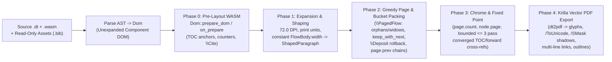

# DirectedType Design Suite: Paginated Documents & Vector PDF Export

- **Status:** Proposed Architecture (Approved Language Contracts)
- **Date:** November 2026
- **Scope:** End-to-end design for TeX-grade multi-page layout, composable editorial templates, pre-layout WASM Component DOM transforms, and pure-vector PDF output (`dt2pdf` + `krilla`).

---

## 1. Executive Overview & Design Philosophy

Bringing DirectedType (`.dt`) from single-viewport interactive GPU UIs to multi-page book, academic paper, and print publishing rests on four architectural principles:

1. **Minimal Orthogonal Kernel Primitives + Option A Editorial Libraries:** Rather than hardcoding book policies (`two_sided`, footnote separator rules, running header suppression, margin sidenotes) into the Rust compiler, the engine provides eight general-purpose primitives—`\PagedFlow`, `\FlowBody`, `\Pagination`, `\PageBreak`, `\PageValue`, `\PageList`, `\Deposit`, and `\Collect`—plus physical print units (`in`, `pc`, `mm`, `cm`), `72.0` DPI PDF mode, and the reserved ambient `page` keyword. Full publishing layouts (`components/Book.dt`, `components/Article.dt`) live cleanly in user-space `.dt`.
2. **Single Call-Site `\Deposit` Syntax & Explicit `bucket[page]` Indexing:** Whether targeting a single-value running mark (`\PageValue()`) or an ordered page-scoped list (`\PageList()`), authors always deposit a single component using `\Deposit(into: bucket) { <SingleComponent> }`. The two bucket types differ solely in overwrite vs. append semantics and their pull-out interfaces (`vb[p].has_value` / `.value.<port>` / `.first.<port>` vs. `\Collect(from: lb[page])` / `lb[p].len` / `.first` / `.last`), while public `\alias` ports roll forward across pages via `page.prev`.
3. **Preserving the Acyclic Single-Pass DAG:** Pre-layout WASM transforms (`Dom::prepare_dom` / `on_prepare`) run **before** component expansion and layout evaluation (generating `\TableOfContents` rows, auto-numbers, and `\Cite`/`\Bibliography` links without ever reading coordinates or `.page`), `\PagedFlow` enforces constant `\FlowBody.width` so paragraphs shape once in Phase 1 and pack sequentially across pages in Phase 2 (with tentative rollback when footnotes shrink `\FlowBody.height`), and forward `.page` cross-references settle inside a bounded fixed-point loop (up to 3 passes).
4. **Pure-Vector PDF Without Modifying `viewer`:** A dedicated headless CLI binary (`dt2pdf` built on `krilla` + `pdf-writer` + `skrifa`) emits searchable Unicode PDFs with `/ToUnicode` CMaps, font subsetting, analytical `erf` `/SMask` drop shadows, cross-page `/Link` destinations, and outlines—while leaving the interactive Vello viewer untouched in V1.

---

## 2. End-to-End Architecture Pipeline

---

## 3. Quick Reference: Engine Kernel vs. User-Space `Book.dt`

| Layer | Constructs | Role |
| :--- | :--- | :--- |
| **Units & Ambient Page** | `in`, `pc`, `mm`, `cm`; canonical `72.0` DPI in PDF mode; reserved `page` (`number`, `count`, `prev`, `is_odd`/`is_recto`, `is_even`/`is_verso`, `is_first`, `is_last`, `width`, `height`, `left`, `top`, `right`, `bottom`, `dpi`) | Gives print templates exact PDF point coordinates and cross-page read access to prior page `\alias` ports (`page.prev.<port>`). |
| **Flow & Splitting** | `\PagedFlow`, `\FlowBody`, implicit unornamented `pagination` port, `\Pagination(breakable, keep_with_next, break_before)`, `\PageBreak(to)`, `Enum Break { Auto, Page, Recto, Verso }`, `orphans` & `widows` on `\PagedFlow` | Shapes prose once at page-invariant `\FlowBody.width`; packs lines and blocks across discrete rectangular page slices with `PaginationOverflowError` on empty-page overflow. |
| **Page Buckets** | `\PageValue()`, `\PageList()`, `\Deposit(into: bucket) { <SingleComponent> }`, `\Collect(from: bucket[page])`, `Expr::Index` (`bucket[page]`) | Routes running chapter marks, bottom footnotes, and outer-margin sidenotes from inline/flow sites back to the active page template without string keys. |
| **Pre-Layout DOM (Option A)** | `Dom::prepare_dom`, guest `Component::on_prepare`, `PrepareContext`, `Expr::DomNodeRef` | Inspects tags/text/literal ports and inserts declarative `\TocEntry`, `\Anchor`, counters, and `\BibEntry` nodes before DAG compilation begins. |
| **User-Space Editorial Lib** (`components/Book.dt`, `Article.dt`) | `\Book`, `\BookPage`, `\Article`, `\ArticlePage`, `\Chapter`, `\Section`, `\Footnote`, `\Sidenote`, `\SidenoteColumn` | Implements two-sided alternating margins (`two_sided`), opener header suppression, customizable footnote rules, and collision-avoiding sidenotes purely in `.dt`. |
| **PDF Output (`dt2pdf`)** | `src/bin/dt2pdf.rs`, `src/pdf/`, `krilla` (`vello-renderer` / `pdf` feature flags) | Renders multi-page `Vec<PageScene>` (or 1-page `\Window` fallback) to PDF 1.7 / 2.0 streams. |

---

## 4. Design Specifications Index

| Document | Focus & Scope |
| :--- | :--- |
| [Page Model, Physical Units, & Multi-Page Flow Primitives](file:///Users/hoefel/dev/directedtype/docs/designs/pages/page_model_and_units.md) | Print units (`in`/`pc`/`mm`/`cm`), `72.0` DPI PDF mode + `window` aliasing, reserved `page` keyword & causal phases, `\PagedFlow` & `\FlowBody`, `pagination`, unified `\Deposit` semantics, complete `components/Book.dt` & `components/Article.dt` reference code, and post-V1 roadmap (`visible`/structural omission vs. `opacity: 0` searchable hidden text, optional `@` port sigil, split oversized footnotes). |
| [Pagination & Page-Scoped Buckets](file:///Users/hoefel/dev/directedtype/docs/designs/pages/pagination_and_buckets.md) | `[ ]` indexing (`Expr::Index`), compiler internals in `schema.rs` & `component.rs` (shallow `pagination` vs. propagated `clip`), static typechecking of `PageValue`/`PageList` slices, `\Collect` expansion in `\Children`, complete Phase 1–3 greedy packing + tentative footnote rollback algorithm, bounded cross-ref fixed point, and diagnostic/test matrix. |
| [Vector PDF Backend (`krilla`) & `dt2pdf` CLI](file:///Users/hoefel/dev/directedtype/docs/designs/pages/pdf_backend.md) | `krilla` vs. `printpdf`/`lopdf`/`pdf` evaluation, Cargo feature-gating decoupling `vello`, `dt2pdf` CLI flags & legacy `\Window` 1-page fallback (`viewer` untouched), scene-to-PDF lowering for text (`/ToUnicode`, `bg`, underlines, transparent `opacity: 0`), rounded rects, analytical 1D Gaussian `erf` `/SMask` drop shadows, multi-fragment links, outlines, PDF/UA readiness, and determinism/parity tests. |
| [Pre-Layout Component DOM Transforms (Option A)](file:///Users/hoefel/dev/directedtype/docs/designs/pages/dom_transforms_and_toc.md) | Extending `src/dom/mod.rs`, `src/component/wasm.rs`, and `directedtype-guest` with `on_prepare` + `dt_dom` host imports while preserving the Cardinal Invariant; full guest Rust + `.dt` recipes for `\TableOfContents`, hierarchical auto-numbering, and `\Cite`/`\Bibliography`; sandbox security, determinism, and geometry-independent caching. |
| [Text Shaping Abstraction, Hyphenation, & Knuth-Plass](file:///Users/hoefel/dev/directedtype/docs/designs/pages/text_engine_and_knuth_plass.md) | Orthogonal future roadmap isolating Parley behind `ShapedParagraph` + `TextLayoutEngine` so V2 can swap in global Knuth-Plass DP paragraph optimization, `hypher` dictionary hyphenation, optical margin protrusion, and variable-width `\parshape` without altering pagination or the `krilla` PDF backend. |

---

## 5. Recommended Implementation Milestones

1. **Milestone 1 — Units, Feature Split, & Single-Page `dt2pdf`:**
   - Extend `DistanceUnit` (`in`, `pc`, `mm`, `cm`) and add `dpi` configurability (`72.0` default for PDF mode).
   - Feature-gate `vello` dependencies, generalize `src/render/color.rs`, add `src/pdf/` (`krilla`) + `src/bin/dt2pdf.rs` supporting single-page `\Window` export (including analytical `/SMask` shadows, glyph runs + `/ToUnicode`, and links).
2. **Milestone 2 — Core Pagination Kernel (`\PagedFlow`, `\FlowBody`, `\Pagination`, `\PageBreak`):**
   - Add `LBracket`/`RBracket` + `Expr::Index`, `Break` enum, shallow `pagination` port in `schema.rs`/`component.rs`, reserved `page` keyword, and Phase 1–3 greedy line/block packing (`orphans`, `widows`, `keep_with_next`, `Break.Recto`/`Verso`, `.page`, bounded fixed point).
3. **Milestone 3 — Page Buckets & Editorial Standard Library (`Book.dt`, `Article.dt`):**
   - Implement `\PageValue()`, `\PageList()`, unified `\Deposit(into: ...)` attachment, `\Collect(from: ...)`, `page.prev.<alias>` roll-forward, tentative bucket rollback on `\FlowBody.height`, and ship `components/Book.dt` and `components/Article.dt`.
4. **Milestone 4 — Option A Pre-Layout WASM Transforms:**
   - Fix `DomNode` mixed-content slot ordering and add `Expr::DomNodeRef` (`src/ast.rs`).
   - Expose `dt_dom` host imports in `src/component/wasm.rs` and `PrepareContext` / `on_prepare` in `directedtype-guest`, delivering `\TableOfContents`, auto-numbering, and `\Cite`/`\Bibliography`.
5. **Milestone 5 — Typography & V2 Post-V1 Upgrades:**
   - Extract `ShapedParagraph` / `TextLayoutEngine` and add `hypher` + Knuth-Plass optimization; evaluate structural omission (`visible`) separately from searchable `opacity: 0`, recursive footnote splitting, and optional `@` compiler-port syntax.
