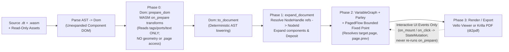

# DirectedType Design Document: Pre-Layout Component DOM Transforms, Table of Contents, Auto-Numbering, & Bibliographies

- **Status:** Proposed Architecture (Option A)
- **Date:** November 2026
- **Target Area:** [`src/dom/mod.rs`](file:///Users/hoefel/dev/directedtype/src/dom/mod.rs), [`src/dom/node.rs`](file:///Users/hoefel/dev/directedtype/src/dom/node.rs), [`src/ast.rs`](file:///Users/hoefel/dev/directedtype/src/ast.rs), [`src/component.rs`](file:///Users/hoefel/dev/directedtype/src/component.rs), [`src/component/wasm.rs`](file:///Users/hoefel/dev/directedtype/src/component/wasm.rs), [`directedtype-guest/src/lib.rs`](file:///Users/hoefel/dev/directedtype/directedtype-guest/src/lib.rs), and future `dt2pdf` / `Book.dt`
- **Related Specifications:**
  - [Page Model, Physical Units, & Multi-Page Flow Primitives](file:///Users/hoefel/dev/directedtype/docs/designs/pages/page_model_and_units.md)
  - [Pagination & Page-Scoped Buckets](file:///Users/hoefel/dev/directedtype/docs/designs/pages/pagination_and_buckets.md)
  - [WASM Sandbox & Batching](file:///Users/hoefel/dev/directedtype/docs/designs/WASM.md)
  - [Component DOM & Mutation Model](file:///Users/hoefel/dev/directedtype/docs/designs/dom.md)
  - [State, Application Logic, & Cardinal Invariant](file:///Users/hoefel/dev/directedtype/docs/designs/state_and_logic.md)
  - [In-Page Anchors & Internal Navigation](file:///Users/hoefel/dev/directedtype/docs/designs/anchors_and_internal_navigation.md)
  - [Visibility & `\Children` Encapsulation](file:///Users/hoefel/dev/directedtype/docs/designs/visibility.md)
  - [Text Shaping & Pagination Boundary](file:///Users/hoefel/dev/directedtype/docs/designs/pages/text_engine_and_knuth_plass.md)

---

## 1. Option A Architectural Model & The Cardinal Invariant

Long-form documents—books, technical manuals, and academic papers—require document-wide structural transformations that local layout equations (`parent`, `prev`, `children`) cannot express cleanly on their own:
1. Collecting headings across the entire manuscript into a `\TableOfContents` and guaranteeing every heading has an addressable `\Anchor`.
2. Computing hierarchical cross-document counters (`1`, `1.1`, `1.2`, `Figure 1.1`, `Footnote 1, 2, ...`) with configurable per-chapter resets.
3. Gathering `\Cite` keys across paragraphs, resolving external or embedded BibTeX/JSON metadata, sorting bibliography entries alphabetically or in citation order, and rewriting inline citations into clickable `[1]` links.

DirectedType resolves these requirements via **Option A: Pre-Layout Component DOM Transforms + Reactive DAG**.

### 1.1 Why Pre-Layout Transforms Preserve the Acyclic DAG

DirectedType's **Cardinal Invariant** ([`docs/designs/state_and_logic.md`](file:///Users/hoefel/dev/directedtype/docs/designs/state_and_logic.md#L34-L38)) states:

> **There is NEVER an edge or query from Layout Math (DAG) backwards into Application Logic (Rust / WASM).**

If WASM/Rust application logic were allowed to inspect resolved geometry (`node.rect.x`, `node.rect.y`, `node.height`) or paginated `.page` numbers to generate or mutate DOM nodes:
- Adding `\TocEntry` rows inside `\TableOfContents` could push Chapter 1 onto a later page, invalidating the page numbers WASM just read, forcing unbounded re-runs of both WASM and layout.
- Any layout change (window resize, font metric update, line wrap) would couple layout back into imperative DOM generation, reintroducing browser-style reflow loops.

**Option A eliminates this coupling completely** by drawing a strict temporal and capability boundary:
- **Phase 0 (`prepare_dom` / `on_prepare`):** Sandboxed Rust/WASM application logic inspects and mutates **only the unexpanded Component DOM** ([`Dom`](file:///Users/hoefel/dev/directedtype/src/dom/mod.rs#L61-L76)). Neither `ExpandedDocument`, `VariableGraph`, Parley shaping, nor `\PagedFlow` pagination exists yet. WASM never reads coordinates or page numbers; instead, it inserts declarative Component DOM nodes (`\TocEntry`, `\Anchor`, `\Link`, `\BibEntry`) and populates static literal or handle-reference ports (`number:`, `marker:`, `target:`).
- **Phases 1 & 2 (Expansion + Single-Pass DAG + Bounded Pagination Fixed Point):** Once `prepare_dom` finishes, the compiler lowers the prepared `Dom` into an immutable `Document` (`Dom::to_document`), expands components (`expand_document_with_resolver`), builds the flat `VariableGraph`, shapes paragraphs, and runs `\PagedFlow` pagination. Inside `.dt`, ports such as `target.page`, `page.prev`, and `\Deposit(into: footnotes)` resolve algebraically in the DAG—including `\PagedFlow`'s bounded fixed-point convergence when frontmatter TOC length shifts chapter pages—with **zero WASM re-execution**.

### 1.2 End-to-End Pipeline



### 1.3 What Stays Reactive in `.dt` vs. What Belongs in Pre-Layout WASM

| Concern | Execution Layer | Mechanism | Why Here? |
| :--- | :--- | :--- | :--- |
| Page numbers in TOC (`target.page`) | `.dt` Layout DAG + `\PagedFlow` | `\Text(text: "" + target.page)` | Depends on post-shaping pagination geometry; converges inside `\PagedFlow`'s bounded fixed point without touching WASM. |
| Running headers/footers & page counters | `.dt` Layout DAG + `\PagedFlow` | `page.number`, `page.prev`, `chapter.title` | Purely geometric/paginated state resolved per page frame. |
| Footnote & sidenote routing | `.dt` Component Expansion + DAG | `\Deposit(into: footnotes)` in `Book.dt` | Structural slot forwarding + page-bottom placement determined by pagination breaks. |
| Hover, focus, & link scrolling | `.dt` + Runtime `on_mount` / `dispatch` | `StateMutation` & `ContextAction::ScrollToNode` | Standard One-Way Pipeline event handling (`src/component/wasm.rs`). |
| TOC heading scan & `\Anchor` synthesis | Phase 0 WASM (`on_prepare`) | `query_by_tag` + `replace_child` + `set_port_node_ref` | Requires global cross-subtree traversal, slug deduplication, and node insertion before expansion. |
| Cross-chapter/figure/footnote numbering | Phase 0 WASM (`on_prepare`) | Pre-order counter pass + `set_port_literal` (`number:`, `marker:`) | Requires stateful sequential/hierarchical counting across disparate subtrees and optional chapter resets. |
| Citation resolution & bibliography sorting | Phase 0 WASM (`on_prepare`) | Parse `.bib`/JSON asset + sort + rewrite `\Cite` to `\Link` | Requires string parsing, sorting algorithms, and transforming inline citation nodes into link spans. |

---

## 2. Extending `src/dom/mod.rs`, `src/component/wasm.rs`, and `directedtype-guest`

### 2.1 Current Codebase Gap Analysis

A direct audit of the current implementation reveals strong foundational primitives alongside four concrete gaps that prevent pre-layout WASM DOM transforms today:

1. **No Host-Guest DOM ABI in `src/component/wasm.rs` or `directedtype-guest`:**
   - [`WasmComponent`](file:///Users/hoefel/dev/directedtype/src/component/wasm.rs#L13-L22) embeds `wasmi::Engine` (`wasmi = "2.0.0"` in [`Cargo.toml`](file:///Users/hoefel/dev/directedtype/Cargo.toml#L32)), creates an empty `Linker::new(&engine)` ([`src/component/wasm.rs#L35`](file:///Users/hoefel/dev/directedtype/src/component/wasm.rs#L35)) with **zero host functions**, and binds only four guest exports: `__dt_alloc`, `__dt_dealloc`, `__dt_mount`, and `__dt_dispatch` ([`src/component/wasm.rs#L47-L69`](file:///Users/hoefel/dev/directedtype/src/component/wasm.rs#L47-L69)).
   - [`MountRequest`](file:///Users/hoefel/dev/directedtype/directedtype-guest/src/protocol.rs#L8-L14) and [`DispatchRequest`](file:///Users/hoefel/dev/directedtype/directedtype-guest/src/protocol.rs#L18-L25) only carry `{ node_id, parent_id, ports, callbacks }`, and [`ComponentResponse`](file:///Users/hoefel/dev/directedtype/directedtype-guest/src/protocol.rs#L58-L66) only returns `{ mutations: Vec<StateMutation>, actions: Vec<Action>, ... }`.
   - Neither [`directedtype_guest::Component`](file:///Users/hoefel/dev/directedtype/directedtype-guest/src/lib.rs#L17-L28) nor [`directedtype::component::Component`](file:///Users/hoefel/dev/directedtype/src/component.rs#L555-L566) defines an `on_prepare` hook, and [`Dom`](file:///Users/hoefel/dev/directedtype/src/dom/mod.rs#L61-L76) never invokes WASM before [`Dom::commit_with_window`](file:///Users/hoefel/dev/directedtype/src/dom/mod.rs#L632-L670) compiles the AST.

2. **Mixed-Content Ordering Loss in `DomNode` (`src/dom/node.rs` & `src/dom/mod.rs`):**
   - [`Dom`](file:///Users/hoefel/dev/directedtype/src/dom/mod.rs#L61-L76) already implements an arena-backed Component DOM ([`DomArena`](file:///Users/hoefel/dev/directedtype/src/dom/arena.rs#L20-L24) with generational [`NodeHandle`](file:///Users/hoefel/dev/directedtype/src/dom/handle.rs#L3-L6)) supporting `create_element`, `create_text`, `parse_fragment`, `append_child`, `insert_before`, `remove_child`, `replace_child`, `set_port`, `remove_port`, `set_text`, and transactional rollback via `DomStructuralSnapshot`.
   - However, [`DomNode`](file:///Users/hoefel/dev/directedtype/src/dom/node.rs#L8-L32) separates `children: Vec<NodeHandle>` from a single `text_content: Option<String>`. When loading an AST node, [`Dom::insert_ast_element`](file:///Users/hoefel/dev/directedtype/src/dom/mod.rs#L996-L1056) concatenates all `ContentItem::Text` chunks into `text_content` and appends all `ContentItem::Node` elements to `children`—losing the interleaved position of inline elements (`See \Cite(key: "knuth84") for details`) and dropping `ContentItem::ParagraphBreak`, `ContentItem::Children`, and slot directives (`Let(Expr)`, `Alias`, `State`, `Env`, `Assert`).
   - **Required Fix:** Preserve ordered content items in `DomNode` (e.g., an ordered `content_items: Vec<DomContentItem>` storing `Text(String)`, `ParagraphBreak`, `Child(NodeHandle)`, and non-element `Directive(ContentItem)` variants synchronized with `children: Vec<NodeHandle>`), or represent inline text runs as first-class `DomNode` text leaves inside `children`, so rewriting an inline `\Cite` node with `replace_child` preserves exact inline prose placement on [`Dom::to_element_node`](file:///Users/hoefel/dev/directedtype/src/dom/mod.rs#L1059-L1100).

3. **Top-Level AST & Resolver Context Dropped by `Dom::from_document_with_window`:**
   - [`Dom::from_document_with_window`](file:///Users/hoefel/dev/directedtype/src/dom/mod.rs#L110-L145) currently ignores `Item::State(_)` and `Item::Use(_)` (lines 138–139), and [`Dom::commit_with_window`](file:///Users/hoefel/dev/directedtype/src/dom/mod.rs#L646-L648) calls `compile_document_with_window(&doc, width, height)` with default `Path::new(".")` and `FsResolver` instead of retaining `\use` imports, top-level `\state` bindings, `base_dir`, and custom `FileResolver`s (such as `VirtualResolver` in tests).
   - **Required Fix:** Store `uses: Vec<UseDeclaration>` and `state_bindings: Vec<StateBinding>` on `Dom`, emit them in [`Dom::to_document`](file:///Users/hoefel/dev/directedtype/src/dom/mod.rs#L1103-L1133), and compile via `compile_document_with_resolver` / `compile_document_with_registry`.

4. **No Pre-Expansion `NodeHandle` Port Reference in `Expr` (`src/ast.rs`):**
   - [`Dom::to_element_node`](file:///Users/hoefel/dev/directedtype/src/dom/mod.rs#L1098) already attaches `handle: Some(handle)` onto [`ElementNode`](file:///Users/hoefel/dev/directedtype/src/ast.rs#L522-L529), and [`expand_element`](file:///Users/hoefel/dev/directedtype/src/compiler/expand/mod.rs#L598) copies `expanded.handle = elem.handle` onto `ExpandedNode`.
   - However, [`Expr`](file:///Users/hoefel/dev/directedtype/src/ast.rs#L600-L613) has no variant to reference another `DomNode` by `NodeHandle` prior to expansion (`Ident::from_node` in [`src/ast.rs#L30-L35`](file:///Users/hoefel/dev/directedtype/src/ast.rs#L30-L35) requires an already-assigned `NodeId`).
   - **Required Fix:** Add `Expr::DomNodeRef(NodeHandle, Span)` (with `StaticType::Node("Node")`). During `expand_document`, maintain `dom_handles: HashMap<NodeHandle, NodeId>` as `expand_element` runs, and lower `Expr::DomNodeRef(handle, span)` to `Expr::Ident(Ident::from_node(node_id, span))` in [`finalize_window_and_forward_refs`](file:///Users/hoefel/dev/directedtype/src/compiler/expand/mod.rs#L547-L571). Resolving at finalization ensures **forward references**—such as a `\TocEntry` at page 1 referencing a `\Chapter`'s `\Anchor` at page 200—work natively in a single expansion pass.

---

### 2.2 Proposed Host-Guest ABI & `directedtype-guest` Rust API

Unlike interactive event handlers (`on_click`), structural transforms like `\TableOfContents` and `\Bibliography` need to traverse arbitrary parts of the `Dom` and see the effects of earlier mutations immediately (**read-your-writes consistency**).

Because [`src/component/wasm.rs`](file:///Users/hoefel/dev/directedtype/src/component/wasm.rs) executes guest code synchronously inside `wasmi::Store<T>`, we store an active `PrepareHostState<'a>` inside the `wasmi::Store` during `Dom::prepare_dom`:
- `NodeHandle { index: u32, generation: u32 }` ([`src/dom/handle.rs#L3-L6`](file:///Users/hoefel/dev/directedtype/src/dom/handle.rs#L3-L6)) packs losslessly into a `u64` across the WASM boundary (`((generation as u64) << 32) | (index as u64)`), matching the `u64` packed pointer-length convention already used in [`pack_ptr_len`](file:///Users/hoefel/dev/directedtype/directedtype-guest/src/lib.rs#L130-L132).
- Every host import validates the handle through [`DomArena`](file:///Users/hoefel/dev/directedtype/src/dom/arena.rs#L87-L120), enforces cycle/budget invariants, and returns a status code or packed JSON/binary buffer allocated in guest memory via `__dt_alloc`.

#### Host Imports Registered on `wasmi::Linker` (Pre-Layout Session Only)

```rust
// Host-side Store payload active ONLY during Dom::prepare_dom
pub struct PrepareHostState<'a> {
    pub dom: &'a mut Dom,
    pub base_dir: &'a Path,
    pub resolver: &'a dyn FileResolver,
    pub created_nodes: usize,
    pub mutations: usize,
    pub max_created_nodes: usize,
    pub max_mutations: usize,
    pub max_asset_bytes: usize,
    pub read_assets: Vec<(PathBuf, [u8; 32])>, // For deterministic cache keys
}
```

The host binds `dt_dom` functions on `wasmi::Linker<PrepareHostState<'_>>`:

| Host Import (`dt_dom`) | Wasm Signature | Purpose / Mapping to `src/dom/mod.rs` |
| :--- | :--- | :--- |
| `__dt_dom_roots` | `() -> u64` | Returns packed `Vec<u64>` of `dom.roots()` handles. |
| `__dt_dom_children` | `(node: u64) -> u64` | Returns packed `Vec<u64>` of `dom.children(h)`. |
| `__dt_dom_parent` | `(node: u64) -> u64` | Returns `dom.parent(h)` (`0` if root/unattached). |
| `__dt_dom_siblings` | `(node: u64) -> u64` | Returns packed `{ prev: Option<u64>, next: Option<u64> }` via `dom.prev_sibling` / `dom.next_sibling`. |
| `__dt_dom_node_info` | `(node: u64) -> u64` | Returns `{ tag, key, has_text }` (tag from `dom.tag_name`, key from `dom.node_key`). |
| `__dt_dom_get_port_literal` | `(node: u64, ptr: u32, len: u32) -> u64` | Inspects `dom.declared_ports(h)`; returns `Some(Value)` iff the authored `Expr` is a static `Literal` (`Ok(None)` for dynamic DAG formulas—never evaluates layout math). |
| `__dt_dom_get_text_content` | `(node: u64, recursive: u32) -> u64` | Returns `dom.text_content(h)` or recursive concatenated plain text across inline `\Span`/`\Text` descendants. |
| `__dt_dom_query_by_tag` | `(scope: u64, ptr: u32, len: u32) -> u64` | Single-crossing pre-order search inside `scope` (`0` = all roots) matching `&[tag_name]`; returns packed `Vec<u64>`. |
| `__dt_dom_ancestors` | `(node: u64) -> u64` | Walks `dom.parent` chain upward, returning `[parent, ..., root]` handles. |
| `__dt_dom_document_links` | `(scope: u64) -> u64` | Single-crossing query returning `{ handle, tag, url_or_name, target_handle }` for all `\Link`, `\Anchor`, and `\AnchorScope` nodes. |
| `__dt_dom_create_element` | `(ptr: u32, len: u32) -> u64` | Calls `dom.create_element_with_key(tag, key, literal_ports)`. |
| `__dt_dom_create_text` | `(ptr: u32, len: u32) -> u64` | Calls `dom.create_text(text, literal_ports)`. |
| `__dt_dom_parse_fragment` | `(ptr: u32, len: u32) -> u64` | Calls `dom.parse_fragment(dtml)` (guarded by recursion/node limits). |
| `__dt_dom_append_child` | `(parent: u64, child: u64) -> u64` | Calls `dom.append_child(parent, child)`. |
| `__dt_dom_insert_before` | `(parent: u64, before: u64, child: u64) -> u64` | Calls `dom.insert_before(parent, before, child)`. |
| `__dt_dom_remove_child` | `(parent: u64, child: u64) -> u64` | Calls `dom.remove_child(parent, child)`. |
| `__dt_dom_replace_child` | `(parent: u64, old: u64, new: u64) -> u64` | Calls `dom.replace_child(parent, old, new)`. |
| `__dt_dom_set_port_literal` | `(node: u64, ptr: u32, len: u32) -> u64` | Calls `dom.set_port(node, name, Expr::Literal(...))`. |
| `__dt_dom_set_port_node_ref` | `(node: u64, target: u64, ptr: u32, len: u32) -> u64` | Calls `dom.set_port(node, name, Expr::DomNodeRef(target, Span::default()))`. |
| `__dt_dom_remove_port` | `(node: u64, ptr: u32, len: u32) -> u64` | Calls `dom.remove_port(node, name)`. |
| `__dt_dom_set_text` | `(node: u64, ptr: u32, len: u32) -> u64` | Calls `dom.set_text(node, text)`. |
| `__dt_host_read_asset` | `(ptr: u32, len: u32) -> u64` | Read-only sandboxed asset read through `FileResolver` (confined to `base_dir`). |

> [!IMPORTANT]
> Notice what is **intentionally absent** from `dt_dom`: `computed_rect`, `computed_value`, `clip_context`, `hit_test`, and `.page`. Those methods exist on `Dom` only after `commit()` produces a `ResolvedLayout`. Omitting them from the `PrepareHostState` ABI enforces the Cardinal Invariant structurally.

#### Guest Ergonomic Rust API (`directedtype_guest::dom` & `Component::on_prepare`)

In `directedtype-guest`, we extend `Component` (`directedtype-guest/src/lib.rs`) and add a `dom` module exposing `NodeHandle` and `PrepareContext`:

```rust
// directedtype-guest/src/dom.rs
use crate::value::Value;
use serde::{Deserialize, Serialize};

/// Opaque Component DOM handle packed as `(generation << 32) | index`.
#[derive(Debug, Clone, Copy, PartialEq, Eq, PartialOrd, Ord, Hash, Serialize, Deserialize)]
pub struct NodeHandle(pub u64);

pub struct PrepareContext<'a> {
    self_handle: NodeHandle,
    _marker: std::marker::PhantomData<&'a mut ()>,
}

impl<'a> PrepareContext<'a> {
    /// The Component DOM handle of the node whose `on_prepare` hook is running.
    pub fn self_handle(&self) -> NodeHandle { self.self_handle }

    // --- Read / Query Methods ---
    pub fn root_nodes(&self) -> Result<Vec<NodeHandle>, DomError>;
    pub fn children(&self, node: NodeHandle) -> Result<Vec<NodeHandle>, DomError>;
    pub fn parent(&self, node: NodeHandle) -> Result<Option<NodeHandle>, DomError>;
    pub fn prev_sibling(&self, node: NodeHandle) -> Result<Option<NodeHandle>, DomError>;
    pub fn next_sibling(&self, node: NodeHandle) -> Result<Option<NodeHandle>, DomError>;
    pub fn tag_name(&self, node: NodeHandle) -> Result<String, DomError>;
    pub fn node_key(&self, node: NodeHandle) -> Result<Option<Vec<Value>>, DomError>;
    pub fn get_port_literal(&self, node: NodeHandle, port: &str) -> Result<Option<Value>, DomError>;
    pub fn get_text_content(&self, node: NodeHandle) -> Result<Option<String>, DomError>;
    pub fn get_subtree_text(&self, node: NodeHandle) -> Result<String, DomError>;
    pub fn query_by_tag(&self, scope: Option<NodeHandle>, tags: &[&str]) -> Result<Vec<NodeHandle>, DomError>;
    pub fn ancestors(&self, node: NodeHandle) -> Result<Vec<NodeHandle>, DomError>;
    pub fn document_links(&self, scope: Option<NodeHandle>) -> Result<Vec<DomLinkInfo>, DomError>;
    pub fn read_asset(&self, rel_path: &str) -> Result<Vec<u8>, DomError>;

    // --- Structural Component DOM Mutations (1:1 with src/dom/mod.rs) ---
    pub fn create_element(&mut self, tag: &str, key: Option<&[Value]>, ports: &[(&str, Value)]) -> Result<NodeHandle, DomError>;
    pub fn create_text(&mut self, text: &str, ports: &[(&str, Value)]) -> Result<NodeHandle, DomError>;
    pub fn parse_fragment(&mut self, dt_snippet: &str) -> Result<NodeHandle, DomError>;
    pub fn append_child(&mut self, parent: NodeHandle, child: NodeHandle) -> Result<(), DomError>;
    pub fn insert_before(&mut self, parent: NodeHandle, before: NodeHandle, child: NodeHandle) -> Result<(), DomError>;
    pub fn remove_child(&mut self, parent: NodeHandle, child: NodeHandle) -> Result<(), DomError>;
    pub fn replace_child(&mut self, parent: NodeHandle, old_child: NodeHandle, new_child: NodeHandle) -> Result<(), DomError>;
    pub fn set_port_literal(&mut self, node: NodeHandle, port: &str, value: Value) -> Result<(), DomError>;
    pub fn set_port_node_ref(&mut self, node: NodeHandle, port: &str, target: NodeHandle) -> Result<(), DomError>;
    pub fn remove_port(&mut self, node: NodeHandle, port: &str) -> Result<(), DomError>;
    pub fn set_text(&mut self, node: NodeHandle, text: &str) -> Result<(), DomError>;

    /// Convenience helper: replaces `node` in its parent (or roots) with `wrapper` and moves `node` inside `wrapper`.
    pub fn wrap_node(&mut self, node: NodeHandle, wrapper: NodeHandle) -> Result<(), DomError>;
}
```

And in `directedtype-guest/src/lib.rs`, `Component` gains an optional `on_prepare` method (exported via `__dt_prepare` in `export_component!`, while keeping `on_prepare` optional so existing interactive components like [`examples/Counter.rs`](file:///Users/hoefel/dev/directedtype/examples/Counter.rs) and [`examples/slider_demo.rs`](file:///Users/hoefel/dev/directedtype/examples/slider_demo.rs) require zero changes):

```rust
pub trait Component: Default + 'static {
    /// Pre-layout Component DOM inspection and structural transform pass.
    fn on_prepare(&mut self, _ctx: &mut PrepareContext<'_>) -> Result<(), DispatchError> {
        Ok(())
    }

    fn on_mount(&mut self, _ctx: &mut Context<'_>) {}
    fn dispatch(
        &mut self,
        method: &str,
        event: &mut Event,
        ctx: &mut Context<'_>,
    ) -> Result<(), DispatchError>;
}
```

On the host (`src/component.rs` & `src/component/wasm.rs`), `WasmComponent` probes for optional `__dt_prepare` during instantiation (`instance.get_typed_func::<u64, u64>(&store, "__dt_prepare").ok()`, passing the packed `self_handle: u64` and returning `0` on `Ok(())` or a packed `(ptr, len)` error payload), and `Component` adds `fn on_prepare(&mut self, _ctx: &mut PrepareHostState<'_>) -> Result<(), DispatchError> { Ok(()) }` so both native Rust companions and `.wasm` modules share the exact same pre-layout contract.

---

### 2.3 Deterministic Execution Order, Cycle Guards, & Error Reporting

#### Pre-Order vs. Post-Order Execution

When multiple transform-enabled components coexist in one document (for example, `\Book` running numbering alongside `\TableOfContents` and `\Bibliography`), traversal order directly affects composition:

| Strategy | Behavior | Strengths & Pitfalls |
| :--- | :--- | :--- |
| **Post-Order** (children before parent) | Leaf/inner components transform first; outer container transforms last. | Good for bottom-up macro expansion, **but** a sibling `\TableOfContents` inside `\Book` runs *before* `\Book::on_prepare` assigns `number:` onto `\Chapter` nodes. |
| **Pre-Order** (parent before children, roots & siblings left-to-right) | Outer coordinator (`\Book`) runs first, followed by `\TableOfContents`, `\Chapter`s, and `\Bibliography`. | Outer numbering/configuration is already written onto nodes before `\TableOfContents` scans headings and before `\Bibliography` builds entries. |

DirectedType executes `Dom::prepare_dom` in **deterministic document tree pre-order** (iterating `dom.roots()` left-to-right, and `dom.children(h)` left-to-right):
1. Maintain `prepared_handles: HashSet<NodeHandle>` so every component instance runs `on_prepare` **at most once**.
2. Snapshot the children or advance safely with a **worklist / bounded follow-up passes**: if an outer `on_prepare` inserts a *new* subtree containing another component that itself defines `on_prepare` (for example, a macro component expanding into a `\TableOfContents`), the scheduler runs another pre-order pass over newly created, unprepared handles.
3. **Cycle & Infinite-Transform Guard (`MAX_PREPARE_PASSES = 8`):**
   - If pass `8` still spawns unprepared nodes that define `on_prepare`, `Dom::prepare_dom` aborts with `DomError::PrepareCycle { pass_limit: 8, last_tag }`.
   - Each prepare run also enforces hard ceilings on `created_nodes` (default `100_000`) and `mutations` (default `500_000`), returning `DomError::PrepareBudgetExceeded`.
   - Every structural host call still checks `Dom::append_child`'s existing `DomError::HierarchyCycle` and `DomError::InvalidHandle` invariants.
4. **Atomic Rollback & Diagnostics:**
   - `Dom::prepare_dom` wraps all `on_prepare` invocations inside `DomStructuralSnapshot` rollback semantics (matching [`Dom::transaction`](file:///Users/hoefel/dev/directedtype/src/dom/mod.rs#L922-L944)). If any guest returns `Err(...)`, traps in `wasmi`, or hits the cycle/budget limit, the `Dom` is restored cleanly and `DomError::PrepareError { component, node, message }` is surfaced with the source `Span` of the originating Component DOM node.

---

### 2.4 Declarative Attachment in `.dt`

Both `dt2pdf`, the interactive viewer, and automated tests invoke `Dom::prepare_dom` automatically before `compile_document_with_registry` using two complementary attachment mechanisms that fit DirectedType's existing [`ComponentRegistry`](file:///Users/hoefel/dev/directedtype/src/component.rs#L786-L859) and [`FileResolver`](file:///Users/hoefel/dev/directedtype/src/compiler/module.rs#L13-L41):

1. **Side-by-Side Component Companions (Zero Syntax Extension Required):**
   Just as `examples/Counter.dt` automatically discovers `examples/Counter.wasm` via [`ComponentRegistry::auto_discover_wasm_for_document`](file:///Users/hoefel/dev/directedtype/src/component.rs#L803-L859), any `\Component` imported via `\use` (or defined in the main file) automatically pairs with its adjacent `.wasm` (or native `.rs` compiled via `build.rs`):
   ```dt
   \use "components/Book.dt"
   \use "components/TableOfContents.dt"
   \use "components/Bibliography.dt"

   \Book(title: "Designing DirectedType") {
       \TableOfContents(title: "Contents")
       \Chapter(title: "The Acyclic Graph") { ... }
       \Bibliography(sort: "citation", src: "./refs.bib")
   }
   ```
   When `TableOfContents.wasm` exports `__dt_prepare`, `Dom::prepare_with_resolver` loads it through `FileResolver::read_bytes` and invokes `on_prepare` on the `\TableOfContents` node automatically.

2. **Explicit Document-Level `.wasm` Transform Import (`\use "*.wasm"`):**
   When a single compiled WASM bundle implements transforms for multiple lightweight tags in a manuscript without separate `.rs`/`.wasm` files per component (e.g., an author's `book_transforms.wasm` handling `\Book`, `\TableOfContents`, and `\Bibliography`), `.dt` supports importing a transform module explicitly at top level:
   ```dt
   \use "./transforms/book_transforms.wasm"
   \use "components/Book.dt"
   ```
   The parser records `Item::Use` for `.wasm` targets; `Dom::prepare_with_resolver` registers the WASM bundle via `FileResolver::read_bytes` (so `VirtualResolver` unit tests run hermetically in memory without disk I/O), binds its exported handlers, and runs `prepare_dom` prior to `Dom::to_document` and compilation.

---

## 3. Reference Recipes (Concrete Guest Rust + `.dt`)

### 3.1 Recipe 1: Automatic Table of Contents (`\TableOfContents`)

In this recipe:
1. `TableOfContents::on_prepare` scans the Component DOM in pre-order for `\Chapter`, `\H1`, and `\H2` nodes (skipping anything nested inside `\TableOfContents`).
2. For each heading, it checks whether the heading already has an enclosing `\Anchor` parent; if not, it synthesizes a deterministic unique `\Anchor(name: slug)` and wraps the heading in place using `replace_child` + `append_child` (`ctx.wrap_node`).
3. It creates `\TocEntry(number: ..., title: ..., level: ...)` inside `\TableOfContents`, wiring `target:` to the heading's `anchor_handle` via `set_port_node_ref`.
4. Inside `TocEntry.dt`, the page number `\Text` simply reads `"" + target.page`, and `\Link(to: target)` makes the entry clickable—with **frontmatter pagination shifts handled automatically** by `\PagedFlow`'s bounded fixed point!

#### Guest Rust Code (`TableOfContents.rs` compiled to `wasm32-unknown-unknown`)

```rust
use directedtype_guest::dom::{NodeHandle, PrepareContext};
use directedtype_guest::prelude::*;
use std::collections::HashSet;

#[derive(Default)]
pub struct TableOfContents;

#[component(guest)]
impl TableOfContents {
    pub fn on_prepare(&mut self, ctx: &mut PrepareContext<'_>) -> Result<(), DispatchError> {
        let toc_handle = ctx.self_handle();
        let max_depth = ctx
            .get_port_literal(toc_handle, "max_depth")?
            .and_then(|v| v.as_i64())
            .unwrap_or(2);

        // Pre-order scan over the entire Component DOM
        let headings = ctx.query_by_tag(None, &["Chapter", "H1", "H2", "H3"])?;
        let mut used_slugs = HashSet::new();

        for heading in headings {
            // Do not index headings placed inside the TableOfContents itself
            if ctx.ancestors(heading)?.contains(&toc_handle) {
                continue;
            }

            let tag = ctx.tag_name(heading)?;
            let level: i64 = match tag.as_str() {
                "Chapter" | "H1" => 1,
                "H2" => 2,
                "H3" => 3,
                _ => continue,
            };
            if level > max_depth {
                continue;
            }

            let title = ctx
                .get_port_literal(heading, "title")?
                .and_then(|v| v.as_str().map(str::to_string))
                .unwrap_or_else(|| ctx.get_subtree_text(heading).unwrap_or_default());

            let number = ctx
                .get_port_literal(heading, "number")?
                .and_then(|v| v.as_str().map(str::to_string))
                .unwrap_or_default();

            let anchor_handle = ensure_heading_anchor(ctx, heading, &title, level, &mut used_slugs)?;

            let entry = ctx.create_element(
                "TocEntry",
                None,
                &[
                    ("number", Value::String(number)),
                    ("title", Value::String(title)),
                    ("level", Value::Integer(level)),
                ],
            )?;
            ctx.set_port_node_ref(entry, "target", anchor_handle)?;
            ctx.append_child(toc_handle, entry)?;
        }

        Ok(())
    }
}

fn ensure_heading_anchor(
    ctx: &mut PrepareContext<'_>,
    heading: NodeHandle,
    title: &str,
    level: i64,
    used_slugs: &mut HashSet<String>,
) -> Result<NodeHandle, DispatchError> {
    if let Some(parent) = ctx.parent(heading)? {
        if ctx.tag_name(parent)? == "Anchor" {
            if let Some(existing) = ctx
                .get_port_literal(parent, "name")?
                .and_then(|v| v.as_str().map(str::to_string))
            {
                used_slugs.insert(existing);
            }
            return Ok(parent);
        }
    }

    let base = format!("toc-{}-{}", level, slugify(title));
    let mut slug = base.clone();
    let mut suffix = 2usize;
    while !used_slugs.insert(slug.clone()) {
        slug = format!("{}-{}", base, suffix);
        suffix += 1;
    }

    let anchor = ctx.create_element("Anchor", None, &[("name", Value::String(slug))])?;
    ctx.wrap_node(heading, anchor)?;
    Ok(anchor)
}

fn slugify(s: &str) -> String {
    let mut out = String::new();
    let mut last_dash = false;
    for ch in s.chars().flat_map(|c| c.to_lowercase()) {
        if ch.is_ascii_alphanumeric() {
            out.push(ch);
            last_dash = false;
        } else if !last_dash && !out.is_empty() {
            out.push('-');
            last_dash = true;
        }
    }
    while out.ends_with('-') {
        out.pop();
    }
    if out.is_empty() { "section".to_string() } else { out }
}

export_component!(TableOfContents);
```

#### Declarative `.dt` Components (`TableOfContents.dt` & `TocEntry.dt`)

> [!NOTE]
> `\Link(to: target, text: ...)` below adds an `Anchor`/`Node` target overload (`to: Anchor`, `text: String`) on [`components/Link.dt`](file:///Users/hoefel/dev/directedtype/components/Link.dt) alongside its existing `url: String` signature, keeping `\Link` as an inline `\Span` inside `\Text` while resolving interactive scrolling and PDF link annotations directly to the target `\Anchor` node.

```dt
\use "components/VStackStretch.dt"
\use "components/HDivider.dt"
\use "components/Link.dt"

\Component TocEntry(
    number: String = "",
    title: String,
    level: Integer = 1,
    target: Anchor,
    x: Distance = parent.left,
    y: Distance = parent.top,
    width: Distance = parent.width,
    env font: Font
) {
    \let indent = (level - 1) * 18px;
    \let is_top = level == 1;
    \let entry_font = \Font(
        font: font,
        size: is_top ? 11pt : 10pt,
        weight: is_top ? 700 : 400
    );
    \let display_title = number != "" ? (number + "  " + title) : title;

    \let title_link = \Text(
        x: x + indent,
        y: y,
        font: entry_font,
        color: #0f172a
    ) {
        \Link(to: target, text: display_title)
    };

    \let page_label = \Text(
        x: x + width - page_label.width,
        y: y,
        font: entry_font,
        color: #334155
    ) {
        \Link(to: target, text: "" + target.page)
    };

    \let leader_start = title_link.right + 8px;
    \let leader_end = max(leader_start, page_label.left - 8px);
    \Line(
        x1: leader_start,
        y1: title_link.bottom - 3px,
        x2: leader_end,
        y2: title_link.bottom - 3px,
        thickness: 0.75px,
        color: #cbd5e1
    )

    \alias height = max(title_link.height, page_label.height);
    \alias right = x + width;
    \alias bottom = y + height;
}

\Component TableOfContents(
    title: String = "Table of Contents",
    max_depth: Integer = 2,
    x: Distance = parent.left,
    y: Distance = parent.top,
    width: Distance = parent.width,
    env font: Font
) {
    \let heading_font = \Font(font: font, size: 18pt, weight: 700);

    \let stack = \VStackStretch(x: x, y: y, width: width, gap: 8px) {
        \Text(font: heading_font, color: #0f172a, text: title)
        \HDivider(color: #cbd5e1)
        \Children
    };

    \alias height = stack.height;
    \alias right = x + width;
    \alias bottom = y + height;
}
```

#### Automatic Frontmatter Pagination Shift Handling

Because `TableOfContents::on_prepare` inserts all `\TocEntry` nodes **before** expansion and pagination:
1. If inserting 60 entries causes the TOC itself to span two frontmatter pages (`ii–iii`), shifting Chapter 1 from page 3 to page 4, `\PagedFlow` evaluates every `target.page` inside its bounded fixed-point loop (`Pass 1 -> Pass 2`).
2. `"" + target.page` updates automatically in the DAG—and because `page_label.width` only changes by a few pixels per digit while `leader_end` absorbs the slack, convergence completes in 2 passes with **zero WASM re-invocation**.

---

### 3.2 Recipe 2: Hierarchical Counters & Auto-Numbering

Auto-numbering `\Chapter`, `\H1`/`\H2` sections, `\Figure` captions, `\Footnote`s, and `\Sidenote`s runs cleanly in pre-order inside `Book::on_prepare`, writing `number:` and `marker:` literal ports onto Component DOM nodes before expansion. Author-supplied overrides (e.g., `\Chapter(number: "A", title: "Appendix")` or `unnumbered: true`) are respected automatically.

#### Guest Rust Code (`Book.rs`)

```rust
use directedtype_guest::dom::PrepareContext;
use directedtype_guest::prelude::*;

#[derive(Default)]
pub struct Book;

#[component(guest)]
impl Book {
    pub fn on_prepare(&mut self, ctx: &mut PrepareContext<'_>) -> Result<(), DispatchError> {
        let book_handle = ctx.self_handle();
        let reset_fn_per_ch = ctx
            .get_port_literal(book_handle, "reset_footnotes_per_chapter")?
            .and_then(|v| v.as_bool())
            .unwrap_or(false);
        let reset_fig_per_ch = ctx
            .get_port_literal(book_handle, "reset_figures_per_chapter")?
            .and_then(|v| v.as_bool())
            .unwrap_or(true);

        let nodes = ctx.query_by_tag(
            Some(book_handle),
            &["Chapter", "H1", "H2", "Figure", "Footnote", "Sidenote"],
        )?;

        let mut chapter: i64 = 0;
        let mut h1: i64 = 0;
        let mut h2: i64 = 0;
        let mut figure: i64 = 0;
        let mut footnote: i64 = 0;
        let mut sidenote: i64 = 0;

        for node in nodes {
            let unnumbered = ctx
                .get_port_literal(node, "unnumbered")?
                .and_then(|v| v.as_bool())
                .unwrap_or(false);
            if unnumbered {
                continue;
            }

            let tag = ctx.tag_name(node)?;
            match tag.as_str() {
                "Chapter" => {
                    chapter += 1;
                    h1 = 0;
                    h2 = 0;
                    if reset_fig_per_ch { figure = 0; }
                    if reset_fn_per_ch { footnote = 0; }
                    set_if_absent(ctx, node, "number", Value::String(format!("{}", chapter)))?;
                }
                "H1" => {
                    h1 += 1;
                    h2 = 0;
                    let label = if chapter > 0 {
                        format!("{}.{}", chapter, h1)
                    } else {
                        format!("{}", h1)
                    };
                    set_if_absent(ctx, node, "number", Value::String(label))?;
                }
                "H2" => {
                    h2 += 1;
                    let label = if chapter > 0 {
                        format!("{}.{}.{}", chapter, h1.max(1), h2)
                    } else {
                        format!("{}.{}", h1.max(1), h2)
                    };
                    set_if_absent(ctx, node, "number", Value::String(label))?;
                }
                "Figure" => {
                    figure += 1;
                    let label = if chapter > 0 {
                        format!("Figure {}.{}", chapter, figure)
                    } else {
                        format!("Figure {}", figure)
                    };
                    set_if_absent(ctx, node, "number", Value::String(label))?;
                }
                "Footnote" => {
                    footnote += 1;
                    set_if_absent(ctx, node, "marker", Value::String(format!("{}", footnote)))?;
                }
                "Sidenote" => {
                    sidenote += 1;
                    set_if_absent(ctx, node, "marker", Value::String(format!("{}", sidenote)))?;
                }
                _ => {}
            }
        }

        Ok(())
    }
}

fn set_if_absent(
    ctx: &mut PrepareContext<'_>,
    node: directedtype_guest::dom::NodeHandle,
    port: &str,
    val: Value,
) -> Result<(), DispatchError> {
    if ctx.get_port_literal(node, port)?.is_none() {
        ctx.set_port_literal(node, port, val)?;
    }
    Ok(())
}

export_component!(Book);
```

#### Composing with Unified `\Deposit` inside `Book.dt`

Because `Book::on_prepare` populates `number:` and `marker:` before component expansion, `\Chapter`, `\Figure`, `\Footnote`, and `\Sidenote` consume them purely declaratively in `.dt` and route page-bound material via `\Deposit`:

```dt
\use "components/VStackStretch.dt"
\use "components/HStack.dt"

\Component Chapter(
    title: String,
    number: String = "",
    unnumbered: Boolean = false,
    x: Distance = parent.left,
    y: Distance = parent.top,
    width: Distance = parent.width,
    env font: Font
) {
    \let ch_font = \Font(font: font, size: 22pt, weight: 700);
    \let heading_text = number != "" ? ("Chapter " + number + ": " + title) : title;

    \let stack = \VStackStretch(x: x, y: y, width: width, gap: 14px) {
        \Text(font: ch_font, color: #0f172a, text: heading_text)
        \Children
    };

    \alias height = stack.height;
    \alias right = x + width;
    \alias bottom = y + height;
}

\use { FootnoteEntry, SidenoteEntry } from "components/Book.dt";

\InlineBox Footnote(
    marker: String = "*",
    env footnotes: PageList,
    env font: Font,
    x: Distance = parent.left,
    y: Distance = parent.top
) {
    \let sup_font = \Font(font: self.font, size: self.font.size * 0.72, weight: 600);
    \let mark = \Text(
        x: x,
        y: y,
        font: sup_font,
        color: #1d4ed8,
        text: marker
    );

    \alias width = mark.width;
    \alias height = mark.height;
    \alias baseline = mark.baseline + self.font.size * 0.32;

    \Deposit(into: footnotes) {
        \FootnoteEntry(marker: marker) {
            \Children
        }
    }
}

\InlineBox Sidenote(
    marker: String = "*",
    env sidenotes: PageList,
    env font: Font,
    x: Distance = parent.left,
    y: Distance = parent.top
) {
    \let sup_font = \Font(font: self.font, size: self.font.size * 0.72, weight: 600);
    \let mark = \Text(
        x: x,
        y: y,
        font: sup_font,
        color: #475569,
        text: marker
    );

    \alias width = mark.width;
    \alias height = mark.height;
    \alias baseline = mark.baseline + self.font.size * 0.32;

    \Deposit(into: sidenotes) {
        \SidenoteEntry(anchor_y: baseline, marker: marker) {
            \Children
        }
    }
}
```

---

### 3.3 Recipe 3: Citations & Sorted Bibliography (`\Cite` + `\Bibliography`)

In this recipe:
1. `Bibliography::on_prepare` reads embedded BibTeX/JSON from a `data:` port (or loads a `.bib` / `.json` asset safely via `ctx.read_asset(src)`).
2. It collects all `\Cite` nodes across the document in pre-order, preserves first-appearance citation indices, and deduplicates cited keys.
3. Depending on `sort:` (`"citation"` vs. `"alpha"`), it orders cited references, constructs `\Anchor(name: "bib-" + key) { \BibEntry(...) }` inside `\Bibliography`, and **rewrites each `\Cite(key: "...")`** in place into an inline `\Link(to: bib_anchor)` containing `[1]`.

#### Guest Rust Code (`Bibliography.rs`)

```rust
use directedtype_guest::dom::{NodeHandle, PrepareContext};
use directedtype_guest::prelude::*;
use std::collections::{BTreeMap, HashMap};

#[derive(Clone, Debug)]
struct BibRecord {
    key: String,
    author: String,
    title: String,
    venue: String,
    year: String,
}

#[derive(Default)]
pub struct Bibliography;

#[component(guest)]
impl Bibliography {
    pub fn on_prepare(&mut self, ctx: &mut PrepareContext<'_>) -> Result<(), DispatchError> {
        let bib_handle = ctx.self_handle();
        let sort_mode = ctx
            .get_port_literal(bib_handle, "sort")?
            .and_then(|v| v.as_str().map(str::to_string))
            .unwrap_or_else(|| "citation".to_string());

        // 1. Load metadata from inline `data:` port or sandboxed FileResolver asset `src:`
        let raw_bib = if let Some(inline) = ctx
            .get_port_literal(bib_handle, "data")?
            .and_then(|v| v.as_str().map(str::to_string))
        {
            inline
        } else if let Some(src_path) = ctx
            .get_port_literal(bib_handle, "src")?
            .and_then(|v| v.as_str().map(str::to_string))
        {
            let bytes = ctx.read_asset(&src_path)?;
            String::from_utf8(bytes)
                .map_err(|e| DispatchError::Custom(format!("Invalid UTF-8 in '{}': {}", src_path, e)))?
        } else {
            return Err(DispatchError::Custom(
                "\\Bibliography requires either a `src:` asset path or inline `data:` literal".into(),
            ));
        };

        let records = parse_bibtex_records(&raw_bib);

        // 2. Collect all \Cite nodes in deterministic pre-order
        let cite_nodes = ctx.query_by_tag(None, &["Cite"])?;
        let mut first_seen_order: Vec<String> = Vec::new();
        let mut cite_key_by_node: Vec<(NodeHandle, String)> = Vec::new();

        for cite in cite_nodes {
            let key = ctx
                .get_port_literal(cite, "key")?
                .and_then(|v| v.as_str().map(str::to_string))
                .ok_or_else(|| DispatchError::Custom("\\Cite requires a literal `key:` port".into()))?;
            if !first_seen_order.contains(&key) {
                first_seen_order.push(key.clone());
            }
            cite_key_by_node.push((cite, key));
        }

        // 3. Sort cited entries deterministically ("alpha" vs. "citation")
        let mut ordered_keys = first_seen_order;
        if sort_mode == "alpha" {
            ordered_keys.sort_by(|a, b| {
                let ra = records.get(a);
                let rb = records.get(b);
                let ka = (
                    ra.map(|r| r.author.as_str()).unwrap_or(a.as_str()),
                    ra.map(|r| r.year.as_str()).unwrap_or(""),
                    a.as_str(),
                );
                let kb = (
                    rb.map(|r| r.author.as_str()).unwrap_or(b.as_str()),
                    rb.map(|r| r.year.as_str()).unwrap_or(""),
                    b.as_str(),
                );
                ka.cmp(&kb)
            });
        }

        // 4. Populate \Bibliography with \Anchor { \BibEntry } nodes
        let mut key_to_num_and_anchor: HashMap<String, (usize, NodeHandle)> = HashMap::new();
        for (idx, key) in ordered_keys.iter().enumerate() {
            let num = idx + 1;
            let rec = records.get(key).ok_or_else(|| {
                DispatchError::Custom(format!("Undefined citation key '{}'", key))
            })?;

            let anchor = ctx.create_element(
                "Anchor",
                None,
                &[("name", Value::String(format!("bib-{}", key)))],
            )?;
            let entry = ctx.create_element(
                "BibEntry",
                None,
                &[
                    ("label", Value::String(format!("[{}]", num))),
                    ("author", Value::String(rec.author.clone())),
                    ("title", Value::String(rec.title.clone())),
                    ("venue", Value::String(rec.venue.clone())),
                    ("year", Value::String(rec.year.clone())),
                ],
            )?;
            ctx.append_child(anchor, entry)?;
            ctx.append_child(bib_handle, anchor)?;
            key_to_num_and_anchor.insert(key.clone(), (num, anchor));
        }

        // 5. Rewrite every \Cite(key: "...") in place to an inline \Link(to: anchor) { [n] }
        for (cite_handle, key) in cite_key_by_node {
            let parent = ctx.parent(cite_handle)?.ok_or_else(|| {
                DispatchError::Custom("Detached \\Cite node cannot be rewritten".into())
            })?;
            let (num, target_anchor) = key_to_num_and_anchor[&key];
            let link = ctx.create_element("Link", None, &[])?;
            ctx.set_text(link, &format!("[{}]", num))?;
            ctx.set_port_node_ref(link, "to", target_anchor)?;
            ctx.replace_child(parent, cite_handle, link)?;
        }

        Ok(())
    }
}

/// Minimal deterministic pure-Rust BibTeX parser (uses BTreeMap for deterministic lookup).
fn parse_bibtex_records(src: &str) -> BTreeMap<String, BibRecord> {
    let mut map = BTreeMap::new();
    for raw_entry in src.split('@').skip(1) {
        let Some(open) = raw_entry.find('{') else { continue };
        let body = &raw_entry[open + 1..];
        let Some(comma) = body.find(',') else { continue };
        let key = body[..comma].trim().to_string();
        let fields_str = &body[comma + 1..];
        let fields = parse_bib_fields(fields_str);
        map.insert(
            key.clone(),
            BibRecord {
                key,
                author: fields.get("author").cloned().unwrap_or_default(),
                title: fields.get("title").cloned().unwrap_or_default(),
                venue: fields
                    .get("journal")
                    .or_else(|| fields.get("booktitle"))
                    .cloned()
                    .unwrap_or_default(),
                year: fields.get("year").cloned().unwrap_or_default(),
            },
        );
    }
    map
}

fn parse_bib_fields(s: &str) -> BTreeMap<String, String> {
    let mut out = BTreeMap::new();
    for line in s.lines() {
        let trimmed = line.trim().trim_end_matches([',', '}']);
        if let Some((k, v)) = trimmed.split_once('=') {
            let val = v.trim().trim_matches(['{', '}', '"']).to_string();
            out.insert(k.trim().to_lowercase(), val);
        }
    }
    out
}

export_component!(Bibliography);
```

#### Declarative `.dt` Components (`Bibliography.dt` & `BibEntry.dt`)

```dt
\use "components/VStackStretch.dt"
\use "components/HStack.dt"
\use "components/HDivider.dt"

\Component BibEntry(
    label: String,
    author: String,
    title: String,
    venue: String = "",
    year: String = "",
    x: Distance = parent.left,
    y: Distance = parent.top,
    width: Distance = parent.width,
    env font: Font
) {
    \let bib_font = \Font(font: font, size: 10pt, line_height: 14pt);
    \let venue_part = venue != "" ? (", " + venue) : "";
    \let year_part = year != "" ? (" (" + year + ").") : ".";
    \let citation_line = author + ", \"" + title + "\"" + venue_part + year_part;

    \let row = \HStack(x: x, y: y, gap: 8px, width: width) {
        \let num_col = \Text(font: bib_font, color: #1d4ed8, text: label);
        \Text(
            width: width - num_col.width - 8px,
            font: bib_font,
            color: #1e293b,
            text: citation_line
        )
    };

    \alias height = row.height;
    \alias right = x + width;
    \alias bottom = y + height;
}

\Component Bibliography(
    title: String = "References",
    sort: String = "citation",
    src: String = "",
    data: String = "",
    x: Distance = parent.left,
    y: Distance = parent.top,
    width: Distance = parent.width,
    env font: Font
) {
    \let heading_font = \Font(font: font, size: 16pt, weight: 700);

    \let stack = \VStackStretch(x: x, y: y, width: width, gap: 10px) {
        \Text(font: heading_font, color: #0f172a, text: title)
        \HDivider(color: #cbd5e1)
        \Children
    };

    \alias height = stack.height;
    \alias right = x + width;
    \alias bottom = y + height;
}
```

And in an authored manuscript:

```dt
\use "components/Book.dt"
\use "components/TableOfContents.dt"
\use "components/Bibliography.dt"
\use "components/Link.dt"

\Book(title: "Typesetting with Graphs", reset_footnotes_per_chapter: true) {
    \TableOfContents(title: "Contents", max_depth: 2)

    \Chapter(title: "Paragraphs and Boxes") {
        Optimal line breaking reduces rivers in justified prose \Cite(key: "knuth81").
        In DirectedType, footnotes flow declaratively \Footnote {
            See Section 2 for \Deposit mechanics.
        } without manual numbering.
    }

    \Bibliography(title: "References", sort: "alpha", src: "./refs.bib")
}
```

---

## 4. Security, Determinism, & Caching Considerations

### 4.1 WASM Sandbox Bounds (`wasmi`)
- **Zero Ambient OS Capabilities:** Following [`docs/designs/WASM.md`](file:///Users/hoefel/dev/directedtype/docs/designs/WASM.md#L17-L18) and [`src/component/wasm.rs`](file:///Users/hoefel/dev/directedtype/src/component/wasm.rs#L30-L42), `wasmi::Engine` is instantiated **without WASI**. Guest modules cannot open sockets, spawn processes, read environment variables, inspect system clocks, or access the filesystem directly.
- **Fuel Metering & Memory Ceilings:** Configure `wasmi::Config::consume_fuel(true)` on the pre-layout engine and allocate a fixed fuel budget (e.g., `10_000_000` instructions per `prepare_dom` pass) plus `wasmi::StoreLimitsBuilder::new().memory_size(64 * 1024 * 1024)` (64 MiB linear memory limit). A runaway guest loop or OOM allocation traps deterministically into `DomError::PrepareTrap` instead of stalling `dt2pdf` or the viewer.
- **Handle & Budget Enforcement:** Every `dt_dom` host call validates [`NodeHandle`](file:///Users/hoefel/dev/directedtype/src/dom/handle.rs#L3-L6) against [`DomArena`](file:///Users/hoefel/dev/directedtype/src/dom/arena.rs#L87-L120), rejects hierarchy cycles (`HierarchyCycle`), and caps created nodes and total passes (`MAX_PREPARE_PASSES = 8`).

### 4.2 Read-Only Asset Access Boundaries
- External inputs like `.bib` files or `.json` datasets are read exclusively through the host's [`FileResolver`](file:///Users/hoefel/dev/directedtype/src/compiler/module.rs#L13-L41) via `__dt_host_read_asset`:
  1. **Path Containment:** Reject absolute paths and normalize relative paths with [`normalize_path`](file:///Users/hoefel/dev/directedtype/src/compiler/module.rs#L118-L166); on `FsResolver`, canonicalize both `base_dir` and the resolved path and verify `resolved.starts_with(&canonical_base_dir)` before reading.
  2. **Read-Only & Size Bounded:** Enforce `MAX_ASSET_BYTES` (e.g., 16 MiB) and permit read-only byte retrieval—never writes or directory listings.
  3. **Test Parity:** Because `FsResolver` and `VirtualResolver` share the exact same `FileResolver` trait, integration tests run full `on_prepare` + `.bib` resolution in memory without touching disk.

### 4.3 Determinism Across Runs
- **Ordered Host Enumeration:** Although [`DomNode::ports`](file:///Users/hoefel/dev/directedtype/src/dom/node.rs#L25) uses a `HashMap<String, Expr>`, `Dom::to_element_node` ([`src/dom/mod.rs#L1062-L1063`](file:///Users/hoefel/dev/directedtype/src/dom/mod.rs#L1062-L1063)) and `Dom::to_document` ([`src/dom/mod.rs#L1106-L1107`](file:///Users/hoefel/dev/directedtype/src/dom/mod.rs#L1106-L1107)) already sort ports and component definitions before compilation. Every `dt_dom` host query likewise returns nodes in deterministic pre-order (`roots()`, `children()`) and port listings sorted lexicographically by port name.
- **Guest Determinism:** Guest recipes use `BTreeMap` / sorted `Vec` rather than `HashMap` iteration order whenever emitting `\TocEntry` or `\BibEntry` nodes, and disambiguate colliding `\Anchor` slugs deterministically (`-2`, `-3`, ... in document order). Identical inputs always yield bit-identical PDFs in `dt2pdf`.

### 4.4 Caching & Incremental Invalidation
- **Compiled `wasmi::Module` Cache:** Parsing and validating `.wasm` bytecode is cached by content hash (SHA-256 of module bytes) inside `ComponentRegistry`, avoiding recompilation across tests and hot-reloads.
- **Geometry-Independent Prepare Cache Key:** Because Phase 0 `prepare_dom` cannot observe `window.width`, `window.height`, `dpi`, or `.page` numbers, its output depends solely on:
  ```text
  PrepareCacheKey = Hash(parsed_source_ast, imported_dt_hashes, wasm_module_hashes, read_asset_hashes)
  ```
- **Zero Re-Execution During Layout, Pagination, or Interaction:**
  - Window resizing (`CompiledDocument::resize_window`), reactive state updates (`set_state`), timers (`advance_timers`), and scrolling never invalidate the prepared `Dom`.
  - `\PagedFlow` bounded fixed-point iterations (converging `target.page` and `page.prev` when TOC or footnotes shift page breaks) execute purely inside Phase 2 DAG evaluation and never re-invoke `on_prepare`.
  - Retaining the unprepared parsed `Dom` snapshot separately from the prepared `Dom` allows hot-reloaders to re-run `prepare_dom` cleanly only when an upstream `.dt`, `.wasm`, or referenced asset hash changes.
