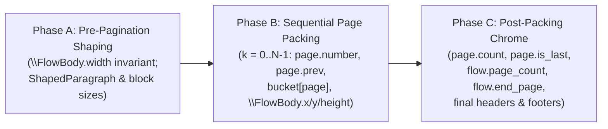

# DirectedType Design Document: Page Model, Physical Units, & Multi-Page Flow Primitives

- **Status:** Proposed
- **Date:** November 2026
- **Target Area:** Lexer & Parser ([`src/token.rs`](file:///Users/hoefel/dev/directedtype/src/token.rs), [`src/ast.rs`](file:///Users/hoefel/dev/directedtype/src/ast.rs), [`src/parser/expr.rs`](file:///Users/hoefel/dev/directedtype/src/parser/expr.rs)), Compiler Expansion & Evaluation ([`src/compiler/expand/rewrite.rs`](file:///Users/hoefel/dev/directedtype/src/compiler/expand/rewrite.rs), [`src/compiler/expand/builtins/window.rs`](file:///Users/hoefel/dev/directedtype/src/compiler/expand/builtins/window.rs), [`src/compiler/expand/schema.rs`](file:///Users/hoefel/dev/directedtype/src/compiler/expand/schema.rs), [`src/compiler/eval.rs`](file:///Users/hoefel/dev/directedtype/src/compiler/eval.rs), [`src/compiler/graph.rs`](file:///Users/hoefel/dev/directedtype/src/compiler/graph.rs)), Pagination & PDF Backend (future pagination expander/packer and `src/render/pdf.rs`), Standard Library Components (`components/Book.dt`, `components/Article.dt`)

---

## 1. Overview & Motivation

DirectedType (`.dt`) models visual documents as a single-pass **Directed Acyclic Graph (DAG)** of algebraic port equations. Up to now, the language has targeted continuous, scrollable interactive canvases (`window`) measured primarily in logical pixels (`px`), typographic points (`pt`), and font-relative units (`em`). Bringing DirectedType to print-ready book, academic article, and multi-page PDF publishing requires three foundational capabilities:

1. **Exact Print & Physical Units:** Authors designing `8.5in × 11in` US Letter or `210mm × 297mm` A4 pages need physical unit literals (`in`, `pc`, `mm`, `cm`) alongside `px`, `pt`, and `em`, plus a canonical `72.0` DPI coordinate mapping for PDF output without breaking existing interactive `window`-based files.
2. **Deterministic, Cycle-Free Multi-Page Flow:** Long prose streams containing headings, multi-paragraph text, cards, inline footnotes, and margin sidenotes must split cleanly across discrete pages without abandoning DirectedType's single-pass DAG guarantees.
3. **Composable Editorial Policy in User Space (Option A Packaging):** Book and article typography involves dozens of stylistic conventions—two-sided recto/verso mirrored margins, suppressed running headers on chapter openers, custom footnote separator rules, collision-avoiding Tufte sidenotes, and Roman-to-Arabic frontmatter chaining.

### Why Minimal Kernel Primitives + User-Space `.dt` Components

Rather than baking editorial opinions (`two_sided`, `margin_inner`, `footnote_rule_width`, `sidenote_gutter`, `suppress_chapter_header`) into the Rust compiler or `\PagedFlow`, DirectedType follows the same strict separation that keeps [`components/VStackStretch.dt`](file:///Users/hoefel/dev/directedtype/components/VStackStretch.dt), [`components/Card.dt`](file:///Users/hoefel/dev/directedtype/components/Card.dt), and [`components/List.dt`](file:///Users/hoefel/dev/directedtype/components/List.dt) out of Rust:

| Layer | Responsibility | Exact Surface |
| :--- | :--- | :--- |
| **Compiler & Engine Kernel** | Physical unit lowering, causal phase enforcement, line/block pagination, and page-scoped state routing | • Physical units (`in`, `pc`, `mm`, `cm`) + canonical `72.0` DPI in PDF mode<br>• Ambient keyword `page` & causal phases<br>• `\PagedFlow` & `\FlowBody`<br>• Implicit `pagination` port, `\Pagination`, `\PageBreak`, `Break`<br>• `\PageValue()`, `\PageList()`, `\Deposit`, `\Collect`, `bucket[page]` |
| **User-Space Standard Library** | Editorial layout policies, chrome, numbering, rules, and margin columns | • `components/Book.dt` (`ChapterMeta`, `Chapter`, `FootnoteEntry`, `Footnote`, `SidenoteEntry`, `Sidenote`, `SidenoteColumn`, `BookPage`, `Book`)<br>• `components/Article.dt` (`Section`, `ArticleHeader`, `ArticlePage`, `Article`) |

Keeping policy in `.dt` ensures that authors can build radically different formats—monographs, two-column proceedings, slide decks, legal briefs, or bilingual side-by-side editions—by composing the exact same eight kernel primitives with zero Rust modifications.

---

## 2. Physical Units Extension (`DistanceUnit` & Lowering)

### 2.1 Current Implementation & Zero-Change Lexing

Currently, [`src/ast.rs`](file:///Users/hoefel/dev/directedtype/src/ast.rs#L815-L845) defines `DistanceUnit` with only three variants: `Px`, `Pt`, and `Em`. However, the Logos lexer rule in [`src/token.rs`](file:///Users/hoefel/dev/directedtype/src/token.rs#L144) already lexes any numeric literal with an identifier suffix via:

```rust
#[regex(r"[0-9]+(\.[0-9]+)?([eE][+-]?[0-9]+)?[a-zA-Z_][a-zA-Z0-9_]*", priority = 2, callback = parse_dimension_token)]
```

and passes `(val, unit_str)` into [`src/parser/expr.rs`](file:///Users/hoefel/dev/directedtype/src/parser/expr.rs#L150-L170), where [`DistanceUnit::from_str`](file:///Users/hoefel/dev/directedtype/src/ast.rs#L823-L830) resolves distance units. Therefore, adding physical print units requires **no lexer regex changes**.

### 2.2 Extending `DistanceUnit`

Extend [`DistanceUnit`](file:///Users/hoefel/dev/directedtype/src/ast.rs#L816-L839) with exact PostScript/ISO physical unit variants:

```rust
#[derive(Debug, Clone, Copy, PartialEq, Eq, Hash)]
pub enum DistanceUnit {
    Px,
    Pt,
    Em,
    In,
    Pc,
    Mm,
    Cm,
}

impl DistanceUnit {
    pub fn from_str(s: &str) -> Option<Self> {
        match s {
            "px" => Some(Self::Px),
            "pt" => Some(Self::Pt),
            "em" => Some(Self::Em),
            "in" => Some(Self::In),
            "pc" => Some(Self::Pc),
            "mm" => Some(Self::Mm),
            "cm" => Some(Self::Cm),
            _ => None,
        }
    }

    pub fn as_str(&self) -> &'static str {
        match self {
            Self::Px => "px",
            Self::Pt => "pt",
            Self::Em => "em",
            Self::In => "in",
            Self::Pc => "pc",
            Self::Mm => "mm",
            Self::Cm => "cm",
        }
    }

    /// Exact PostScript point multiplier for DPI-scaled physical units (`pt`, `in`, `pc`, `mm`, `cm`).
    pub const fn points_per_unit(&self) -> Option<f64> {
        match self {
            Self::Pt => Some(1.0),
            Self::In => Some(72.0),
            Self::Pc => Some(12.0),
            Self::Mm => Some(72.0 / 25.4),
            Self::Cm => Some(72.0 / 2.54),
            Self::Px | Self::Em => None,
        }
    }
}
```

### 2.3 Exact Unit Table & Lowering via `window.dpi / 72.0`

All physical distance literals lower uniformly through the exact point conversion multiplied by `window.dpi / 72.0`:

| Unit | Suffix | Exact Definition in `pt` | Lowered Formula (Logical `px` at Active `window.dpi`) | Value at `72.0` DPI (PDF) | Value at `96.0` DPI (Viewer) |
| :--- | :--- | :--- | :--- | :--- | :--- |
| Logical pixel | `px` | — | `val` | `1px -> 1.0` | `1px -> 1.0` |
| PostScript point | `pt` | `1pt` | `val * (window.dpi / 72.0)` | `1pt -> 1.0` | `1pt -> 1.3333...` |
| Inch | `in` | `72pt` | `(val * 72.0) * (window.dpi / 72.0)` | `1in -> 72.0` | `1in -> 96.0` |
| Pica | `pc` | `12pt` | `(val * 12.0) * (window.dpi / 72.0)` | `1pc -> 12.0` | `1pc -> 16.0` |
| Millimeter | `mm` | `(72.0 / 25.4) pt` | `(val * (72.0 / 25.4)) * (window.dpi / 72.0)` | `25.4mm -> 72.0` | `25.4mm -> 96.0` |
| Centimeter | `cm` | `(72.0 / 2.54) pt` | `(val * (72.0 / 2.54)) * (window.dpi / 72.0)` | `2.54cm -> 72.0` | `2.54cm -> 96.0` |
| Font em | `em` | — | `val * active_font.size` | `1em -> font.size` | `1em -> font.size` |

In [`src/compiler/expand/rewrite.rs`](file:///Users/hoefel/dev/directedtype/src/compiler/expand/rewrite.rs#L2265-L2295), `rewrite_expr` replaces the `DistanceUnit::Pt`-only arm with one shared helper for all `unit.points_per_unit()` cases:

```rust
Expr::Literal(Literal::Distance(val, unit, span)) => {
    if let Some(pts_per_unit) = unit.points_per_unit() {
        let points_val = *val * pts_per_unit;
        Ok(lower_points_to_px_expr(points_val, *span))
    } else {
        match unit {
            DistanceUnit::Px => Ok(expr.clone()),
            DistanceUnit::Em => {
                let font_size_expr = resolve_active_font_size_expr(ctx, *span)?;
                Ok(Expr::Binary(BinaryExpr {
                    op: BinaryOp::Mul,
                    left: std::sync::Arc::new(Expr::Literal(Literal::Float(*val, *span))),
                    right: std::sync::Arc::new(font_size_expr),
                    span: *span,
                }))
            }
            _ => unreachable!("all physical units handled by points_per_unit()"),
        }
    }
}
```

where `lower_points_to_px_expr(points_val, span)` emits `Distance(points_val, DistanceUnit::Px) * (window.dpi / 72.0)`—preserving live reactivity whenever `window.dpi` changes.

To keep the compiler consistent end-to-end:
- [`src/parser/expr.rs`](file:///Users/hoefel/dev/directedtype/src/parser/expr.rs#L163-L166) updates its unknown-unit diagnostic string to list `'px', 'pt', 'em', 'in', 'pc', 'mm', 'cm', 's', and 'ms'`.
- [`src/compiler/eval.rs`](file:///Users/hoefel/dev/directedtype/src/compiler/eval.rs#L344-L372) handles `unit.points_per_unit()` for both `Literal::Distance` and `Literal::Area` (`factor = (dpi / 72.0) * pts_per_unit`).
- `distance_to_float(d, unit)` in [`src/compiler/expand/rewrite.rs`](file:///Users/hoefel/dev/directedtype/src/compiler/expand/rewrite.rs#L1974-L2015) and [`src/compiler/eval.rs`](file:///Users/hoefel/dev/directedtype/src/compiler/eval.rs#L843-L899), along with conversion methods/functions (`to_in`, `to_pc`, `to_mm`, `to_cm` matching [`to_px` and `to_pt`](file:///Users/hoefel/dev/directedtype/src/compiler/eval.rs#L1495-L1516) and [`src/compiler/expand/typecheck.rs`](file:///Users/hoefel/dev/directedtype/src/compiler/expand/typecheck.rs#L2717)), accept all physical `DistanceUnit` suffixes uniformly.

---

## 3. Canonical `72.0` DPI in PDF Mode & Backward Compatibility

### 3.1 Interactive Viewer Mode (`96.0` DPI Default — Unchanged)

In interactive windowed and headless PNG mode, `window.dpi` defaults to `96.0` across [`src/compiler/graph.rs`](file:///Users/hoefel/dev/directedtype/src/compiler/graph.rs#L290-L293), [`src/compiler/expand/component.rs`](file:///Users/hoefel/dev/directedtype/src/compiler/expand/component.rs#L1951-L1958), [`src/compiler/expand/typecheck.rs`](file:///Users/hoefel/dev/directedtype/src/compiler/expand/typecheck.rs#L798-L800), and fallback evaluations in [`src/compiler/eval.rs`](file:///Users/hoefel/dev/directedtype/src/compiler/eval.rs#L347-L366). Window dimensions (`window.width`, `window.height`, `window.right`, `window.bottom`) continue to track the OS viewport and [`CompiledDocument::resize_window`](file:///Users/hoefel/dev/directedtype/src/compiler/compiled.rs#L484-L523). Existing interactive `.dt` applications behave identically without modification.

In V1, interactive `viewer` support for `\PagedFlow` is explicitly a **non-goal** (`viewer` stays untouched for continuous single-viewport apps while paginated documents export directly via `dt2pdf`; see [`pdf_backend.md`](file:///Users/hoefel/dev/directedtype/docs/designs/pages/pdf_backend.md#L160-L163)). If interactive viewer support for `\PagedFlow` is enabled in a future release:
- `window.dpi` remains `96.0` (so an `8.5in × 11in` page renders cleanly at `816 × 1056` logical pixels).
- `\PagedFlow` arranges its generated pages vertically with `gap` spacing (default `0pt`, or viewer preview gap such as `24px`), letting users inspect and scroll multi-page layouts live in Vello.

### 3.2 PDF Compilation Mode (`72.0` DPI Canonical User Space)

PDF coordinates operate natively in PostScript points (`1` PDF user unit = `1/72 in` = `1pt`). When compiling in **PDF / print export mode**:

1. **Canonical `window.dpi = 72.0`:** Unless the document explicitly overrides `\Window(dpi: ...)` (per [`ALLOWED_WINDOW_PORTS`](file:///Users/hoefel/dev/directedtype/src/compiler/expand/builtins/window.rs#L9)), `NodeId::WINDOW`'s `dpi` port is initialized to `72.0`. Because `window.dpi / 72.0 == 1.0`, every `Distance` value in the resolved DAG directly represents exact PDF points:
   - `1pt == 1.0` PDF user unit
   - `1in == 72.0` PDF user units
   - `1pc == 12.0` PDF user units
   - `1mm == 72.0 / 25.4` PDF user units
   - `1cm == 72.0 / 2.54` PDF user units
   - `1px == 1.0` PDF user unit (allowing existing `px`-authored components such as `1px` borders in `components/*.dt` to export cleanly at `1pt` without scaling artifacts).
2. **`window.width` & `window.height` Alias Page 1:** Existing components and user documents (such as [`components/PadIn.dt`](file:///Users/hoefel/dev/directedtype/components/PadIn.dt), [`components/Card.dt`](file:///Users/hoefel/dev/directedtype/components/Card.dt), or top-level formulas) may reference `window.width`, `window.height`, `window.right`, or `window.bottom`. In paginated PDF mode:
   - `window.x` and `window.left` remain `0pt`; `window.y` and `window.top` remain `0pt`.
   - `window.width`, `window.height`, `window.right`, and `window.bottom` alias **Page 1's dimensions** (`page[1].width`, `page[1].height`) of the document's first `\PagedFlow` (after resolving with `window.dpi = 72.0`).
   - If a document contains **no** `\PagedFlow` (e.g., exporting [`examples/text_flow_demo.dt`](file:///Users/hoefel/dev/directedtype/examples/text_flow_demo.dt) directly to a single-page PDF), PDF export uses the CLI/exporter target canvas size (or content bounding box) for `window.width` and `window.height` and emits one PDF page.

This guarantees 100% backward compatibility: all existing `components/*.dt` files compile unmodified in both interactive viewer mode and PDF mode.

---

## 4. The Reserved Ambient `page` Keyword & Causal Phases

### 4.1 Reserved Keyword Rules

`page` joins the list of reserved ambient identifiers in [`docs/language.md`](file:///Users/hoefel/dev/directedtype/docs/language.md#L159) (`window`, `parent`, `self`, `child`, `prev`, `children`, `env`, plus `page`).

- Declaring a `\Component` parameter, `\let`, `\alias`, `\state`, or `\env` named `page` is a compile-time `ReservedPort` error.
- Referencing `page` outside a `\PagedFlow`'s `page:` template component (or a helper/bucket indexing expression scoped to a page template instantiation) is a compile-time error.

### 4.2 Complete Port Table on `page`

Inside any `page:` template instantiated by a `\PagedFlow` (for physical page index $0 \le k < N$ within that `\PagedFlow`):

| Port | Type | Causal Phase | Description |
| :--- | :--- | :--- | :--- |
| `page.number` | `Integer` | Phase B (Per-Page) | Logical page number: `start_page + k`. |
| `page.count` | `Integer` | **Phase C (Post-Packing)** | Total number of pages $N$ produced by the enclosing `\PagedFlow`. |
| `page.prev` | `Optional<PageNode>` | Phase B (Per-Page) | Reference to the previous page's instantiated template root node (`k - 1`) in the same `\PagedFlow`, or `None` (falsy in ternary `page.prev ? ... : ...`) on the first page (`k == 0`). Exposes **only public parameters and `\alias` ports** per [`visibility.md`](file:///Users/hoefel/dev/directedtype/docs/designs/visibility.md). |
| `page.is_odd`<br>`page.is_recto` | `Boolean` | Phase B (Per-Page) | `true` iff `page.number % 2 == 1` (`is_recto` is an exact synonym for `is_odd`). |
| `page.is_even`<br>`page.is_verso` | `Boolean` | Phase B (Per-Page) | `true` iff `page.number % 2 == 0` (`is_verso` is an exact synonym for `is_even`). |
| `page.is_first` | `Boolean` | Phase B (Per-Page) | `true` on the first page of the enclosing `\PagedFlow` (`k == 0`); `false` otherwise. |
| `page.is_last` | `Boolean` | **Phase C (Post-Packing)** | `true` on the final page of the enclosing `\PagedFlow` (`k == N - 1`); `false` otherwise. |
| `page.width` | `Distance` | Phase B (Per-Page) | Width of the current page template root (`template.width`). |
| `page.height` | `Distance` | Phase B (Per-Page) | Height of the current page template root (`template.height`). |
| `page.left` | `Distance` | Phase B (Per-Page) | Page-local left edge (`0pt`). |
| `page.top` | `Distance` | Phase B (Per-Page) | Page-local top edge (`0pt`). |
| `page.right` | `Distance` | Phase B (Per-Page) | Page-local right edge (`page.left + page.width`). |
| `page.bottom` | `Distance` | Phase B (Per-Page) | Page-local bottom edge (`page.top + page.height`). |
| `page.dpi` | `Float` | Phase A / B | Active DPI (`window.dpi`: `72.0` in PDF mode, `96.0` in interactive viewer mode). |

> [!NOTE]
> **Page-Local Coordinate Origin:** Inside a `page:` template, `page.left` and `page.top` are always `0pt`, regardless of whether the output target is a discrete PDF page or a vertically stacked preview inside the interactive Vello viewer. When rendering in continuous viewer mode, `\PagedFlow` applies the page's vertical stack transform `(0, sum_prev_page_heights + k * gap)` at the page root rather than shifting internal coordinates inside the page template.

### 4.3 Causal Evaluation Phases & Compile-Time Invariants

Because DirectedType compiles into a single-pass acyclic DAG, pagination divides evaluation into three strictly ordered causal phases:



1. **Phase A — Flow Width Invariance & Content Shaping (Pre-Pagination):**
   - `\FlowBody.width` **must be invariant across pages** of a `\PagedFlow`. It **cannot** read any `page.*` port (`page.number`, `page.is_odd`, `page.prev`, `page.count`, `page.is_last`, etc.) or any `bucket[page]` expression.
   - **Why:** Every `\Text` paragraph inside the flow body is shaped once into `Arc<ShapedParagraph>` (see [`text_engine_and_knuth_plass.md`](file:///Users/hoefel/dev/directedtype/docs/designs/pages/text_engine_and_knuth_plass.md#L35-L69)) *before* page breaks are computed. Allowing `FlowBody.width` to vary across pages would require re-breaking paragraphs mid-flow based on which page a line landed on.
   - **Asymmetric Two-Sided Margins Remain Legal:** Two-sided layouts with unequal `margin_inner` and `margin_outer` still have an invariant `body_width = page_width - margin_inner - margin_outer`! Only `FlowBody.x` shifts between recto (`margin_inner`) and verso (`margin_outer`), which is purely translational and never invalidates line breaks.
   - **Enforcement:** Any dependency path from `page.*` or `bucket[page]` to `\FlowBody.width` (or to the `width` of any child inside `\PagedFlow`) fails compilation with `PageInvariantViolation`.

2. **Phase B — Sequential Page Packing (`k = 0, 1, 2, ...`):**
   - For each page `k`, the packer resolves pre-pack page inputs (`page.number`, `page.is_odd`/`is_recto`, `page.is_even`/`is_verso`, `page.is_first`, `page.prev` pointing to already-finalized page `k - 1`, `page.width`, `page.height`).
   - `\FlowBody.x`, `\FlowBody.y`, and `\FlowBody.height`, along with flow-body expressions and page chrome, **may** depend on `page.*` (excluding `page.count` and `page.is_last`), `page.prev.<alias_port>`, and `bucket[page]`.
   - **How `FlowBody.height` Safely Depends on `bucket[page]` (Tentative-Commit Footnote Shrinking):**
     When `\FlowBody.height` subtracts the height of bottom-anchored footnotes (`\Collect(from: footnotes[page])`), the packer evaluates `FlowBody.height` incrementally as lines or blocks are placed onto page `k`:
     1. Before considering candidate item/line `m`, `footnotes[page]` contains only footnotes deposited by items `0..m-1` already committed to page `k`.
     2. If item/line `m` contains no `\Deposit` affecting `FlowBody.height`, the packer tests `cursor_y + item_height <= FlowBody.y + FlowBody.height` directly.
     3. If item/line `m` contains a `\Deposit(into: footnotes)` (or other bucket read by `FlowBody.height`), the packer tentatively appends its deposited component to `footnotes[page]`, re-evaluates `FlowBody.height` (which depends only on `FlowBody.width` and `footnotes[page]`, never on `FlowBody.bottom`), and checks whether **both** already-committed items and candidate item/line `m` still fit within the updated `FlowBody.y + FlowBody.height`.
     4. If adding item/line `m` and its footnote overflows `FlowBody.height`, the packer rolls back the tentative deposit on page `k` and pushes item/line `m` (with its footnote) to page `k + 1`.
     5. If item/line `m` and its atomic footnote exceed `FlowBody.height` even on an **empty** page, V1 pagination halts immediately with **`PaginationOverflowError`**.

3. **Phase C — Post-Packing Chrome & Global Counts (`page.count`, `page.is_last`):**
   - Once the final page $N - 1$ finishes packing, `page.count` ($= N$) and `page.is_last` ($= k == N - 1$) become known constants for all pages $k \in [0, N)$, along with `\PagedFlow.page_count`, `\PagedFlow.end_page`, `\PagedFlow.width`, and `\PagedFlow.height`.
   - Expressions outside `\FlowBody` geometry and `page.prev` packing dependencies—such as footer chrome `"Page " + page.number + " of " + page.count` or `"End of document"` indicators gated by `page.is_last`—evaluate cleanly in Phase C.
   - **Enforcement:** Any dependency path from `page.count` or `page.is_last` into `\FlowBody` (`x`, `y`, `width`, `height`), any `\PagedFlow` flow child, any `\Deposit` payload, or any port read via `page.prev` during Phase B is rejected at compile time with `CausalPhaseError`.

---

## 5. Kernel Primitives Specification

### 5.1 `\PagedFlow`

`\PagedFlow` is the root pagination engine container. It takes a page template node slot and flows its block/paragraph children sequentially across instantiated pages.

#### Signature & Ports

| Port | Kind | Type | Default | Description |
| :--- | :--- | :--- | :--- | :--- |
| `page` | **Required Input** | `Node` (Element template) | — | Element instantiation template (e.g. `\BookPage(...)`), parsed as `Expr::Node` and instantiated lazily once per physical page with `page` bound in scope. |
| `gap` | Optional Input | `Distance` | `0pt` | Vertical spacing between consecutive pages when laid out in continuous viewer mode. Ignored during discrete PDF page export. |
| `orphans` | Optional Input | `Integer` | `2` | Minimum number of lines of a paragraph that must remain at the bottom of a page before breaking to the next page. |
| `widows` | Optional Input | `Integer` | `2` | Minimum number of lines of a paragraph that must carry onto the top of the next page after a break. |
| `start_page` | Optional Input | `Integer` | `1` | Starting logical `page.number` assigned to the first page (`k = 0`) generated by this `\PagedFlow`. |
| `x`, `y` | Optional Input | `Distance` | `parent.left`, `parent.top` | Top-left origin of the stacked page sequence in continuous viewer mode. |
| `z`, `clip` | Optional Input | `Integer`, `Clip` | `0`, inherited `clip` | Standard spatial stacking order and hardware clip context. |
| `page_count` | **Output** | `Integer` | Computed | Total number of pages $N \ge 0$ produced by this `\PagedFlow` (Phase C). |
| `end_page` | **Output** | `Integer` | `start_page + page_count - 1` | Logical `page.number` of the final page (Phase C). When `page_count == 0`, `end_page == start_page - 1`, preserving `end_page + 1 == start_page`. |
| `width` | **Output** | `Distance` | Computed | Maximum `page.width` across generated pages (`0pt` if `page_count == 0`). |
| `height` | **Output** | `Distance` | Computed | `sum(page.height) + max(0, page_count - 1) * gap` in continuous viewer mode. |
| `left`, `top`, `right`, `bottom` | **Output** | `Distance` | Synthesized | `x`, `y`, `x + width`, `y + height`. |

#### Flow Child Context Contract
- `\PagedFlow` places its `{ ... }` content in a **Block Container Context** (matching [`text_flow_and_inline_components.md`](file:///Users/hoefel/dev/directedtype/docs/designs/text_flow_and_inline_components.md#L275-L296)): plain text and inline `\Span`/`\InlineBox` runs coalesce into synthetic `\Text` paragraphs split by blank lines (`\n\n`), while block `\Component`s stay direct block children.
- `\PagedFlow` injects `width: flow_body.width` as an ambient default port onto its direct flow children (just as `\VStackStretch` pushes `width`), and stacks consecutive direct flow children seamlessly with `0pt` implicit spacing (allowing `\VStackStretch(gap: ..., pagination: \Pagination(breakable: true))` or `\Chapter` to control vertical spacing explicitly without phantom gaps around empty headers).

#### Chaining Multiple `\PagedFlow` Instances

Because `end_page`, `page_count`, and `bottom` are standard output ports, multiple `\PagedFlow` sections chain cleanly in a single document—for example, switching from frontmatter page templates to main book pages:

```dt
\let frontmatter = \PagedFlow(
    page: \FrontmatterPage(),
    start_page: 1,
    gap: 24px
) {
    // Title page, copyright, table of contents...
};

\let main_body = \PagedFlow(
    y: frontmatter.bottom + 24px,
    page: \BookPage(two_sided: true),
    start_page: frontmatter.end_page + 1,
    gap: 24px
) {
    // Chapters 1..N continuing page numbering seamlessly...
};
```

*(Alternatively, passing `start_page: 1` on `main_body` resets logical `page.number` to `1` for Arabic main text while `frontmatter.page_count + main_body.page_count` computes total physical pages and PDF export appends `main_body`'s pages immediately after `frontmatter`.)*

---

### 5.2 `\FlowBody`

`\FlowBody` is a geometric marker primitive placed inside a `page:` template component to define the shrinkable rectangular flow slice on each page.

```dt
\FlowBody(
    x: Distance,
    y: Distance,
    width: Distance,
    height: Distance
)
```

- **Cardinality:** Each `page:` template component must instantiate **exactly one** `\FlowBody` (0 or $>1$ triggers a compile error in V1).
- **Required Ports:** `x`, `y`, `width`, `height` (all `Distance`), with `left`, `top`, `right`, and `bottom` synthesized automatically.
- **Causal Rules:**
  - `width` must be invariant across pages (Phase A).
  - `x`, `y`, and `height` may depend on `page.*` (except `page.count` and `page.is_last`), `page.prev.*`, and `bucket[page]` (Phase B).
- **Why Rectangular Flow Slices:** Because `width` is fixed across pages, every flow paragraph is shaped once (`Arc<ShapedParagraph>`), and each page simply receives a contiguous slice of lines `paragraph.lines[start_line..end_line]` (or atomic/splittable block subtrees) translated into `(FlowBody.x, FlowBody.y + offset)` within `[FlowBody.y, FlowBody.y + FlowBody.height]`.

---

### 5.3 Implicit `pagination` Port, `\Pagination`, `\PageBreak`, & `Break`

#### Implicit `pagination` Port (Alongside `clip`)

Just as every spatial primitive and `\Component` automatically inherits an unornamented `clip` port in [`src/compiler/expand/schema.rs`](file:///Users/hoefel/dev/directedtype/src/compiler/expand/schema.rs#L360) and [`src/compiler/expand/component.rs`](file:///Users/hoefel/dev/directedtype/src/compiler/expand/component.rs#L547-L557) (no `@` prefix in V1), every spatial primitive and `\Component` accepts an implicit unornamented `pagination` port of type `Pagination`:

- **Default:** `\Pagination()` (`breakable: false, keep_with_next: false, break_before: Break.Auto`) on components and atomic primitives (`\Rect`, `\Line`, `\Card`, `\HDivider`); synthesized `\Text` paragraphs inside flow containers default to `breakable: true` unless explicitly overridden via `pagination: \Pagination(breakable: false)`.
- **Call-site override:** Any caller can pass `pagination: \Pagination(...)` on any element (e.g. `\Card(style: s, pagination: \Pagination(breakable: false)) { ... }`), even if that component did not list `pagination` in its parameter signature.
- **Component definition override:** Component authors may declare `pagination: Pagination = \Pagination(...)` as an overridable parameter or bind `\alias pagination = \Pagination(...);` for a fixed policy.

#### `\Pagination` & `Break`

```dt
\Enum Break {
    Auto,
    Page,
    Recto,
    Verso
}
```

`\Pagination` constructs a pagination-policy node with three optional ports:

| Port | Type | Default | Semantics |
| :--- | :--- | :--- | :--- |
| `breakable` | `Boolean` | `false` | When `false`, the node is packed atomically as an indivisible box. When `true` on a container (`\Chapter`, `\Section`, `\VStackStretch`), `\PagedFlow` descends into its vertical children and splits between them (collapsing inter-sibling `gap` at page boundaries so the first item on a new page starts flush at `FlowBody.top`); when `true` on `\Text`, `\PagedFlow` splits across line boundaries honoring `orphans` and `widows`. |
| `keep_with_next` | `Boolean` | `false` | Prevents a page break immediately *after* this element. If the next sibling (or the first `orphans` lines of a following `\Text` paragraph) cannot fit on the current page alongside this element, this element moves together with it to the next page. |
| `break_before` | `Break` | `Break.Auto` | Break constraint applied before placing this element:<br>• `Break.Auto`: break only on overflow.<br>• `Break.Page`: start a new page if the current page already has placed flow content.<br>• `Break.Recto`: advance until `page.is_recto` (`is_odd`) is `true` (emitting an empty verso page if currently on an odd page with content or on an even page).<br>• `Break.Verso`: advance until `page.is_verso` (`is_even`) is `true`. |

#### `\PageBreak`

`\PageBreak(to: Break = Break.Page)` inserts an explicit zero-height flow break directive inside `\PagedFlow` or any `breakable: true` flow container:

```dt
\PageBreak()                  // Advances to the next page (Break.Page)
\PageBreak(to: Break.Recto)   // Advances to the next recto (odd) page
```

---

### 5.4 Page Buckets: `\PageValue`, `\PageList`, `\Deposit`, `\Collect`, & `bucket[page]`

When inline content inside `\FlowBody` (chapter headings, footnotes, margin sidenotes, dictionary guidewords) needs to route data back out to the enclosing `page:` template (headers, bottom footnote region, margin columns) on whichever page that content happens to land on, DirectedType provides two zero-argument bucket constructors and a unified deposit/collect mechanism.

#### Bucket Constructors

| Constructor | Type | Per-Page Write Semantics | Exposed Ports on `bucket[p]` |
| :--- | :--- | :--- | :--- |
| `\PageValue()` | `PageValue` | **Overwrite per page:** If multiple `\Deposit(into: vb)` components land on page `p`, `vb[p].value` retains the **last** deposit on page `p`, while `vb[p].first` preserves the **first** deposit on page `p`. | • `vb[p].has_value: Boolean` (`true` if $\ge 1$ deposit on page `p`)<br>• `vb[p].value.<port>`: public parameter or `\alias` port on the last deposited component on page `p`<br>• `vb[p].first.<port>`: public parameter or `\alias` port on the first deposited component on page `p`<br>• Optional `\Collect(from: vb[p])`: splats `0` or `1` (`value`) child into a container |
| `\PageList()` | `PageList` | **Append per page:** Every `\Deposit(into: lb)` landing on page `p` appends its component in document flow order to page `p`'s list. | • `lb[p].len: Integer` (count of deposits on page `p`, `0` when empty)<br>• `lb[p].first.<port>`: public port on first deposited component (`len > 0`)<br>• `lb[p].last.<port>`: public port on last deposited component (`len > 0`)<br>• `\Collect(from: lb[p])`: splats all deposited components on page `p` into an enclosing container's `\Children` in deposition order |

> [!IMPORTANT]
> **Short-Circuit Guarding on `vb[p]` & `lb[p]`:** Reading `vb[p].value.<port>` or `vb[p].first.<port>` when `vb[p].has_value == false` (or `lb[p].first`/`lb[p].last` when `lb[p].len == 0`) is an evaluation error unless guarded by a conditional ternary (`vb[p].has_value ? vb[p].value.title : fallback`), which short-circuits the unchosen branch.

#### Unified `\Deposit` Syntax

Both `\PageValue()` and `\PageList()` use the **exact same call-site syntax**:

```dt
\Deposit(into: bucket_handle) {
    <SingleComponent>
}
```

- **Strict Port Contract:** `\Deposit` accepts **only** `into:` (of type `PageValue` or `PageList`) and a `{ ... }` content slot resolving to **strictly one root child component**. There is **no `value:` port** on `\Deposit`; passing `value:` or providing `0` or $> 1$ root children inside `{ ... }` is a compile-time error.
- **Zero Flow Footprint:** `\Deposit` is a non-visual attachment node. Placed in a block container (`\Chapter`, `\VStackStretch`), it adds `0pt` height and incurs zero `gap` spacing; placed inline inside a paragraph or `\InlineBox` (`\Footnote`, `\Sidenote`), it does not break the paragraph and attaches to its exact inline character/line position so the deposit is attributed to whichever page that line lands on.
- **Scoping of Deposited Components:** The `<SingleComponent>` inside `\Deposit(into: ...)` is expanded in the lexical and `\env` scope of the **`\Deposit` call site** (with `self`/enclosing variables in scope, including post-shaping ports like `baseline` on an enclosing `\InlineBox`), while spatial placement ports (`x`, `y`, `width`) may be left defaulted to `parent.left`/`parent.top`/`parent.width` so the collecting container's `\Children(...)` supplies them when `\Collect(from: bucket[page])` splats the deposited component into the page template.

#### AST & Parser Support for `bucket[page]`

Currently, [`src/token.rs`](file:///Users/hoefel/dev/directedtype/src/token.rs#L57-L85) does not include `[` / `]` tokens and [`src/ast.rs`](file:///Users/hoefel/dev/directedtype/src/ast.rs#L600-L613) has `MemberAccess` and `MethodCall` postfix expressions in `Expr`. To support `bucket[page]` cleanly:
1. Add `Token::LBracket` (`"["`) and `Token::RBracket` (`"]"`) to [`src/token.rs`](file:///Users/hoefel/dev/directedtype/src/token.rs).
2. Add `IndexExpr { target: Arc<Expr>, index: Arc<Expr>, span: Span }` and `Expr::Index(IndexExpr)` alongside [`MethodCallExpr`](file:///Users/hoefel/dev/directedtype/src/ast.rs#L770-L775) in [`src/ast.rs`](file:///Users/hoefel/dev/directedtype/src/ast.rs).
3. Parse postfix `[expr]` in [`parse_expr_bp`](file:///Users/hoefel/dev/directedtype/src/parser/expr.rs#L19-L85) at the same precedence level as `.` and `(...)`, allowing chained member accesses such as `chapter_meta[page].value.title` and `footnotes[page].len`.

---

## 6. Complete User-Space Reference Implementations (`components/Book.dt` & `components/Article.dt`)

The two files below form the reference standard-library packaging (Option A) built solely from the kernel primitives defined in Sections 2–5 and existing standard components ([`components/Align.dt`](file:///Users/hoefel/dev/directedtype/components/Align.dt) and [`components/VStackStretch.dt`](file:///Users/hoefel/dev/directedtype/components/VStackStretch.dt)).

### 6.1 `components/Book.dt`

```dt
// DirectedType Standard Component Library: Book
// Composable book typography built on kernel pagination primitives:
//   - Two-sided recto/verso mirrored margins (`two_sided`, `margin_inner`, `margin_outer`)
//   - Cross-page running headers via public `\alias running_chapter` + `page.prev`
//   - Running headers suppressed on chapter opener pages
//   - Bottom-anchored footnotes with customizable separator rule
//   - Collision-avoiding outer-margin Tufte sidenotes

\use "components/Align.dt"
\use "components/VStackStretch.dt"

// Pure metadata payload deposited into `chapter_meta` (\PageValue) at each chapter start.
\Component ChapterMeta(
    title: String,
    number: String = ""
) {}

// Breakable chapter container:
// 1. Advances to a recto (odd) page by default (`break_before: Break.Recto`).
// 2. Deposits `\ChapterMeta` into `env chapter_meta` on the opener page.
// 3. Keeps label + title glued to the first opening block (`keep_with_next: true`).
\Component Chapter(
    title: String,
    number: String = "",
    env font: Font,
    env chapter_meta: PageValue,
    x: Distance = parent.left,
    y: Distance = parent.top,
    width: Distance = parent.width,
    gap: Distance = 12pt,
    title_gap: Distance = 20pt,
    heading_color: Color = #0f172a,
    label_color: Color = #64748b,
    break_before: Break = Break.Recto,
    pagination: Pagination = \Pagination(breakable: true, break_before: break_before)
) {
    \Deposit(into: chapter_meta) {
        \ChapterMeta(title: title, number: number)
    }

    \let has_number = number != "";
    \let label_node = \Text(
        x: x,
        y: y,
        width: width,
        font: \Font(font: self.font, size: self.font.size * 0.85, weight: 600),
        color: label_color,
        text: has_number ? ("CHAPTER " + number) : "",
        pagination: \Pagination(breakable: false, keep_with_next: true)
    );

    \let title_y = has_number ? (label_node.bottom + 6pt) : y;
    \let title_node = \Text(
        x: x,
        y: title_y,
        width: width,
        font: \Font(
            font: self.font,
            size: self.font.size * 1.9,
            weight: 700,
            line_height: self.font.line_height * 1.75
        ),
        color: heading_color,
        text: title,
        pagination: \Pagination(breakable: false, keep_with_next: true)
    );

    \let body = \VStackStretch(
        x: x,
        y: title_node.bottom + title_gap,
        width: width,
        gap: gap,
        pagination: \Pagination(breakable: true)
    ) {
        \Children
    };

    \alias right: Distance = x + width;
    \alias height: Distance = (title_node.bottom + title_gap + body.height) - y;
    \alias bottom: Distance = y + height;
}

// Atomic footnote entry collected at the bottom of the page where its anchor landed.
\Component FootnoteEntry(
    marker: String = "*",
    env font: Font,
    x: Distance = parent.left,
    y: Distance = parent.top,
    width: Distance = parent.width,
    marker_indent: Distance = 14pt,
    color: Color = #334155,
    marker_color: Color = #0f172a
) {
    \let has_marker = marker != "";
    \let note_font = \Font(
        font: self.font,
        size: self.font.size * 0.85,
        weight: 400,
        italic: false,
        line_height: self.font.line_height * 0.85
    );
    \let mark_node = \Text(
        x: x,
        y: y,
        font: note_font,
        color: marker_color,
        text: marker
    );
    \let indent = has_marker ? marker_indent : 0pt;
    \let body_node = \Text(
        x: x + indent,
        y: y,
        width: width - indent,
        font: note_font,
        color: color
    ) {
        \Children
    };

    \alias right: Distance = x + width;
    \alias height: Distance = max(mark_node.height, body_node.height);
    \alias bottom: Distance = y + height;
}

// Inline footnote callout (`\InlineBox`):
// Renders the raised superscript marker inline on the text line and deposits `\FootnoteEntry`
// into `env footnotes` (\PageList) for the page containing that line.
\InlineBox Footnote(
    marker: String = "*",
    env font: Font,
    env footnotes: PageList,
    x: Distance = parent.left,
    y: Distance = parent.top,
    marker_color: Color = #1e293b
) {
    \let sup_font = \Font(font: self.font, size: self.font.size * 0.72, weight: 400, italic: false);
    \let shift = self.font.size * 0.38;
    \let mark = \Text(
        x: x,
        y: y,
        font: sup_font,
        color: marker_color,
        text: marker
    );

    \Deposit(into: footnotes) {
        \FootnoteEntry(marker: marker) {
            \Children
        }
    }

    \alias width: Distance = mark.width;
    \alias height: Distance = mark.height;
    \alias baseline: Distance = marker != "" ? (mark.baseline + shift) : y;
}

// Margin sidenote entry deposited into `sidenotes` (\PageList).
// Exposes `target_y` so `\SidenoteColumn` aligns the first baseline to the prose callout
// while pushing overlapping notes downward in single-pass order.
\Component SidenoteEntry(
    anchor_y: Distance,
    marker: String = "",
    env font: Font,
    x: Distance = parent.left,
    y: Distance = parent.top,
    width: Distance = parent.width,
    color: Color = #475569,
    marker_color: Color = #0f172a
) {
    \let has_marker = marker != "";
    \let note_font = \Font(
        font: self.font,
        size: self.font.size * 0.85,
        weight: 400,
        italic: false,
        line_height: self.font.line_height * 0.85
    );
    \let mark_node = \Text(
        x: x,
        y: y,
        font: note_font,
        color: marker_color,
        text: marker
    );
    \let marker_gap = has_marker ? 4pt : 0pt;
    \let body_node = \Text(
        x: x + mark_node.width + marker_gap,
        y: y,
        width: width - mark_node.width - marker_gap,
        font: note_font,
        color: color
    ) {
        \Children
    };

    \alias target_y: Distance = anchor_y - note_font.cap_height;
    \alias right: Distance = x + width;
    \alias height: Distance = max(mark_node.height, body_node.height);
    \alias bottom: Distance = y + height;
}

// Inline sidenote callout (`\InlineBox`):
// Passes its positioned page-local `baseline` to `\SidenoteEntry(anchor_y: baseline)`.
\InlineBox Sidenote(
    marker: String = "",
    env font: Font,
    env sidenotes: PageList,
    x: Distance = parent.left,
    y: Distance = parent.top,
    marker_color: Color = #1e293b
) {
    \let sup_font = \Font(font: self.font, size: self.font.size * 0.72, weight: 400, italic: false);
    \let shift = self.font.size * 0.38;
    \let mark = \Text(
        x: x,
        y: y,
        font: sup_font,
        color: marker_color,
        text: marker
    );

    \Deposit(into: sidenotes) {
        \SidenoteEntry(anchor_y: baseline, marker: marker) {
            \Children
        }
    }

    \alias width: Distance = mark.width;
    \alias height: Distance = mark.height;
    \alias baseline: Distance = marker != "" ? (mark.baseline + shift) : y;
}

// Collision-avoiding margin column for `\Collect(from: sidenotes[page])`.
// Each child starts at its desired `child.target_y`, clamped below `y` and `prev.bottom + gap`.
\Component SidenoteColumn(
    x: Distance,
    y: Distance,
    width: Distance,
    max_bottom: Distance,
    gap: Distance = 10pt
) {
    \alias right: Distance = x + width;
    \alias height: Distance = max_bottom - y;
    \alias bottom: Distance = max_bottom;

    \Children(
        x: x,
        width: width,
        y: prev ? max(child.target_y, prev.bottom + gap) : max(y, child.target_y)
    )
}

// Book page template with two-sided mirrored margins, running header roll-forward,
// chapter-opener header suppression, customizable footnote rule, and margin sidenotes.
\Component BookPage(
    width: Distance = 8.5in,
    height: Distance = 11in,
    x: Distance = page.left,
    y: Distance = page.top,
    two_sided: Boolean = true,
    margin_inner: Distance = 1in,
    margin_outer: Distance = 0.75in,
    margin_top: Distance = 0.9in,
    margin_bottom: Distance = 0.9in,
    header_offset: Distance = 0.45in,
    footer_offset: Distance = 0.45in,
    header_gap: Distance = 6pt,
    sidenote_width: Distance = 0pt,
    sidenote_gutter: Distance = 0.25in,
    sidenote_gap: Distance = 10pt,
    footnote_gap: Distance = 6pt,
    footnote_rule_width: Distance = 1.5in,
    footnote_rule_thickness: Distance = 0.5pt,
    footnote_rule_color: Color = #64748b,
    footnote_rule_top_gap: Distance = 10pt,
    footnote_rule_bottom_gap: Distance = 6pt,
    page_bg: Color = #ffffff,
    chrome_color: Color = #64748b,
    book_title: String = "",
    show_total_pages: Boolean = false,
    env font: Font,
    env chapter_meta: PageValue,
    env footnotes: PageList,
    env sidenotes: PageList
) {
    \let body_width = width - margin_inner - margin_outer;
    \let body_top = y + margin_top;
    \let body_bottom_limit = y + height - margin_bottom;
    \let body_max_height = body_bottom_limit - body_top;

    \assert body_width > 0pt as "BookPage horizontal margins exceed page width.";
    \assert body_max_height > 0pt as "BookPage vertical margins exceed page height.";

    \let is_verso = two_sided && page.is_verso;
    \let body_x = is_verso ? (x + margin_outer) : (x + margin_inner);

    // Public `\alias` port (NEVER `\let`) so `page.prev.running_chapter` is visible across pages.
    \let has_chapter_start = chapter_meta[page].has_value;
    \alias running_chapter: String = has_chapter_start
        ? chapter_meta[page].value.title
        : (page.prev ? page.prev.running_chapter : "");

    \alias right: Distance = x + width;
    \alias bottom: Distance = y + height;

    // Optional page background sheet
    \Rect(
        x: x,
        y: y,
        width: width,
        height: height,
        color: page_bg
    )

    // Running header (suppressed on chapter openers and before the first chapter)
    \let chrome_font = \Font(font: self.font, size: self.font.size * 0.82, weight: 400, italic: true);
    \let num_font = \Font(font: self.font, size: self.font.size * 0.85, weight: 400, italic: false);
    \let show_header = !has_chapter_start && running_chapter != "";
    \let verso_title = book_title != "" ? book_title : running_chapter;
    \let header_text = show_header ? (is_verso ? verso_title : running_chapter) : "";
    \let header_align = is_verso ? Align.Left : (two_sided ? Align.Right : Align.Left);

    \let header_node = \Text(
        x: body_x,
        y: y + header_offset,
        width: body_width,
        font: chrome_font,
        color: chrome_color,
        align: header_align,
        text: header_text
    );

    \Rect(
        x: body_x,
        y: header_node.bottom + header_gap,
        width: body_width,
        height: 0.4pt,
        color: #cbd5e1,
        opacity: show_header ? 1.0 : 0.0
    )

    // Bottom-anchored footnote block & customizable separator rule
    \let has_footnotes = footnotes[page].len > 0;
    \let footnote_stack = \VStackStretch(
        x: body_x,
        y: body_bottom_limit - footnote_stack.height,
        width: body_width,
        gap: footnote_gap
    ) {
        \Collect(from: footnotes[page])
    };

    \Rect(
        x: body_x,
        y: footnote_stack.top - footnote_rule_bottom_gap - footnote_rule_thickness,
        width: footnote_rule_width,
        height: footnote_rule_thickness,
        color: footnote_rule_color,
        opacity: has_footnotes ? 1.0 : 0.0
    )

    \let fn_reserved = has_footnotes
        ? (footnote_stack.height + footnote_rule_top_gap + footnote_rule_thickness + footnote_rule_bottom_gap)
        : 0pt;

    // Rectangular flow region (width invariant; height shrinks as footnotes land on this page)
    \FlowBody(
        x: body_x,
        y: body_top,
        width: body_width,
        height: body_max_height - fn_reserved
    )

    // Outer-margin collision-avoiding sidenotes
    \let sidenote_x = is_verso
        ? (body_x - sidenote_gutter - sidenote_width)
        : (body_x + body_width + sidenote_gutter);

    \SidenoteColumn(
        x: sidenote_x,
        y: body_top,
        width: sidenote_width,
        max_bottom: body_bottom_limit,
        gap: sidenote_gap
    ) {
        \Collect(from: sidenotes[page])
    }

    // Footer page number (reads post-packing `page.count` safely in Phase C)
    \let footer_align = (!two_sided || has_chapter_start)
        ? Align.Center
        : (is_verso ? Align.Left : Align.Right);
    \let footer_text = show_total_pages
        ? ("Page " + page.number + " of " + page.count)
        : ("" + page.number);

    \Text(
        x: body_x,
        y: y + height - footer_offset,
        width: body_width,
        font: num_font,
        color: chrome_color,
        align: footer_align,
        text: footer_text
    )
}

// Top-level Book component packaging `BookPage` and buckets into `\PagedFlow`.
\Component Book(
    title: String = "",
    two_sided: Boolean = true,
    page_width: Distance = 8.5in,
    page_height: Distance = 11in,
    margin_inner: Distance = 1in,
    margin_outer: Distance = 0.75in,
    margin_top: Distance = 0.9in,
    margin_bottom: Distance = 0.9in,
    header_offset: Distance = 0.45in,
    footer_offset: Distance = 0.45in,
    sidenote_width: Distance = 0pt,
    sidenote_gutter: Distance = 0.25in,
    sidenote_gap: Distance = 10pt,
    paragraph_gap: Distance = 10pt,
    footnote_gap: Distance = 6pt,
    footnote_rule_width: Distance = 1.5in,
    footnote_rule_thickness: Distance = 0.5pt,
    footnote_rule_color: Color = #64748b,
    footnote_rule_top_gap: Distance = 10pt,
    footnote_rule_bottom_gap: Distance = 6pt,
    page_bg: Color = #ffffff,
    show_total_pages: Boolean = false,
    orphans: Integer = 2,
    widows: Integer = 2,
    start_page: Integer = 1,
    page_gap: Distance = 0pt,
    x: Distance = parent.left,
    y: Distance = parent.top,
    env font: Font = \Font(family: "Georgia", size: 11pt, line_height: 15.5pt)
) {
    \let chapter_meta = \PageValue();
    \let footnotes = \PageList();
    \let sidenotes = \PageList();

    \env font = self.font;
    \env chapter_meta = chapter_meta;
    \env footnotes = footnotes;
    \env sidenotes = sidenotes;

    \let body_width = page_width - margin_inner - margin_outer;

    \let flow = \PagedFlow(
        x: x,
        y: y,
        gap: page_gap,
        orphans: orphans,
        widows: widows,
        start_page: start_page,
        page: \BookPage(
            width: page_width,
            height: page_height,
            two_sided: two_sided,
            margin_inner: margin_inner,
            margin_outer: margin_outer,
            margin_top: margin_top,
            margin_bottom: margin_bottom,
            header_offset: header_offset,
            footer_offset: footer_offset,
            sidenote_width: sidenote_width,
            sidenote_gutter: sidenote_gutter,
            sidenote_gap: sidenote_gap,
            footnote_gap: footnote_gap,
            footnote_rule_width: footnote_rule_width,
            footnote_rule_thickness: footnote_rule_thickness,
            footnote_rule_color: footnote_rule_color,
            footnote_rule_top_gap: footnote_rule_top_gap,
            footnote_rule_bottom_gap: footnote_rule_bottom_gap,
            page_bg: page_bg,
            book_title: title,
            show_total_pages: show_total_pages
        )
    ) {
        \VStackStretch(
            width: body_width,
            gap: paragraph_gap,
            pagination: \Pagination(breakable: true)
        ) {
            \Children
        }
    };

    \alias page_count: Integer = flow.page_count;
    \alias end_page: Integer = flow.end_page;
    \alias width: Distance = flow.width;
    \alias height: Distance = flow.height;
    \alias right: Distance = x + width;
    \alias bottom: Distance = y + height;
}
```

### 6.2 `components/Article.dt`

```dt
// DirectedType Standard Component Library: Article
// Single-sided article and academic paper layout sharing note primitives from `Book.dt`.

\use "components/Align.dt"
\use "components/VStackStretch.dt"
\use { Footnote, FootnoteEntry, Sidenote, SidenoteEntry, SidenoteColumn } from "components/Book.dt";

// Breakable section heading + body container (`keep_with_next: true` prevents orphaned headings).
\Component Section(
    title: String,
    number: String = "",
    env font: Font,
    x: Distance = parent.left,
    y: Distance = parent.top,
    width: Distance = parent.width,
    gap: Distance = 10pt,
    heading_gap: Distance = 8pt,
    heading_scale: Float = 1.35,
    heading_color: Color = #0f172a,
    pagination: Pagination = \Pagination(breakable: true)
) {
    \let full_title = number != "" ? (number + "  " + title) : title;
    \let heading = \Text(
        x: x,
        y: y,
        width: width,
        font: \Font(
            font: self.font,
            size: self.font.size * heading_scale,
            weight: 700,
            line_height: self.font.line_height * heading_scale
        ),
        color: heading_color,
        text: full_title,
        pagination: \Pagination(breakable: false, keep_with_next: true)
    );

    \let body = \VStackStretch(
        x: x,
        y: heading.bottom + heading_gap,
        width: width,
        gap: gap,
        pagination: \Pagination(breakable: true)
    ) {
        \Children
    };

    \alias right: Distance = x + width;
    \alias height: Distance = (heading.bottom + heading_gap + body.height) - y;
    \alias bottom: Distance = y + height;
}

// Optional flowing article title & byline block (collapses to 0pt height when all fields are empty).
\Component ArticleHeader(
    title: String = "",
    author: String = "",
    date: String = "",
    env font: Font,
    x: Distance = parent.left,
    y: Distance = parent.top,
    width: Distance = parent.width,
    title_color: Color = #0f172a,
    meta_color: Color = #64748b,
    bottom_gap: Distance = 18pt,
    pagination: Pagination = \Pagination(breakable: false, keep_with_next: true)
) {
    \let has_title = title != "";
    \let has_meta = author != "" || date != "";
    \let has_any = has_title || has_meta;
    \let meta_line = (author != "" && date != "")
        ? (author + "  •  " + date)
        : (author != "" ? author : date);

    \let title_node = \Text(
        x: x,
        y: y,
        width: width,
        font: \Font(
            font: self.font,
            size: self.font.size * 1.9,
            weight: 700,
            line_height: self.font.line_height * 1.7
        ),
        color: title_color,
        text: title
    );

    \let meta_y = has_title ? (title_node.bottom + 8pt) : y;
    \let meta_node = \Text(
        x: x,
        y: meta_y,
        width: width,
        font: \Font(font: self.font, size: self.font.size * 0.92, weight: 400, italic: false),
        color: meta_color,
        text: meta_line
    );

    \let content_bottom = has_meta
        ? meta_node.bottom
        : (has_title ? title_node.bottom : y);
    \let rule_y = content_bottom + 12pt;

    \Rect(
        x: x,
        y: rule_y,
        width: has_any ? width : 0pt,
        height: has_any ? 0.75pt : 0pt,
        color: #cbd5e1,
        opacity: has_any ? 1.0 : 0.0
    )

    \alias right: Distance = x + width;
    \alias height: Distance = has_any ? ((rule_y + 0.75pt + bottom_gap) - y) : 0pt;
    \alias bottom: Distance = y + height;
}

// Single-sided article page template with running header on pages 2+, bottom footnotes,
// optional right-margin sidenotes, and "Page X of Y" footer via post-packing `page.count`.
\Component ArticlePage(
    width: Distance = 8.5in,
    height: Distance = 11in,
    x: Distance = page.left,
    y: Distance = page.top,
    margin_left: Distance = 1in,
    margin_right: Distance = 1in,
    margin_top: Distance = 0.85in,
    margin_bottom: Distance = 0.85in,
    header_offset: Distance = 0.42in,
    footer_offset: Distance = 0.42in,
    sidenote_width: Distance = 0pt,
    sidenote_gutter: Distance = 0.25in,
    sidenote_gap: Distance = 10pt,
    footnote_gap: Distance = 6pt,
    footnote_rule_width: Distance = 1.5in,
    footnote_rule_thickness: Distance = 0.5pt,
    footnote_rule_color: Color = #64748b,
    footnote_rule_top_gap: Distance = 10pt,
    footnote_rule_bottom_gap: Distance = 6pt,
    page_bg: Color = #ffffff,
    chrome_color: Color = #64748b,
    article_title: String = "",
    env font: Font,
    env footnotes: PageList,
    env sidenotes: PageList
) {
    \let body_x = x + margin_left;
    \let body_width = width - margin_left - margin_right;
    \let body_top = y + margin_top;
    \let body_bottom_limit = y + height - margin_bottom;
    \let body_max_height = body_bottom_limit - body_top;

    \assert body_width > 0pt as "ArticlePage horizontal margins exceed page width.";
    \assert body_max_height > 0pt as "ArticlePage vertical margins exceed page height.";

    \alias right: Distance = x + width;
    \alias bottom: Distance = y + height;

    \Rect(
        x: x,
        y: y,
        width: width,
        height: height,
        color: page_bg
    )

    // Running title header on pages 2+ (suppressed on page 1)
    \let chrome_font = \Font(font: self.font, size: self.font.size * 0.82, weight: 400, italic: false);
    \let show_header = !page.is_first && article_title != "";
    \Text(
        x: body_x,
        y: y + header_offset,
        width: body_width,
        font: chrome_font,
        color: chrome_color,
        align: Align.Right,
        text: show_header ? article_title : ""
    )

    // Bottom-anchored footnotes & customizable separator rule
    \let has_footnotes = footnotes[page].len > 0;
    \let footnote_stack = \VStackStretch(
        x: body_x,
        y: body_bottom_limit - footnote_stack.height,
        width: body_width,
        gap: footnote_gap
    ) {
        \Collect(from: footnotes[page])
    };

    \Rect(
        x: body_x,
        y: footnote_stack.top - footnote_rule_bottom_gap - footnote_rule_thickness,
        width: footnote_rule_width,
        height: footnote_rule_thickness,
        color: footnote_rule_color,
        opacity: has_footnotes ? 1.0 : 0.0
    )

    \let fn_reserved = has_footnotes
        ? (footnote_stack.height + footnote_rule_top_gap + footnote_rule_thickness + footnote_rule_bottom_gap)
        : 0pt;

    \FlowBody(
        x: body_x,
        y: body_top,
        width: body_width,
        height: body_max_height - fn_reserved
    )

    \SidenoteColumn(
        x: body_x + body_width + sidenote_gutter,
        y: body_top,
        width: sidenote_width,
        max_bottom: body_bottom_limit,
        gap: sidenote_gap
    ) {
        \Collect(from: sidenotes[page])
    }

    // Post-packing Phase C footer: "Page X of Y"
    \Text(
        x: body_x,
        y: y + height - footer_offset,
        width: body_width,
        font: chrome_font,
        color: chrome_color,
        align: Align.Center,
        text: "Page " + page.number + " of " + page.count
    )
}

// Top-level Article component packaging `ArticlePage`, header, and buckets into `\PagedFlow`.
\Component Article(
    title: String = "",
    author: String = "",
    date: String = "",
    page_width: Distance = 8.5in,
    page_height: Distance = 11in,
    margin_left: Distance = 1in,
    margin_right: Distance = 1in,
    margin_top: Distance = 0.85in,
    margin_bottom: Distance = 0.85in,
    header_offset: Distance = 0.42in,
    footer_offset: Distance = 0.42in,
    sidenote_width: Distance = 0pt,
    sidenote_gutter: Distance = 0.25in,
    sidenote_gap: Distance = 10pt,
    paragraph_gap: Distance = 10pt,
    footnote_gap: Distance = 6pt,
    footnote_rule_width: Distance = 1.5in,
    footnote_rule_thickness: Distance = 0.5pt,
    footnote_rule_color: Color = #64748b,
    footnote_rule_top_gap: Distance = 10pt,
    footnote_rule_bottom_gap: Distance = 6pt,
    page_bg: Color = #ffffff,
    orphans: Integer = 2,
    widows: Integer = 2,
    start_page: Integer = 1,
    page_gap: Distance = 0pt,
    x: Distance = parent.left,
    y: Distance = parent.top,
    env font: Font = \Font(family: "Inter", size: 10.5pt, line_height: 15pt)
) {
    \let footnotes = \PageList();
    \let sidenotes = \PageList();

    \env font = self.font;
    \env footnotes = footnotes;
    \env sidenotes = sidenotes;

    \let body_width = page_width - margin_left - margin_right;

    \let flow = \PagedFlow(
        x: x,
        y: y,
        gap: page_gap,
        orphans: orphans,
        widows: widows,
        start_page: start_page,
        page: \ArticlePage(
            width: page_width,
            height: page_height,
            margin_left: margin_left,
            margin_right: margin_right,
            margin_top: margin_top,
            margin_bottom: margin_bottom,
            header_offset: header_offset,
            footer_offset: footer_offset,
            sidenote_width: sidenote_width,
            sidenote_gutter: sidenote_gutter,
            sidenote_gap: sidenote_gap,
            footnote_gap: footnote_gap,
            footnote_rule_width: footnote_rule_width,
            footnote_rule_thickness: footnote_rule_thickness,
            footnote_rule_color: footnote_rule_color,
            footnote_rule_top_gap: footnote_rule_top_gap,
            footnote_rule_bottom_gap: footnote_rule_bottom_gap,
            page_bg: page_bg,
            article_title: title
        )
    ) {
        \ArticleHeader(title: title, author: author, date: date, width: body_width)
        \VStackStretch(
            width: body_width,
            gap: paragraph_gap,
            pagination: \Pagination(breakable: true)
        ) {
            \Children
        }
    };

    \alias page_count: Integer = flow.page_count;
    \alias end_page: Integer = flow.end_page;
    \alias width: Distance = flow.width;
    \alias height: Distance = flow.height;
    \alias right: Distance = x + width;
    \alias bottom: Distance = y + height;
}
```

### 6.3 Example Usage (Demonstrating Dynamic Text Without String Interpolation)

```dt
\use "components/Book.dt"
\use "components/Bold.dt"
\use "components/Italic.dt"

\Book(
    title: "Elements of Reactive Typography",
    two_sided: true,
    margin_inner: 0.75in,
    margin_outer: 2.5in,
    sidenote_width: 1.75in,
    footnote_rule_width: 1.2in
) {
    \Chapter(number: "1", title: "Single-Pass Pagination") {
        Every page in DirectedType is a pure node in the DAG.\Footnote(marker: "1") {
            See \Italic{visibility.md} for why \Bold{alias} ports are required on cross-page reads.
        }

        Margin commentary aligns directly to the anchor line's baseline.\Sidenote(marker: "a") {
            Overlapping notes push downward cleanly inside \Bold{SidenoteColumn}.
        }

        Dynamic values inside prose use inline \Text(text: "embedded expressions") cleanly.
    }
}
```

### 6.4 How `page.prev.<alias_port>` Rolls Forward Cleanly Across Empty Pages

In `BookPage`, running headers rely on a single recurrence equation:

```dt
\let has_chapter_start = chapter_meta[page].has_value;
\alias running_chapter: String = has_chapter_start
    ? chapter_meta[page].value.title
    : (page.prev ? page.prev.running_chapter : "");
```

This construction satisfies four critical invariants:

1. **Encapsulation & Visibility Compliance ([`visibility.md`](file:///Users/hoefel/dev/directedtype/docs/designs/visibility.md#L9-L15)):** `\let` bindings inside `BookPage` (such as `has_chapter_start`, `body_width`, `is_verso`) are strictly private. Declaring `running_chapter` with **`\alias`** exports it on the `BookPage` instance's public port table, making `page.prev.running_chapter` legal. Writing `\let running_chapter` instead of `\alias running_chapter` is a compile-time visibility error.
2. **Arbitrarily Many Intermediate or Empty Pages Without Loops:**
   - **Page 1 (`Chapter 1` opens):** `chapter_meta[page 1].has_value` is `true`, so `page[1].running_chapter` evaluates to `"Single-Pass Pagination"` without touching `page.prev`. `has_chapter_start` is `true`, so `show_header` is `false` (header suppressed on opener).
   - **Page 2 (prose continues):** No `\Chapter` starts here (`has_chapter_start == false`). The true branch is skipped, and `page[2].running_chapter` reads `page.prev.running_chapter` (`page[1].running_chapter`), yielding `"Single-Pass Pagination"`.
   - **Page 3 (empty verso page inserted by `Break.Recto` before `Chapter 2`):** Even with **zero** flow items on Page 3, `BookPage` is still instantiated for Page 3, `has_chapter_start` is `false`, and `page[3].running_chapter` rolls forward from `page[2].running_chapter` in $O(1)$ per page. Notice that even across 50 consecutive empty or chapter-less pages, there is no cycle because page $k$ only ever reads page $k - 1$.
   - **Page 4 (`Chapter 2` opens):** `has_chapter_start` is `true` again, resetting `running_chapter` to Chapter 2's title and suppressing Page 4's header.
3. **Causal Safety:** Because `running_chapter` depends only on `chapter_meta[page]` (Phase B) and `page.prev.running_chapter` (already finalized in Phase B for page $k - 1$), it never touches Phase C ports (`page.count`, `page.is_last`) and never feeds backward into `\FlowBody.width`.

---

## 7. Cross-Document Consistency & Post-V1 Roadmap

### 7.1 Alignment Across DirectedType Specifications

- **Language Reference ([`docs/language.md`](file:///Users/hoefel/dev/directedtype/docs/language.md)):** All examples preserve strict `:` (parameter types and call-site ports) vs. `=` (defaults and `\let`/`\alias`/`\env`/`\state` bindings), use `\Text(text: expr)` or string concatenation `"" + page.number` instead of string interpolation, and treat `page` consistently with `window`, `parent`, `prev`, `child`, and `children`.
- **Visibility Contract ([`docs/designs/visibility.md`](file:///Users/hoefel/dev/directedtype/docs/designs/visibility.md)):** Cross-page `page.prev.<port>` queries and `bucket[page].value.<port>` queries access only public parameters and `\alias` bindings, never private `\let` locals.
- **Text Flow & Inline Components ([`docs/designs/text_flow_and_inline_components.md`](file:///Users/hoefel/dev/directedtype/docs/designs/text_flow_and_inline_components.md)):** `\Footnote` and `\Sidenote` are declared as `\InlineBox` so they stay inline inside coalesced paragraphs without triggering block breaks, while `\Chapter`, `\Section`, and `\PagedFlow` are Block Container Contexts.
- **Knuth-Plass & `ShapedParagraph` IR ([`docs/designs/pages/text_engine_and_knuth_plass.md`](file:///Users/hoefel/dev/directedtype/docs/designs/pages/text_engine_and_knuth_plass.md)):** Because `ParleyEngine` (V1) and `KnuthPlassEngine` (V2) both produce `Arc<ShapedParagraph>`, `\PagedFlow` paginates identically by slicing `paragraph.lines[start_line..end_line]` and reading `line.ends_with_hyphen` for page-break penalties. Note also that [`src/compiler/text.rs`](file:///Users/hoefel/dev/directedtype/src/compiler/text.rs#L760-L766) already maps `Align.Justify` to `parley::Alignment::Justify`; adding `Justify` to [`components/Align.dt`](file:///Users/hoefel/dev/directedtype/components/Align.dt) is a trivial companion update for justified book columns.

### 7.2 Post-V1 Roadmap

1. **Structural / PDF Output Omission vs. `opacity: 0` Searchable Hidden Text:**
   In V1, setting `opacity: 0` on a primitive (such as hiding decorative rules via `opacity: show_header ? 1.0 : 0.0` in `BookPage`) still instantiates the node and emits zero-alpha PDF drawing commands—meaning `opacity: 0` on `\Text` emits transparent, searchable/selectable text in the PDF content stream (which is why V1 `BookPage` passes `text: ""` for suppressed running headers). Post-V1 introduces structural omission (`visible: Boolean` or conditional `\If`) so omitted primitives are excluded completely from both Vello scenes and PDF output streams.
2. **Optional `@` Sigil for Compiler-Intrinsic Ports (`clip`, `pagination`):**
   In V1, both `clip` and `pagination` are unornamented implicit ports across all spatial nodes and `\Component` definitions. Post-V1 may introduce an optional `@` prefix (e.g., `@clip`, `@pagination`, `@z`) to distinguish compiler-intrinsic cross-cutting ports visually from user-authored component parameters while keeping unornamented V1 syntax valid.
3. **Recursive Multi-Page Splitting for Oversized Footnotes:**
   In V1, each `\FootnoteEntry` is atomic; if a single footnote cannot fit inside `FlowBody.height` even on an empty page, pagination aborts cleanly with `PaginationOverflowError`. Post-V1 lifts this restriction by slicing oversized footnote `ShapedParagraph`s across consecutive pages (similar to TeX `\splitfootnotepenalty`), tracking continuation state across `page.prev`.
4. **Optional Variable Column Widths (`\parshape` Across Recto/Verso):**
   V1 enforces page-invariant `\FlowBody.width` so paragraphs shape once in Phase A. Once `KnuthPlassEngine` (per [`text_engine_and_knuth_plass.md`](file:///Users/hoefel/dev/directedtype/docs/designs/pages/text_engine_and_knuth_plass.md#L190-L195)) supports per-line `target_width(line_index)`, a future V2+ extension can lazily re-shape only the specific paragraphs that straddle a page boundary when recto and verso column widths differ.
