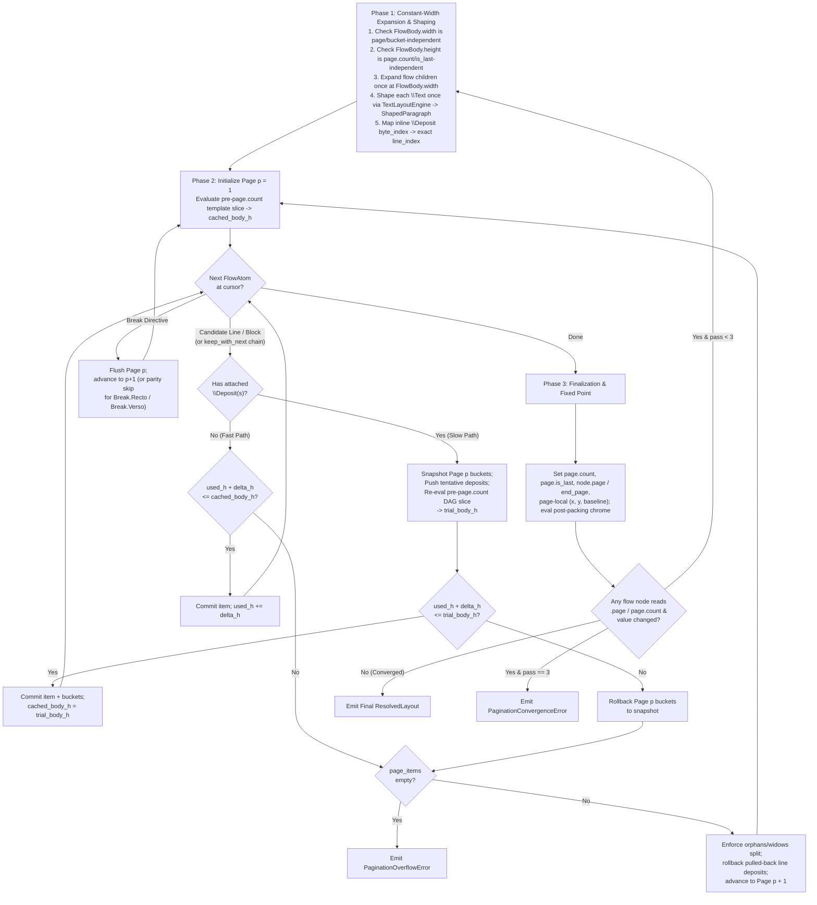

# DirectedType Design Document: Pagination (`\PagedFlow`, `\FlowBody`, `\Pagination`, `\PageBreak`) & Page-Scoped Buckets (`\PageValue`, `\PageList`, `\Deposit`, `\Collect`)

- **Status:** Proposed
- **Date:** November 2026
- **Target Area:** Lexer & Parser ([`src/token.rs`](file:///Users/hoefel/dev/directedtype/src/token.rs), [`src/lexer.rs`](file:///Users/hoefel/dev/directedtype/src/lexer.rs), [`src/ast.rs`](file:///Users/hoefel/dev/directedtype/src/ast.rs), [`src/parser/expr.rs`](file:///Users/hoefel/dev/directedtype/src/parser/expr.rs)), Expander & Typechecker ([`src/compiler/expand/schema.rs`](file:///Users/hoefel/dev/directedtype/src/compiler/expand/schema.rs), [`src/compiler/expand/component.rs`](file:///Users/hoefel/dev/directedtype/src/compiler/expand/component.rs), [`src/compiler/expand/children.rs`](file:///Users/hoefel/dev/directedtype/src/compiler/expand/children.rs), [`src/compiler/expand/builtins/mod.rs`](file:///Users/hoefel/dev/directedtype/src/compiler/expand/builtins/mod.rs), [`src/compiler/expand/typecheck.rs`](file:///Users/hoefel/dev/directedtype/src/compiler/expand/typecheck.rs)), Text Engine & Graph Evaluator ([`src/compiler/text.rs`](file:///Users/hoefel/dev/directedtype/src/compiler/text.rs), [`src/compiler/graph.rs`](file:///Users/hoefel/dev/directedtype/src/compiler/graph.rs), [`src/compiler/eval.rs`](file:///Users/hoefel/dev/directedtype/src/compiler/eval.rs), [`src/compiler/layout.rs`](file:///Users/hoefel/dev/directedtype/src/compiler/layout.rs), [`src/compiler/error.rs`](file:///Users/hoefel/dev/directedtype/src/compiler/error.rs))
- **Related Specifications:**
  - [Page Model, Physical Units, & Multi-Page Flow Primitives](file:///Users/hoefel/dev/directedtype/docs/designs/pages/page_model_and_units.md)
  - [Plain Text Contexts, Paragraph Flow, & Inline Components](file:///Users/hoefel/dev/directedtype/docs/designs/text_flow_and_inline_components.md)
  - [Text Shaping Abstraction, Hyphenation, & Knuth-Plass Optimization](file:///Users/hoefel/dev/directedtype/docs/designs/pages/text_engine_and_knuth_plass.md)
  - [Pre-Layout Component DOM Transforms (Option A)](file:///Users/hoefel/dev/directedtype/docs/designs/pages/dom_transforms_and_toc.md)
  - [Clipping & Environmental Clip Contexts](file:///Users/hoefel/dev/directedtype/docs/designs/clipping.md)

---

## Executive Summary & Architectural Overview

DirectedType models layout as a Directed Acyclic Graph (DAG) of algebraic port equations resolved in a single topological pass ([`src/compiler/mod.rs`](file:///Users/hoefel/dev/directedtype/src/compiler/mod.rs#L117-L138), [`src/compiler/topo.rs`](file:///Users/hoefel/dev/directedtype/src/compiler/topo.rs#L30-L159)). Extending DirectedType from continuous scrollable canvases to multi-page print and PDF documents (books, manuals, academic papers) introduces an apparent tension:

1. **Body flow depends on page geometry:** A footnote deposited on line $k$ of a paragraph shrinks `\FlowBody.height` on Page $p$, potentially pushing line $k$ (and its footnote!) onto Page $p + 1$.
2. **Page chrome depends on body flow:** Running headers, footers, page totals (`page.count`), and cross-page state (`page.prev.<port>`) depend on where paragraphs break and which deposits land on each page.
3. **Prose can contain forward page references:** A paragraph on Page 2 can reference `sec_types.page` (on Page 14) or `page.count`, slightly altering line widths when `"" + page` changes from `"0"` to `"14"`.

This specification resolves all three cleanly within DirectedType's declarative model using **three orthogonal mechanisms**:

1. **Shallow Per-Box `pagination` Port & Transparent Container Unpacking:** An implicit `pagination` port (alongside `clip`, unornamented with no `@` prefix) configured by `\Pagination(breakable, keep_with_next, break_before)` plus the standalone `\PageBreak(to)` directive.
2. **Page-Scoped Buckets (`\PageValue()`, `\PageList()`) with Unified `\Deposit` & `\Collect`:** A single call-site syntax `\Deposit(into: bucket) { <SingleComponent> }` routes running marks, footnotes, and margin notes into per-page buckets indexed via `bucket[page]`.
3. **Multi-Phase Greedy Pagination + Bounded Fixed Point:**
   - **Phase 1:** Verify `\FlowBody.width` is page-independent, expand the flow tree once at constant width, and shape every paragraph once into `ShapedParagraph` line slices.
   - **Phase 2:** Pack flattened `FlowAtom`s sequentially across pages $p = 1, 2, \dots$, enforcing `orphans`, `widows`, `keep_with_next`, `Break.Recto`/`Break.Verso`/`Break.Page`, $O(1)$ normal-line fit checks, and tentative deposit rollback against Page $p$'s pre-`page.count` template DAG slice.
   - **Phase 3:** Populate `page.count`, `page.is_last`, node `.page`/`.end_page`, and page-local coordinates, evaluate post-packing page chrome, and iterate at most **3 passes** if any prose or flow block references forward `.page` / `page.count` values.

### End-to-End Example

```dt
\env font = \Font(family: "Georgia", size: 11pt, line_height: 15pt);
\env footnotes = \PageList();
\env section_mark = \PageValue();

\Component ChapterMark(title: String) { }

\Component Footnote(
    num: Integer,
    width: Distance = parent.width,
    x: Distance = parent.left,
    y: Distance = parent.top,
    env font: Font
) {
    \let fn_font = \Font(font: font, size: 9pt, line_height: 12pt);
    \let body = \Text(x: x, y: y, width: width, font: fn_font) {
        \Text(text: "" + num + ". ")
        \Children
    };
    \alias height = body.height;
    \alias bottom = y + height;
}

\Component Section(
    title: String,
    width: Distance = parent.width,
    x: Distance = parent.left,
    y: Distance = parent.top,
    gap: Distance = 10pt,
    env font: Font,
    env section_mark: PageValue
) {
    \let pagination = \Pagination(breakable: true);

    \Deposit(into: section_mark) { \ChapterMark(title: title) }
    \let heading_font = \Font(font: font, size: 15pt, weight: 700, line_height: 20pt);
    \let heading = \Text(
        x: x,
        y: y,
        width: width,
        font: heading_font,
        pagination: \Pagination(keep_with_next: true),
        text: title
    );

    \let body = \VStackStretch(
        x: x,
        y: heading.bottom + gap,
        width: width,
        gap: gap,
        pagination: \Pagination(breakable: true)
    ) {
        \Children
    };

    \alias height = (heading.bottom + gap + body.height) - y;
    \alias bottom = y + height;
}

\Component BookPage(
    env font: Font,
    env footnotes: PageList,
    env section_mark: PageValue
) {
    \let chrome_font = \Font(font: font, size: 9pt, line_height: 12pt);

    // Must use \alias (not \let) so page.prev.running_section is public across pages
    \alias running_section = section_mark[page].has_value
        ? section_mark[page].value.title
        : (page.prev ? page.prev.running_section : "");

    // Header (depends on page.prev chain; evaluated cleanly per page)
    \Text(
        x: 72pt,
        y: 42pt,
        width: 468pt,
        font: chrome_font,
        color: #64748b,
        text: page.is_first ? "" : running_section
    )

    // Bottom-anchored footnote stack (re-evaluated tentatively when footnotes deposit)
    \let fn_stack = \VStackStretch(
        x: 72pt,
        y: 720pt - fn_stack.height,
        width: 468pt,
        gap: 4pt
    ) {
        \Collect(from: footnotes[page])
    };

    \let fn_rule_y = fn_stack.top - 8pt;
    \Rect(
        x: 72pt,
        y: fn_rule_y,
        width: footnotes[page].len > 0 ? 144pt : 0pt,
        height: footnotes[page].len > 0 ? 0.5pt : 0pt,
        color: #94a3b8
    )

    // Main flow region: width is page-constant (468pt); height shrinks dynamically for footnotes
    \let body_top = 72pt;
    \let body_bottom = footnotes[page].len > 0 ? (fn_rule_y - 8pt) : 720pt;
    \FlowBody(
        x: 72pt,
        y: body_top,
        width: 468pt,
        height: body_bottom - body_top
    )

    // Footer (depends on page.count; evaluated in Phase 3 after packing finishes)
    \Text(
        x: 72pt,
        y: 744pt,
        width: 468pt,
        font: chrome_font,
        color: #475569,
        text: "Page " + page.number + " of " + page.count
    )
}

\PagedFlow(page: \BookPage(), orphans: 2, widows: 2) {
    \VStackStretch(width: 468pt, gap: 12pt, pagination: \Pagination(breakable: true)) {
        \Section(title: "1. Introduction") {
            DirectedType resolves pagination declaratively\Sup { 1 }\Deposit(into: footnotes) {
                \Footnote(num: 1) { Footnotes shrink \Code{\\FlowBody.height} via tentative rollback. }
            } without imperative reflow callbacks. See Section 2 on page \Text(text: sec_types.page).
        }

        \PageBreak(to: Break.Recto)

        \let sec_types = \Section(title: "2. Type System") {
            Every bucket read is statically checked before layout evaluation begins.
        };
    }
}
```

---

## 1. Lexer, Parser, & AST Additions

### 1.1 Bracket Indexing (`[ ... ]`) & `Expr::Index`

Currently [`src/token.rs`](file:///Users/hoefel/dev/directedtype/src/token.rs#L57-L67) defines delimiters `(`, `)`, `{`, `}`, while [`src/lexer.rs`](file:///Users/hoefel/dev/directedtype/src/lexer.rs#L6-L52) drives `logos::Lexer<'a, Token>` directly from those token attributes. Indexing into per-page buckets (`footnotes[page]`, `section_mark[page.prev]`, `vb[1]`) requires square-bracket tokens and a postfix index AST node.

#### Token & Lexer Changes
In [`src/token.rs`](file:///Users/hoefel/dev/directedtype/src/token.rs#L56-L68) and its `Display` implementation ([`src/token.rs#L211-L262`](file:///Users/hoefel/dev/directedtype/src/token.rs#L211-L262)):
```rust
    #[token("[")]
    LBracket,

    #[token("]")]
    RBracket,
```
- **Content-Slot Isolation:** Inside [`ParserCursor::parse_content_slot_mode`](file:///Users/hoefel/dev/directedtype/src/parser/cursor.rs#L175-L491) with `SlotMode::ContentSlot`, plain prose characters bypass `Token::lexer` completely (except `\` escapes, `~`, `{`, `}`, and comments). Therefore, literal brackets in prose—such as `citation [1]` or `\Sup { [1] }` in [`examples/text_flow_demo.dt`](file:///Users/hoefel/dev/directedtype/examples/text_flow_demo.dt#L98)—continue to lex as plain text with zero breakage.
- `[` and `]` are tokenized as `Token::LBracket` / `Token::RBracket` solely in expression contexts (`(...)` port arguments, `\let` / `\alias` / `\env` / `\state` expressions, and `\Expr` bodies).

#### AST & Parser Changes
In [`src/ast.rs`](file:///Users/hoefel/dev/directedtype/src/ast.rs#L600-L613), add `Expr::Index(IndexExpr)`:

```rust
#[derive(Debug, Clone, PartialEq)]
pub struct IndexExpr {
    pub target: std::sync::Arc<Expr>,
    pub index: std::sync::Arc<Expr>,
    pub span: Span,
}

pub enum Expr {
    // ... existing variants ...
    Index(IndexExpr),
}
```

In [`src/parser/expr.rs`](file:///Users/hoefel/dev/directedtype/src/parser/expr.rs#L14-L86), extend the postfix loop inside `parse_expr_bp` right alongside `Token::Dot` and `Token::LParen`:

```rust
        // Postfix: Index access `target[index]`
        if peeked.0 == Token::LBracket {
            cursor.consume_token(&Token::LBracket)?;
            let index = parse_expr_bp(cursor, 0)?;
            let close_span = cursor.consume_token(&Token::RBracket)?;
            let span = lhs.span().merge(close_span);
            lhs = Expr::Index(IndexExpr {
                target: std::sync::Arc::new(lhs),
                index: std::sync::Arc::new(index),
                span,
            });
            continue;
        }
```

Because `Expr::Index` runs inside the top-level postfix `while` loop at higher binding power than ternary (`? :`) and all infix operators (`infix_binding_power` at [`src/parser/expr.rs#L619-L636`](file:///Users/hoefel/dev/directedtype/src/parser/expr.rs#L619-L636)), arbitrary postfix chains parse left-to-right naturally:
- `footnotes[page].len > 0` $\rightarrow$ `Binary(Gt, MemberAccess(Index(footnotes, page), "len"), 0)`
- `section_mark[page].value.title` $\rightarrow$ `MemberAccess(MemberAccess(Index(section_mark, page), "value"), "title")`
- `env.footnotes[page.number - 1].last.bottom` $\rightarrow$ valid chained postfix tree.

#### Required AST Traversal Updates
Every exhaustive `match expr` over `crate::ast::Expr` must handle `Expr::Index`:
- [`src/ast.rs`](file:///Users/hoefel/dev/directedtype/src/ast.rs): `expr_eq_ignore_span` (lines 355–458), `Expr::span` (lines 677–692), `fmt::Display for Expr` (lines 1088–1170).
- [`src/parser/expr.rs`](file:///Users/hoefel/dev/directedtype/src/parser/expr.rs#L262-L295): `expr_contains_non_value_node`.
- [`src/compiler/expand/schema.rs`](file:///Users/hoefel/dev/directedtype/src/compiler/expand/schema.rs): `expr_references_any_name` (lines 181–221), `collect_expr_lets` (lines 1101–1148), plus `validate_key_expr` (lines 1311–1360) rejecting component keys that depend on bucket indexing.
- [`src/compiler/expand/typecheck.rs`](file:///Users/hoefel/dev/directedtype/src/compiler/expand/typecheck.rs): `validate_expr_type_annotations` (lines 160–222), `validate_children_sibling_guards` (lines 382–496), `infer_expr_type` (line 1964+), and literal type inference.
- [`src/compiler/expand/aggregation.rs`](file:///Users/hoefel/dev/directedtype/src/compiler/expand/aggregation.rs): `collect_agg_members_and_parent_refs` (lines 36–84), `scan_expr_for_parent_or_local_deps` (lines 86–227), `resolve_and_filter_agg_expr` (lines 279–579), `expr_contains_agg_child_of` (lines 581–609).
- [`src/compiler/expand/rewrite.rs`](file:///Users/hoefel/dev/directedtype/src/compiler/expand/rewrite.rs) and [`src/compiler/graph.rs`](file:///Users/hoefel/dev/directedtype/src/compiler/graph.rs#L582-L649) (`collect_dependencies`).

### 1.2 New Built-in Enum & Primitives

All pagination constructs are registered via [`BuiltinPrimitive`](file:///Users/hoefel/dev/directedtype/src/compiler/expand/builtins/mod.rs#L52-L183) and [`register_builtin_enums_and_components`](file:///Users/hoefel/dev/directedtype/src/compiler/expand/builtins/mod.rs#L321-L329), requiring **zero new parser keywords**. Pre-interned symbols (`pagination`, `breakable`, `keep_with_next`, `break_before`, `page`, `end_page`, `into`, `from`, `to`, `has_value`, `first`, `last`, `value`, `number`, `count`, `is_first`, `is_last`, `is_recto`, `is_verso`, `orphans`, `widows`, `PagedFlow`, `FlowBody`, `Pagination`, `PageBreak`, `PageValue`, `PageList`, `Deposit`, `Collect`, `Break`) are added to `PREINTERNED` in [`src/symbol.rs`](file:///Users/hoefel/dev/directedtype/src/symbol.rs#L17-L106).

#### Built-in Enum: `Break`
Registered alongside `TextStart`, `TextEnd`, and `LineCap`:

```dt
\Enum Break {
    Auto,
    Page,
    Recto,
    Verso
}
```

#### Summary of Built-in Pagination Primitives

| Primitive | `is_non_spatial()` | Accepted Input Ports & Defaults | Content Slot / Output Contract |
| :--- | :---: | :--- | :--- |
| **`\PagedFlow`** | `false` | `page: Node` *(required page template instance, e.g. `\BookPage()`)*<br>`orphans: Integer = 2`<br>`widows: Integer = 2`<br>`gap: Distance = 0pt` *(inter-page vertical spacing in continuous stack mode; inter-paragraph/block spacing comes from `\VStackStretch(gap: ...)`)*<br>`start_page: Integer = 1`<br>`x: Distance = parent.left`, `y: Distance = parent.top`<br>`width`, `height`, `end_page`, `page_count` *(outputs)* | Flow container content slot (`{ ... }`). Accepts paragraphs, `\Component`s, `\PageBreak`, `\Deposit`, and `\let` declarations. Exposes `page_count: Integer` (`page.count`) and `end_page: Integer`. |
| **`\FlowBody`** | `false` | `x: Distance = parent.left`<br>`y: Distance = parent.top`<br>`width: Distance` *(required; must be page-invariant)*<br>`height: Distance` *(required; may depend on buckets/page, must not depend on `page.count`)* | Empty slot (`{ }` disallowed). Marks the single target region inside a page template component where `\PagedFlow` packs content on Page $p$. |
| **`\Pagination`** | `true` | `breakable: Boolean = false`<br>`keep_with_next: Boolean = false`<br>`break_before: Break = Break.Auto` | Value/metadata node attached to any component or primitive via the implicit `pagination` port. |
| **`\PageBreak`** | `true` *(0×0 flow item)* | `to: Break = Break.Page` | Empty slot (`{ }` disallowed). Zero-height break marker in flow containers and coalesced prose. |
| **`\PageValue`** | `true` | *(zero arguments)* | Zero-arg constructor returning a `PageValue` bucket handle. Per-page overwrite semantics; indexed by `vb[p]`. |
| **`\PageList`** | `true` | *(zero arguments)* | Zero-arg constructor returning a `PageList` bucket handle. Per-page append semantics; indexed by `lb[p]`. |
| **`\Deposit`** | `true` | `into: PageValue \| PageList` *(required; NO `value:` port)* | Content slot resolving/coalescing to **strictly 1 root component** (`CompileError` if 0 or >1 root children). |
| **`\Collect`** | `true` | `from: PageListSlice \| PageValueSlice` *(required, e.g. `footnotes[page]`)* | Empty slot (`{ }` disallowed). Splats Page $p$'s bucket entries into the enclosing container's `\Children` list. |

#### Built-in `Page` Context Type (`page` Ambient Keyword)
When `\PagedFlow` instantiates its `page:` template component (e.g., `\BookPage`) for physical page $k \in \{0, \dots, P - 1\}$ (`page.number = start_page + k`), it binds the reserved ambient keyword **`page`** (`StaticType::Node("Page")`) in the template's scope (parallel to `window`; declaring a parameter, `\let`, `\alias`, `\state`, or `\env` named `page` is a `ReservedPort` error):

| Port on `page: Page` | Static Type | Value on Page $p$ | Phase Availability |
| :--- | :--- | :--- | :--- |
| `page.number` | `Integer` | $p$ (logical `start_page + k`) | Phase 2 (template slice) & Phase 3 |
| `page.is_first` | `Boolean` | `k == 0` (first page of `\PagedFlow`) | Phase 2 (template slice) & Phase 3 |
| `page.is_odd` / `page.is_recto` | `Boolean` | `page.number % 2 == 1` | Phase 2 (template slice) & Phase 3 |
| `page.is_even` / `page.is_verso` | `Boolean` | `page.number % 2 == 0` | Phase 2 (template slice) & Phase 3 |
| `page.prev` | `Option<PageTemplate>` | `unset` if $k == 0$; else `NodeId` of previous page's template root | Phase 2 (template slice) & Phase 3 |
| `page.width`, `page.height` | `Distance` | Dimensions of the current page template root | Phase 2 (template slice) & Phase 3 |
| `page.left`, `page.top`, `page.right`, `page.bottom`, `page.dpi` | `Distance` / `Float` | `0pt`, `0pt`, `page.width`, `page.height`, active DPI (`72.0` PDF / `96.0` viewer) | Phase 1 / Phase 2 & Phase 3 |
| `page.count` | `Integer` | Total page count $P$ | **Phase 3 only** (post-packing; forbidden in `\FlowBody.height`) |
| `page.is_last` | `Boolean` | `k == P - 1` | **Phase 3 only** (post-packing; forbidden in `\FlowBody.height`) |

#### Non-Spatial Graph Exemption & Bucket Let Handling
1. In [`build_variable_graph_with_window`](file:///Users/hoefel/dev/directedtype/src/compiler/graph.rs#L347), `is_prim_spatial` must exclude non-spatial pagination primitives (`Pagination`, `PageValue`, `PageList`, `PageBreak`, `Deposit`, `Collect`, `Page`) so the graph builder does not inject spurious default `x`, `y`, `width`, `height`, `z` variables onto them.
2. In [`src/parser/component.rs`](file:///Users/hoefel/dev/directedtype/src/parser/component.rs#L167-L177) (`parse_let_binding`) and [`src/compiler/expand/mod.rs`](file:///Users/hoefel/dev/directedtype/src/compiler/expand/mod.rs#L211-L213) (`is_value_node_name`), `\PageValue()` and `\PageList()` remain node-backed non-spatial primitives (like `\Font`) rather than scalar value nodes so every constructor call allocates a distinct `NodeId` identity. However, [`count_consumer_children`](file:///Users/hoefel/dev/directedtype/src/compiler/expand/children.rs#L36) and [`collect_consumer_children`](file:///Users/hoefel/dev/directedtype/src/compiler/expand/children.rs#L234) must exclude `LetValue::Node` bindings whose element is `PageValue`, `PageList`, or `Pagination` from the parent container's flow child list (they are declarations bound into `lexical_scope`, never layout children).
3. In [`src/compiler/expand/typecheck.rs`](file:///Users/hoefel/dev/directedtype/src/compiler/expand/typecheck.rs#L67-L113), `StaticType::from_type_name` accepts `"Break"`, `"Page"`, `"Pagination"`, `"PageValue"`, `"PageList"`, `"PagedFlow"`, and `"FlowBody"`.

---

## 2. Implicit `pagination` Port Mechanics in `schema.rs` & `component.rs`

Every component and visual primitive in DirectedType accepts an implicit, unornamented **`pagination`** port alongside **`clip`** (with **no `@` prefix** in V1). Authors write `pagination: \Pagination(...)` at call sites or `\let pagination = \Pagination(...);` inside component bodies identically to `clip`.

### 2.1 Mirroring `clip` for Acceptance & Overload Exclusion — While Staying Strictly Shallow

The existing `clip` implementation spans [`src/compiler/expand/schema.rs`](file:///Users/hoefel/dev/directedtype/src/compiler/expand/schema.rs), [`src/compiler/expand/component.rs`](file:///Users/hoefel/dev/directedtype/src/compiler/expand/component.rs), and [`src/compiler/expand/builtins/mod.rs`](file:///Users/hoefel/dev/directedtype/src/compiler/expand/builtins/mod.rs). `pagination` mirrors `clip`'s acceptance and overload machinery exactly, **except** that `pagination` is strictly **shallow (per-box)** and **never propagates** down `children_env_scope` or `internal_body_env_scope`.

| Compiler Location | Existing `clip` Behavior | `pagination` Behavior & Critical Difference |
| :--- | :--- | :--- |
| [`ComponentSchema::from_def`](file:///Users/hoefel/dev/directedtype/src/compiler/expand/schema.rs#L360) | `comp_scope_ports` initialized with `["clip"]`. | Initialize `comp_scope_ports` with `["clip", "pagination"]`. |
| [`ComponentSchema::from_def`](file:///Users/hoefel/dev/directedtype/src/compiler/expand/schema.rs#L538-L548) | `comp_shadowed_ports` checks `.chain(["clip", "left", "top", "right", "bottom"])` so `\let clip = ...` allows `self.clip`. | Add `"pagination"` to `.chain(["clip", "pagination", "left", "top", "right", "bottom"])` so `\let pagination = \Pagination(...)` allows `self.pagination` in component bodies. |
| [`ComponentSchema::from_def`](file:///Users/hoefel/dev/directedtype/src/compiler/expand/schema.rs#L570-L571) | `static_port_types.insert("clip", "Clip")` | `static_port_types.insert("pagination", "Pagination")` |
| [`ComponentSchema::validate_caller_ports`](file:///Users/hoefel/dev/directedtype/src/compiler/expand/schema.rs#L968-L977) | Rejects caller ports found in `all_let_names` when not in `param_names`. | **Crucial Guard:** Exempt `"pagination"` (when `name != "pagination"`) from the `all_let_names` rejection so callers can pass `pagination: \Pagination(break_before: Break.Recto)` to a component like `\Section` that internally declares `\let pagination = \Pagination(breakable: true);`. |
| [`select_component_overload`](file:///Users/hoefel/dev/directedtype/src/compiler/expand/schema.rs#L1249-L1281) | Skips `name == "clip"` and `on_*` when checking whether an overload accepts all explicit caller ports (and omits `"clip"` from error lists). | Skip `name == "clip" \|\| name == "pagination"` in both the filter (line 1251) and error formatting (line 1280). Passing `pagination:` never breaks overload selection on `\Card`, `\HStack`, `\VStackStretch`, or user components. |
| [`ComponentExpander::resolve_parameters`](file:///Users/hoefel/dev/directedtype/src/compiler/expand/component.rs#L484-L501) | Allows `name == "clip"` without being a declared param; rejects unknown ports. | Allow `name == "clip" \|\| name == "pagination"`, validating that a caller-supplied `pagination` expression has type `Pagination`. |
| [`ComponentExpander::resolve_parameters`](file:///Users/hoefel/dev/directedtype/src/compiler/expand/component.rs#L547-L557) | Synthesizes default `clip` via `default_inherited_clip_expr` (`env_scope.get("clip")` or `parent.clip`). | **Shallow Default:** Never reads `env_scope` or `parent.pagination`! Defaults to a shared `\Pagination(breakable: false, keep_with_next: false, break_before: Break.Auto)` (or `breakable: true` for `\Text`). |
| [`ComponentExpander::init_scopes_and_preresolve`](file:///Users/hoefel/dev/directedtype/src/compiler/expand/component.rs#L954-L968) | Inserts `self_clip_entry` into both `internal_body_env_scope` and `children_env_scope`. | **NEVER** insert `pagination` into `internal_body_env_scope` or `children_env_scope`! |
| [`BuiltinPrimitive::accepts_port`](file:///Users/hoefel/dev/directedtype/src/compiler/expand/builtins/mod.rs#L66-L70) & [`RectPrimitive`](file:///Users/hoefel/dev/directedtype/src/compiler/expand/builtins/rect.rs#L20-L49) / [`LinePrimitive`](file:///Users/hoefel/dev/directedtype/src/compiler/expand/builtins/line.rs#L27-L42) / [`TextPrimitive`](file:///Users/hoefel/dev/directedtype/src/compiler/expand/builtins/text.rs#L104-L125) | Accepts `"clip"`. | Accept `"pagination"` (`StaticType::Node("Pagination")`) on `\Rect`, `\Line`, `\Text`, and all `\Component` / `\InlineBox` definitions (rejected on non-spatial value primitives `\Font`, `\Clip`, `\Box`, `\PageValue`, `\PageList`, `\Pagination`, `\Deposit`, `\Collect`). |

#### Why `pagination` Must NEVER Propagate Down `children_env_scope`
If `pagination` propagated down `children_env_scope` like `clip`:
1. Placing `\Section(pagination: \Pagination(break_before: Break.Recto)) { \P1 \P2 }` would cause `P1` and `P2` inside `\Section` to inherit `break_before: Break.Recto`, forcing a blank/recto page break before *every single paragraph* inside the section.
2. Placing `\H2(pagination: \Pagination(keep_with_next: true))` would propagate `keep_with_next: true` to `\H2`'s internal `\Text`, and a `\VStackStretch` with `\let pagination = \Pagination(breakable: true);` would propagate `breakable: true` down into a child `\Card`, illegally marking an atomic chromed card as breakable.

By keeping `pagination` strictly shallow (per-box), each node owns only its own `pagination` metadata.

#### Merging Component `\let pagination` with Call-Site `pagination:` Overrides
A structural component such as `\Section` or `\VStackStretch` frequently declares `\let pagination = \Pagination(breakable: true);` inside its body, while a call site may simultaneously pass `\Section(pagination: \Pagination(break_before: Break.Recto)) { ... }`:
1. During `ComponentExpander::resolve_parameters`, any caller-supplied `pagination` node (`NodeId(caller_pag)`) is recorded in `comp_ports["pagination"]` (so `self.pagination` inside the body still accesses the caller's argument, mirroring `self.clip` in `ScrollView`).
2. During `ComponentExpander::expand_body_let`, `\let pagination = \Pagination(...)` creates `NodeId(body_pag)` in `local_scope`.
3. In `ComponentExpander::finish`, the node's effective `pagination` resolved by `\PagedFlow` is determined as follows:
   - If no `\let pagination` exists in the body: use caller's `pagination` (or component default `breakable: false`).
   - If `\let pagination` exists and the caller omitted `pagination:`: use `body_pag`.
   - If **both** exist: for each of the three fields (`breakable`, `keep_with_next`, `break_before`), any field **explicitly authored** in the caller's `\Pagination(...)` expression overrides `body_pag`, while omitted caller fields inherit from `body_pag` (so `\Section(pagination: \Pagination(break_before: Break.Recto))` remains `breakable: true` while adding `break_before: Break.Recto`, whereas `\Section(pagination: \Pagination(breakable: false))` explicitly locks it to atomic).

### 2.2 Exact `breakable` Defaults & Structural Containers vs. Atomic Chrome

| Element / Component Category | Default `breakable` | Pagination Semantics in `\PagedFlow` |
| :--- | :---: | :--- |
| **`\Text`** (explicit or coalesced paragraph) | **`true`** | Breaks across pages at shaped line boundaries (`ShapedLine`s), respecting `\PagedFlow.orphans` and `\PagedFlow.widows`. Setting `pagination: \Pagination(breakable: false)` makes the paragraph an indivisible `AtomicBlock`. |
| **`\Component`** (e.g. `\H1`, `\H2`, `\Card`, `\Figure`) | **`false`** | Treated as an indivisible `AtomicBlock`. Moves whole to the next page on overflow. |
| **`\Rect`, `\Line`** | **`false`** | Always atomic `AtomicBlock`s; never sliced vertically across pages. |
| **`\InlineBox`** (when placed standalone in block context) | **`false`** | Atomic `AtomicBlock` (and when inline inside `\Text`, moves atomically with its host `ShapedLine`). |
| **Transparent Structural Container** (`\Component` with `\let pagination = \Pagination(breakable: true);`, e.g. `\VStackStretch`, `\Section`) | **`true`** *(via `\let`)* | Unpacks its child flow items into the parent `\PagedFlow` atom stream with preserved horizontal indentation (`x_offset`) and vertical inter-child spacing (`gap_before`). |

#### Unpacking Transparent Structural Containers vs. V1 Atomic Chrome
- **Transparent Structural Containers (`\VStackStretch`, `\Section`):**
  When `\Section` or `\VStackStretch` has `breakable: true`:
  1. Its children are expanded in Phase 1 under its own constrained `width` and `x` offset (e.g., `x: x + 16pt`, `width: width - 16pt`).
  2. In Phase 2, the container itself is **unpacked**—emitting its children recursively into the `FlowAtom` stream rather than emitting a monolithic box—while transferring:
     - `container.break_before` onto the **first** emitted child atom,
     - `container.keep_with_next` onto the **last** emitted child atom,
     - `gap_before` between consecutive children recovered from Phase 1 spacing (`child[i].y - child[i - 1].bottom`, suppressed when a child starts at the top of a page), and
     - a span record `[first_atom_idx ..= last_atom_idx]` so Phase 3 computes `container.page` (first child's page) and `container.end_page` (last child's page).
- **Atomic Chromed Containers (`\Card` with background/border `\Rect`):**
  In V1, any container that draws background fills, borders, or drop shadows spanning its vertical extent (like [`components/Card.dt`](file:///Users/hoefel/dev/directedtype/components/Card.dt#L30-L39)) defaults to `breakable: false` and remains **atomic**. If an author sets `breakable: true` on a component whose body contains a `\Rect` or `\Line` sibling whose `height` or `y2` depends on `height` or `children.*`, the compiler emits `CompileError::UnsupportedBreakableChrome` in V1 (per-fragment split border/background chrome for breakable cards is deferred to V2).

### 2.3 `\PageBreak(to: Break = Break.Page)` Semantics

`\PageBreak(to: Break = Break.Page)` is a standalone zero-height flow directive (`width: 0px`, `height: 0px`) that requests an explicit page transition at its stream position:
- **In Flow Containers (`\PagedFlow`, `\VStackStretch`, `\Section`):**
  Emits a `FlowAtom::PageBreakDirective { to, span }` in the atom stream.
- **Inside Coalesced Prose:**
  Because `PageBreak` is not a `\Span` or `\InlineBox` (`is_inline_element` in [`src/compiler/expand/text_flow.rs`](file:///Users/hoefel/dev/directedtype/src/compiler/expand/text_flow.rs#L32-L37) returns `false`), [`collect_consumer_children`](file:///Users/hoefel/dev/directedtype/src/compiler/expand/children.rs#L390-L425) automatically flushes any open coalesced `\Text` paragraph immediately before `\PageBreak`, inserts `\PageBreak` as a direct sibling node, and opens a fresh `\Text` paragraph after it—even without blank lines:
  ```dt
  \PagedFlow(page: \BookPage()) {
      End of chapter one.
      \PageBreak(to: Break.Recto)
      Start of chapter two on an odd page.
  }
  ```
- **Invalid Contexts (Compile Errors):**
  - Inside single-text primitives/components (`\Text { ... \PageBreak() ... }`, `\Span`, `\H1 { ... \PageBreak() ... }`): rejected by [`TextPrimitive::validate_content_child`](file:///Users/hoefel/dev/directedtype/src/compiler/expand/builtins/text.rs#L138-L153) and [`collect_consumer_children`](file:///Users/hoefel/dev/directedtype/src/compiler/expand/children.rs#L145) because a single `\Text` node cannot contain block directives.
  - Inside an unbreakable (`breakable: false`) container (`\Card { \PageBreak() }`): rejected at expansion/flattening time (`CompileError::PageBreakInUnbreakableContainer`) since an atomic box cannot split across pages.

---

## 3. `\Deposit`, `\Collect`, `\PageValue`, and `\PageList`

Buckets bridge the main body flow and per-page template regions (headers, footers, footnote columns, sidenote gutters) while keeping the layout DAG acyclic on every page.

### 3.1 Unified `\Deposit(into: bucket_handle) { <SingleComponent> }` Expansion

Both `\PageValue()` and `\PageList()` share the **exact same call-site syntax**:

```dt
\Deposit(into: footnotes) {
    \Footnote(num: 1) { See Section 3 for proof details. }
}

\Deposit(into: running_mark) {
    \ChapterMark(title: "Chapter 1: Foundations")
}

// Coalesced single prose run inside \Deposit also yields 1 synthetic \Text root:
\Deposit(into: margin_notes) {
    Note that \Bold{all} edges remain acyclic.
}
```

#### Strict Syntax & Structural Invariants
1. **Only `into:` Port Permitted:** `DepositPrimitive::accepts_port` accepts **only** `"into"`. There is **no** `value:` port on `\Deposit`; supplying `value:` or any other port fails immediately in [`PrimitiveExpander::new`](file:///Users/hoefel/dev/directedtype/src/compiler/expand/builtins/mod.rs#L525-L534) with `Node 'Deposit' does not accept property 'value'`.
2. **`into:` Environment / Lexical Resolution:** The `into:` expression is rewritten in the call site's `ScopeContext` and statically checked to have type `PageValue` or `PageList` resolving to a concrete bucket `NodeId` (via `env.<bucket>`, lexical `\let` handle, or a component parameter of type `PageValue` / `PageList`).
3. **Single-Root-Child Invariant:** The `{ ... }` content slot of `\Deposit` is normalized using the same block-container coalescing pass as [`collect_consumer_children`](file:///Users/hoefel/dev/directedtype/src/compiler/expand/children.rs#L290-L571) (so directives like `\let` and contiguous text + `\Span` runs coalesce into 1 synthetic `\Text` node, while a single explicit `\Component` stays 1 node). After coalescing:
   - `count == 0` (empty `{}`, whitespace only, or directives only) $\rightarrow$ `CompileError::DepositRequiresSingleChild { count: 0, span }`.
   - `count > 1` (multiple components or two paragraphs separated by a blank line `\n\n`) $\rightarrow$ `CompileError::DepositRequiresSingleChild { count, span }`.
   - `count == 1` $\rightarrow$ accepted as the single root payload `ElementNode` (alongside its captured `caller_lexical_scope` and `caller_env_scope`, analogous to `ConsumerChildEntry`).

#### Attachment & Placement Rules
Depending on where `\Deposit` appears in the source tree, the expander attaches it as follows:

1. **Inline Inside `\Text` (Explicit or Coalesced Prose):**
   - `is_allowed_in_single_text` ([`src/compiler/expand/text_flow.rs#L39-L50`](file:///Users/hoefel/dev/directedtype/src/compiler/expand/text_flow.rs#L39-L50)) permits `"Deposit"`.
   - When `TextPrimitive::on_content_child` encounters `Deposit`, it appends **0 bytes** to `full_text` (so main-body shaping is unaffected; any duplicate ASCII space across a space-flanked `\Deposit` is collapsed) and records:
     ```rust
     pub struct InlineDepositAttachment {
         pub deposit_id: NodeId,
         pub bucket_id: NodeId,
         pub payload_template: DeferredDepositPayload,
         pub byte_index: usize, // byte offset in parent \Text.text_content
         pub span: Span,
     }
     ```
   - In Phase 1, after `ShapedParagraph` is built, `byte_index` maps to the line containing the **immediately preceding non-whitespace cluster** (or line `0` if `byte_index == 0`). Thus `"word\Sup{1}\Deposit(...) next"` attaches the deposit strictly to the line carrying `"word[1]"`, even if a line break immediately follows `[1]`.
2. **Inside an Atomic Block (`breakable: false`, e.g., `\H1`, `\Card`):**
   - All `\Deposit`s anywhere inside an atomic block's subtree are collected onto that `FlowAtom::AtomicBlock`, so they commit or roll back atomically with the enclosing block.
3. **Standalone Sibling in a Breakable Flow Container (`\PagedFlow`, `\Section`, `\VStackStretch`):**
   - Buffered and attached to the **next visual `FlowAtom`** (so `\Deposit(...) { \Mark(...) }` placed right before a `\H2` that wraps to Page $p+1$ moves with `\H2` onto Page $p+1$ instead of stranding at the bottom of Page $p$). If immediately followed by `\PageBreak` or end-of-stream, it attaches as a zero-height deposit item on the current page before the break.

#### Deferred Instantiation on Page $p$
A `\Deposit` payload does **not** inherit `\FlowBody.width` at the deposit site—for instance, a `\Footnote` deposits from a `468pt` body (or a `300pt` indented block) into a `\Collect` container of width `468pt`, or a `\Sidenote` deposits into a `140pt` margin column. Therefore, `\Deposit`'s root child is captured as a `DeferredDepositPayload` (storing the unexpanded `ElementNode` plus its deposit-site `caller_lexical_scope` and `caller_env_scope`). When Page $p$ materializes its buckets (tentatively during Phase 2 or finally in Phase 3):
- If collected via `\Collect(from: bucket[page])` inside a Page $p$ container (e.g. `\VStackStretch`), the payload instantiates **as a child of that container** with `\Children` ambient ports (`x`, `y`, `width`) injected normally while lexical variables from the deposit site (including same-page `marker.baseline` / `marker.top` anchors!) resolve against Page $p$'s materialized nodes.
- If a `PageValue` (or non-collected `PageList`) has no `\Collect` in the page template (e.g. a data-only `\ChapterMark(title: "...")`), Page $p$ instantiates the winning/first/last payload in a non-visual bucket node slot so `vb[page].value.<port>` and `vb[page].first.<port>` evaluate cleanly in the DAG.

### 3.2 Static Typechecking of Bucket Indexing & Payload Ports

Every bucket constructor produces a distinct handle type (`StaticType::PageValue` or `StaticType::PageList`), and `Expr::Index` produces a page-slice view (`StaticType::PageValueSlice(bucket_id)` or `StaticType::PageListSlice(bucket_id)`):

1. **Index Expression Typing (`bucket[idx]`):**
   - `target` must infer to `StaticType::PageValue` or `StaticType::PageList`.
   - `idx` must infer to `StaticType::Integer` (`0`/`1`/`p`) or `StaticType::Node("Page")` (`page`, shorthand for `page.number`).
   - Indexing anything other than a bucket, or indexing with a non-`Integer`/`Page` expression (e.g., `"foo"`), fails in `infer_expr_type` ([`src/compiler/expand/typecheck.rs#L1964`](file:///Users/hoefel/dev/directedtype/src/compiler/expand/typecheck.rs#L1964)).
2. **Slice Metadata Ports (Always Valid, Even with 0 Deposits):**
   - On `PageValueSlice`: `.has_value` $\rightarrow$ `StaticType::Boolean`.
   - On `PageListSlice`: `.len` $\rightarrow$ `StaticType::Integer`.
3. **Payload Port Schema Inference Across Deposits (`bucket[p].value.<port>`, `first.<port>`, `last.<port>`):**
   - Before `typecheck_expanded_document` ([`src/compiler/expand/typecheck.rs#L1501`](file:///Users/hoefel/dev/directedtype/src/compiler/expand/typecheck.rs#L1501)) checks expressions, `infer_bucket_schemas` scans every `\Deposit(into: bucket_id)` targeting `bucket_id`:
     - **0 Deposits:** Accessing `.value.<port>`, `.first.<port>`, or `.last.<port>` fails with `CompileError::UnpopulatedBucketPortAccess` because no payload component schema exists to type the port.
     - **1+ Deposits (Homogeneous or Heterogeneous):** For each deposit's root `ElementNode`, resolve its candidate component overloads (allowing container-supplied spatial ports `x`, `y`, `width`, `height` if not authored at the deposit site) and extract its **public port map** (`params` + `declared_aliases` + spatial aliases `left`/`top`/`right`/`bottom`, strictly **excluding** `private_ports` from `\let` and `\state`).
     - Compute the **structural intersection** across all deposits targeting `bucket_id`: a port `p` belongs to `bucket_id`'s payload schema with type `T` if and only if **every** deposit into `bucket_id` publicly exposes `p` with compatible `StaticType` `T`.
     - Accessing a `\let` private binding or a port missing from any deposited component type fails at compile time (`Node '<Comp>' has no public property '<port>'` or `NoCommonBucketPort`).
4. **Existence Guard Enforcement:**
   - Mirroring `prev` ([`validate_children_sibling_guards`](file:///Users/hoefel/dev/directedtype/src/compiler/expand/typecheck.rs#L382-L496)) and nullable `Timer` ([`is_nullable_timer_target`](file:///Users/hoefel/dev/directedtype/src/compiler/expand/typecheck.rs#L1829-L1842)):
     - Accessing `vb[p].value.<port>` or `vb[p].first.<port>` requires an enclosing `vb[p].has_value` guard (`vb[p].has_value ? vb[p].value.title : fallback`, or equivalent `match` / `&&` guard).
     - Accessing `lb[p].first.<port>` or `lb[p].last.<port>` requires an enclosing `lb[p].len > 0` (or `lb[p].len >= 1` / `lb[p].len != 0`) guard.
   - Unguarded accesses emit a compile error during `typecheck_expanded_document` so empty pages never trigger runtime null-dereference or missing-port errors.

### 3.3 `\Collect(from: bucket[page])` Expansion Inside Containers

`\Collect(from: bucket[page])` is placed inside the `{ ... }` content slot of any block container (such as `\VStackStretch`, `\VStack`, `\HStack`, `\Card`, or a custom `\SidenoteColumn`) inside a page template:

```dt
\let fn_stack = \VStackStretch(x: 72pt, y: 720pt - fn_stack.height, width: 468pt, gap: 6pt) {
    \HDivider(color: #cbd5e1)
    \Collect(from: footnotes[page])
};
```

During page instantiation for Page $p$, inside [`collect_consumer_children`](file:///Users/hoefel/dev/directedtype/src/compiler/expand/children.rs#L124-L574):
1. When `slot.items` contains `ElementNode { name: "Collect", .. }`, validate that it has only the `from:` port, no `{ ... }` body, and that `from:` evaluates to `(bucket_id, target_page_idx)` of type `PageListSlice` or `PageValueSlice`.
2. Look up Page `target_page_idx`'s active entries for `bucket_id` (committed entries, or tentative entries during Phase 2 trial evaluation):
   - For a `PageList`: splat all $k = 0 \dots N$ `ConsumerChildEntry` records in deposit order directly into `consumer_child_entries` at `\Collect`'s exact position.
   - For a `PageValue`: splat $0$ entries (if `!has_value`) or $1$ entry (the winning/latest deposit, if `has_value`) at `\Collect`'s exact position.
3. Because splatting happens inside `collect_consumer_children` *before* `count_consumer_children` and [`expand_block_consumer_children`](file:///Users/hoefel/dev/directedtype/src/compiler/expand/children.rs#L803-L944):
   - `\VStackStretch`'s `\Children(x: x, y: prev ? prev.bottom + gap : y, width: width)` configures every collected footnote uniformly (including `prev` chaining across `\HDivider` $\rightarrow$ footnote 1 $\rightarrow$ footnote 2).
   - `children.len`, `sum(children.height)`, `max(children.width)`, and `aggregation.rs` dependency filtering work **identically** to static `\Children` with zero special cases.
   - `lb[p].first` and `lb[p].last` bind directly to the instantiated `NodeId`s of `collected[0]` and `collected[k - 1]`.

### 3.4 Detailed Comparison: `\PageValue()` vs. `\PageList()`

| Dimension | `\PageValue()` | `\PageList()` |
| :--- | :--- | :--- |
| **Constructor** | `\PageValue()` *(zero arguments)* | `\PageList()` *(zero arguments)* |
| **Static Type** | `PageValue` (indexed slice: `PageValueSlice`) | `PageList` (indexed slice: `PageListSlice`) |
| **Deposit Syntax** | `\Deposit(into: vb) { <SingleComponent> }` | `\Deposit(into: lb) { <SingleComponent> }` *(100% identical)* |
| **Per-Page Semantics** | **Overwrite:** each deposit on Page $p$ updates `value` (latest/winning deposit); `first` remembers the first deposit on Page $p$. | **Append:** each deposit on Page $p$ appends to Page $p$'s ordered list `[0 .. len - 1]`. |
| **Empty / Count Query** | `vb[p].has_value: Boolean` | `lb[p].len: Integer` |
| **Element Accessors** | `vb[p].value.<port>` *(last/winning)*<br>`vb[p].first.<port>` *(first on page)* | `lb[p].first.<port>` *(index `0`)*<br>`lb[p].last.<port>` *(index `len - 1`)* |
| **Required Ternary Guard** | `vb[p].has_value ? ... : ...` | `lb[p].len > 0 ? ... : ...` |
| **`\Collect(from: ...)`** | **Optional** (`0` or `1` child splatted into container; data-only marks often omit `\Collect`). | **Primary mechanism** (`0..N` children splatted in deposit order into `\Children`). |
| **Public Port Rule (`page.prev`)** | Cross-page state rolled forward via `page.prev.<port>` must be declared with `\alias`, never `\let` (`private_ports`). | Same: any per-page summary port read via `page.prev.<port>` must use `\alias`. |
| **Primary Use Cases** | Running chapter/section titles (`\ChapterMark`), dictionary first/last headwords (`first`–`value`), per-page layout flags. | Footnotes, bottom-of-page endnotes, margin sidenotes, per-page figures/callouts. |

---

## 4. Multi-Phase Greedy Pagination Algorithm



### 4.1 Phase 1 — Constant-Width Expansion & Single-Pass Shaping

1. **Compile-Time Template Slice Validation:**
   Before expanding the flow body, the compiler builds a template probe of the `page:` component (e.g., `\BookPage`) and locates its unique `\FlowBody` node (emitting `CompileError::MissingFlowBody` or `CompileError::MultipleFlowBodies` if count $\ne 1$). It inspects two dependency cones in the template `VariableGraph`:
   - **`VarId(flow_body, "width")`:** Must have **zero** transitive upstream dependencies on `page.*` (`number`, `count`, `is_first`, `is_last`, `is_recto`, `is_verso`, `prev`) or any `Expr::Index` bucket expression. Violation emits `CompileError::FlowBodyWidthDependsOnPage`. Evaluating this constant slice yields `W_body: f64`.
   - **`VarId(flow_body, "height")`:** May depend on `page.number`, `page.is_first`, `page.is_recto`, `page.is_verso`, `page.prev`, and `bucket[page]`, **must not** transitively depend on `page.count` or `page.is_last` (or any node `.page`/`.end_page`). Violation emits `CompileError::FlowBodyHeightDependsOnTotalPageCount`.

2. **Constant-Width Flow Expansion:**
   `\PagedFlow`'s consumer children are expanded once at origin `(0.0, 0.0)` with available width `W_body`. Nested containers (`\Section`, `\VStackStretch`, `\Card`) compute their own `x_offset` and child `width` algebraically from `W_body` (e.g., an indented block gives children `x_offset = 24pt`, `width = W_body - 24pt`).

3. **Single-Pass Parley Shaping into `ShapedParagraph`:**
   Each `\Text` node in the expanded flow is shaped **once** at its resolved constant width via `TextLayoutEngine::shape_paragraph` ([`src/compiler/text.rs`](file:///Users/hoefel/dev/directedtype/src/compiler/text.rs), following the `ShapedParagraph` / `ShapedLine` IR in [`docs/designs/pages/text_engine_and_knuth_plass.md`](file:///Users/hoefel/dev/directedtype/docs/designs/pages/text_engine_and_knuth_plass.md#L57-L130)) to produce `lines[0..L]`.
   - Using `FontMetrics` (`cap_height`, `ascent`, `em_top`, `descent`, `gap_bottom`) from [`measure_font_metrics`](file:///Users/hoefel/dev/directedtype/src/compiler/text.rs#L388-L540) and [`text_y_offset`](file:///Users/hoefel/dev/directedtype/src/compiler/text.rs#L64-L87), each line $k \in \{0, \dots, L-1\}$ yields exact slice boundaries matching [`measure_rich_text_bounds_with_boxes`](file:///Users/hoefel/dev/directedtype/src/compiler/text.rs#L286-L366):
     - `top_coord(k)`: top landmark (`baseline - cap_height` for `TextStart.Capital`, `baseline - ascent` for `Ascender`, `baseline - em_top` for `EmTop`, or `block_min` for `LineHeight`, expanded if an `InlineBox` rises higher).
     - `bottom_coord(k)`: bottom landmark (`baseline` for `TextEnd.Baseline`, `baseline + descent` for `Descender`, `baseline + gap_bottom` for `GapBottom`, or `block_max` for `LineHeight`, expanded if an `InlineBox` extends lower).
     - **Slice height for lines $s \dots e$ (inclusive):**
       $$\text{slice\_height}(s, e) = \text{bottom\_coord}(e) - \text{top\_coord}(s)$$
       So starting a slice at line $s$ costs $\Delta_s = \text{bottom\_coord}(s) - \text{top\_coord}(s)$, and appending each subsequent line $j > s$ adds only $\Delta_j = \text{bottom\_coord}(j) - \text{bottom\_coord}(j - 1)$!
   - Each `InlineDepositAttachment { byte_index, .. }` on the `\Text` node is mapped once to the unique `line_index` owning the preceding non-whitespace glyph cluster (or line `0` if `byte_index == 0`), populating `line_deposits[k]`.

### 4.2 Phase 2 — Sequential Page-by-Page Packing ($p = 1, 2, \dots$)

#### Stream Flattening (`FlowAtom`)
Before packing, `\PagedFlow`'s expanded subtree is flattened recursively into an ordered `Vec<FlowAtom>`:

```rust
enum FlowAtom {
    ParagraphLines {
        node_id: NodeId,
        shaped: Arc<ShapedParagraph>,
        x_offset: f64,
        gap_before: f64,
        keep_with_next: bool,
        break_before: Break,
        line_deposits: Vec<Vec<DepositItem>>,
        start_line: usize, // initially 0; mutated when split across pages
        end_line: usize,   // exclusive, initially shaped.lines.len()
    },
    AtomicBlock {
        node_id: NodeId,
        x_offset: f64,
        width: f64,
        height: f64,
        gap_before: f64,
        keep_with_next: bool,
        break_before: Break,
        deposits: Vec<DepositItem>,
    },
    PageBreakDirective {
        to: Break,
        deposits_before: Vec<DepositItem>,
        span: Span,
    },
}
```

Unpacking rules during flattening:
- `\PageBreak(to)` emits `FlowAtom::PageBreakDirective`.
- Standalone block `\Deposit` attaches to the immediately following `ParagraphLines` or `AtomicBlock` (or onto `PageBreakDirective.deposits_before` / trailing `ZeroHeightDepositAtom` before a break or EOF).
- `\Text` with `breakable == true` emits `ParagraphLines`; `\Text` with `breakable == false` emits `AtomicBlock`.
- Components with `breakable == true` (e.g., `\VStackStretch`, `\Section`) unpack their children recursively, passing down horizontal `x_offset`, recovering `gap_before` from Phase 1 `child[i].y - child[i - 1].bottom`, attaching container `break_before` to the first emitted atom and container `keep_with_next` to the last emitted atom, and recording `[first_atom ..= last_atom]` ownership so Phase 3 populates `container.page` and `container.end_page`.
- Components/primitives with `breakable == false` (default for `\Component`, `\Rect`, `\Line`, `\Card`, `\H2`) emit `AtomicBlock` carrying all `\Deposit`s found inside their subtree.

#### Packing Algorithm (Pseudocode)

```rust
fn pack_pages(
    atoms: Vec<FlowAtom>,
    template: &PageTemplate,
    orphans: usize, // default 2
    widows: usize,  // default 2
) -> Result<Vec<PackedPage>, CompileError> {
    let mut pages: Vec<PackedPage> = Vec::new();
    let mut curr = open_fresh_page(1, None, template)?;
    let mut i = 0;

    while i < atoms.len() {
        // 1. Handle explicit PageBreakDirective
        if let FlowAtom::PageBreakDirective { to, deposits_before, .. } = &atoms[i] {
            apply_deposits_and_check_empty_overflow(&mut curr, deposits_before, template)?;
            advance_for_break(&mut pages, &mut curr, *to, /*force_non_empty=*/false, template)?;
            i += 1;
            continue;
        }

        // 2. Handle atom-level break_before (e.g. Break.Page / Recto / Verso on \H1 or \Section)
        let req_break = atoms[i].break_before();
        if req_break != Break::Auto {
            advance_for_break(&mut pages, &mut curr, req_break, /*force_non_empty=*/false, template)?;
        }

        // 3. Lookahead for keep_with_next chains (e.g. \H2 -> \H3 -> first `orphans` lines of \Text)
        if atoms[i].keep_with_next() {
            let chain_end = find_keep_chain_end(&atoms, i);
            let snapshot = curr.checkpoint();
            if try_measure_keep_chain(&mut curr, &atoms[i..=chain_end], orphans, widows, template)? {
                // Chain anchor fits on current page; rollback probe and commit atoms normally
                curr.rollback(snapshot, template)?;
            } else {
                curr.rollback(snapshot, template)?;
                if !curr.items.is_empty() {
                    pages.push(curr);
                    curr = open_fresh_page(pages.len() + 1, pages.last(), template)?;
                    continue; // Retry chain on fresh empty page
                }
                // Fresh empty page overflow: verify single-atom oversize vs multi-block chain > 1 page
                ensure_single_atoms_fit_empty_page(&atoms[i..=chain_end], &curr, template)?;
                // Break keep constraint greedily to prevent infinite loop when chained items > 1 page
            }
        }

        // 4. Place atoms[i] onto curr (or split ParagraphLines)
        let gap = if curr.items.is_empty() { 0.0 } else { atoms[i].gap_before() };
        match &mut atoms[i] {
            FlowAtom::AtomicBlock { node_id, x_offset, width, height, deposits, .. } => {
                let delta_h = gap + *height;
                let snap = curr.checkpoint();
                let fit_h = evaluate_fit_height(&mut curr, deposits, template)?;
                if curr.used_h + delta_h <= fit_h + EPS {
                    curr.items.push(PlacedItem::Block {
                        node_id: *node_id,
                        x: curr.body_x + *x_offset,
                        y: curr.body_y + curr.used_h + gap,
                        width: *width,
                        height: *height,
                    });
                    curr.used_h += delta_h;
                    i += 1;
                } else {
                    curr.rollback(snap, template)?;
                    if curr.items.is_empty() {
                        return Err(CompileError::PaginationOverflowError {
                            page: curr.page_number,
                            required: delta_h,
                            available: fit_h,
                            span: atoms[i].span(),
                        });
                    }
                    pages.push(curr);
                    curr = open_fresh_page(pages.len() + 1, pages.last(), template)?;
                }
            }

            FlowAtom::ParagraphLines {
                node_id, shaped, x_offset, line_deposits, start_line, end_line, ..
            } => {
                let total_rem = *end_line - *start_line;
                let mut line_checkpoints = Vec::with_capacity(total_rem + 1);
                line_checkpoints.push((curr.checkpoint(), curr.used_h));
                let mut fit_count = 0usize;

                for offset in 0..total_rem {
                    let line_idx = *start_line + offset;
                    let line_delta = if offset == 0 {
                        gap + (shaped.bottom_coord(line_idx) - shaped.top_coord(line_idx))
                    } else {
                        shaped.bottom_coord(line_idx) - shaped.bottom_coord(line_idx - 1)
                    };
                    let deps = &line_deposits[line_idx];
                    // Fast path O(1) when deps.is_empty(); slow path only when line carries \Deposit
                    let fit_h = if deps.is_empty() {
                        curr.cached_body_h
                    } else {
                        evaluate_fit_height(&mut curr, deps, template)?
                    };
                    if curr.used_h + line_delta <= fit_h + EPS {
                        curr.used_h += line_delta;
                        fit_count += 1;
                        line_checkpoints.push((curr.checkpoint(), curr.used_h));
                    } else {
                        // Roll back this overflowing line's tentative deposits
                        let (prev_snap, prev_h) = &line_checkpoints[fit_count];
                        curr.rollback(prev_snap.clone(), template)?;
                        curr.used_h = *prev_h;
                        break;
                    }
                }

                // 5. Enforce orphans and widows on split
                let split_count = if fit_count == total_rem {
                    total_rem
                } else if *start_line == 0 && total_rem < orphans + widows {
                    0 // Entire short paragraph cannot split; push whole to next page
                } else {
                    let mut count = fit_count;
                    if *start_line == 0 && count < orphans {
                        count = 0; // Orphan violation -> push whole paragraph
                    } else if total_rem - count < widows {
                        let pulled = total_rem - widows;
                        if *start_line == 0 && pulled < orphans {
                            count = 0;
                        } else if pulled == 0 {
                            count = 0;
                        } else {
                            count = pulled;
                        }
                    }
                    count
                };

                if split_count == 0 {
                    // Roll back all tentative line deposits for this paragraph
                    let (orig_snap, orig_h) = &line_checkpoints[0];
                    curr.rollback(orig_snap.clone(), template)?;
                    curr.used_h = *orig_h;

                    if curr.items.is_empty() {
                        // Even 1 line (+ its deposits) did not fit on a fresh empty page
                        return Err(CompileError::PaginationOverflowError {
                            page: curr.page_number,
                            required: line_0_with_deps_height,
                            available: curr.cached_body_h,
                            span: atoms[i].span(),
                        });
                    }
                    pages.push(curr);
                    curr = open_fresh_page(pages.len() + 1, pages.last(), template)?;
                } else {
                    // Roll back any deposits belonging to lines pulled back by widow enforcement
                    let (final_snap, final_h) = &line_checkpoints[split_count];
                    curr.rollback(final_snap.clone(), template)?;
                    curr.used_h = *final_h;

                    let slice_end = *start_line + split_count;
                    curr.items.push(PlacedItem::TextSlice {
                        node_id: *node_id,
                        shaped: Arc::clone(shaped),
                        x: curr.body_x + *x_offset,
                        y: curr.body_y + (curr.used_h - slice_height_only),
                        line_range: *start_line..slice_end,
                    });

                    if slice_end == *end_line {
                        i += 1;
                    } else {
                        *start_line = slice_end;
                        pages.push(curr);
                        curr = open_fresh_page(pages.len() + 1, pages.last(), template)?;
                    }
                }
            }
            _ => {}
        }
    }

    pages.push(curr);
    Ok(pages)
}
```

#### Key Details of the Phase 2 Mechanisms
- **`Break.Recto` / `Break.Verso` Blank Parity Pages (`advance_for_break`):**
  - `Break.Page`: if `!curr.items.is_empty()`, push `curr` and open `p + 1`; if `curr.items.is_empty()`, stay on `curr` (avoiding accidental double blank pages).
  - `Break.Recto` (targets odd page $p \bmod 2 == 1$): if `!curr.items.is_empty()`, push `curr` and open `p + 1`. Then, while the open page `curr.page_number` is **even** (`p % 2 == 0`), finalize that empty verso page by running its pre-`page.count` template slice (so `page.prev` `\alias` chains stay unbroken and the author can suppress chrome on blank pages via `page.prev` or emptiness if desired!) and advance to `curr.page_number + 1`.
  - `Break.Verso`: symmetric, advancing until `curr.page_number % 2 == 0`.
- **$O(1)$ Fast Path vs. Tentative Deposit Rollback (`evaluate_fit_height`):**
  - On normal lines/blocks without `\Deposit`s (`deps.is_empty()`), `\FlowBody.height` cannot change, so fit testing is a single float comparison (`used_h + line_delta <= curr.cached_body_h + EPS`).
  - When a line or atomic block carries $\ge 1$ `\Deposit`s:
    - If all deposits target buckets that are **not** in `VarId(flow_body, "height")`'s upstream DAG cone (e.g. a `\Sidenote` collected into an outer margin `\SidenoteColumn` beside `\FlowBody`), pushing into the bucket does not invalidate `curr.cached_body_h`, so `FlowBody.height` still stays cached!
    - If any deposit targets a bucket that **is** in `VarId(flow_body, "height")`'s upstream cone (e.g. `footnotes[page]`), `evaluate_fit_height` pushes the tentative items, re-evaluates **only** the dirty pre-`page.count` template DAG slice (`invalidate_and_reevaluate` in [`src/compiler/eval.rs`](file:///Users/hoefel/dev/directedtype/src/compiler/eval.rs#L205-L320)) for Page $p$, updates `curr.cached_body_h = trial_body_h`, and rolls back to the snapshot on overflow.
- **`PaginationOverflowError` on Empty Fresh Page:**
  - If `curr.items.is_empty()` and an `AtomicBlock` (plus its deposits) or line `0` of a continuation/paragraph (plus its deposits) exceeds `trial_body_h`, V1 immediately emits `CompileError::PaginationOverflowError` reporting the page number, required height, available `\FlowBody.height`, and source span. (Automatic splitting of oversized footnotes across pages is a V2 feature.)

### 4.3 Phase 3 — Post-Packing Finalization & Cross-Reference Fixed Point

Once Phase 2 produces the packed `pages[0..P]`:

1. **Global & Per-Node Page Metrics:**
   - Set `page.count = P` and `page.is_last = (p == P)` on all $P$ page contexts.
   - Assign `node.page: Integer` (1-based start page) and `node.end_page: Integer` (1-based end page) on every expanded node inside `\PagedFlow`:
     - Atomic blocks: `page = end_page = p`.
     - Split `\Text` paragraphs: `page` = first slice's page, `end_page` = last slice's page.
     - Unpacked breakable containers (`\Section`, `\VStackStretch`): `page` = first child's `page`, `end_page` = last child's `end_page`.
     - Inline `\Span`, `\InlineBox`, and `\Anchor` inside `\Text`: `page` = page of the `ShapedLine` where the span/box/anchor starts, `end_page` = page of the `ShapedLine` where it ends.
2. **Page-Local Geometry & Chrome Evaluation:**
   - Project page-local `(x, y, baseline)` onto each placed `TextSlice`, `AtomicBlock`, `\Span`, and `\InlineBox` per page (`ResolvedPage`), updating `ShapedParagraph` slice offsets and [`project_inline_fragments`](file:///Users/hoefel/dev/directedtype/src/compiler/layout.rs#L1169-L1453).
   - Evaluate the post-packing template DAG slice for every page $p \in \{1, \dots, P\}$ in ascending order $p = 1 \to P$:
     - Page $p$ headers/footers reading `page.count`, `page.is_last`, and `page.prev.<alias>` chains resolve in a single topological sweep.
     - Margin notes (`\Sidenote` collected on Page $p$) reading same-page anchor metrics like `marker.baseline` resolve against `marker`'s final page-local coordinate on Page $p$.
3. **Bounded Fixed-Point Convergence (Max 3 Passes) for Forward `.page` / `page.count` References:**
   - When flow prose or TOC entries embed forward page numbers (e.g., `See page \Text(text: sec_types.page).` or `\TocEntry` using `text: "" + target.page` in [`docs/designs/pages/dom_transforms_and_toc.md`](file:///Users/hoefel/dev/directedtype/docs/designs/pages/dom_transforms_and_toc.md#L455)):
     - **Pass 1:** Unknown forward `.page` / `.end_page` / `page.count` ports inside flow items default to `"0"` (or `0`) during initial shaping/packing.
     - **Convergence Check:** After Phase 3 assigns actual `.page` / `.end_page` / `page.count`:
       - If **no** flow-stream node reads `.page`, `.end_page`, `page.count`, or `page.is_last`, terminate immediately after **Pass 1** (zero extra overhead for ordinary documents).
       - If all observed `.page` / `.end_page` / `page.count` values match the previous pass's snapshot, the layout has **converged**—emit the final multi-page `ResolvedLayout`.
       - Otherwise, re-shape only the affected paragraphs with the newly resolved page strings and re-run Phase 2 + Phase 3, up to **3 passes maximum**.
       - If Pass 3 still produces a change (e.g., an adversarial self-altering wrap where `"9"` fits on 1 line and pushes an anchor to page 10, while `"10"` wraps to 2 lines and pulls it back to page 9), emit `CompileError::PaginationConvergenceError` with the oscillating node/port details rather than looping unboundedly.

---

## 5. Testing & Diagnostic Cases

All lexer, parser, schema, typecheck, and end-to-end pagination behaviors will be covered across `tests/parser_tests.rs`, `tests/compiler_tests.rs`, and a dedicated `tests/pagination_tests.rs` integration suite:

| Category | Test Case | Expected Behavior / Diagnostic |
| :--- | :--- | :--- |
| **Lexer & Parser** | `bucket[page]`, `vb[page.prev].value.title`, `lb[1].len` | Parses as chained `Expr::Index` + `Expr::MemberAccess`; prose `[1]` inside `{ ... }` remains `ContentItem::Text`. |
| **Privacy & `page.prev`** | `page.prev.chapter_title` when `\let chapter_title = ...;` is used | Compile error (`Node 'BookPage' has no public property 'chapter_title'`); succeeds when changed to `\alias chapter_title = ...;`. |
| **Privacy & `page.prev`** | Unguarded `page.prev.chapter_title` (omitting `page.prev ? ... : ...`) | Compile error even on a 1-page document (`Cannot access property 'chapter_title' on unguarded 'page.prev'`). |
| **Shallow `pagination`** | `\Section(pagination: \Pagination(break_before: Break.Recto))` with `\let pagination = \Pagination(breakable: true);` | Only `\Section`'s first atom triggers `Break.Recto`; child paragraphs do NOT inherit `break_before` or `breakable: false`. |
| **Chrome Constraint** | `\let pagination = \Pagination(breakable: true);` on `\Card` with background `\Rect(height: height)` | Compile error (`UnsupportedBreakableChrome`). |
| **Static Typechecks** | `\FlowBody(width: page.is_recto ? 400pt : 440pt, ...)` | Compile error (`FlowBodyWidthDependsOnPage`). |
| **Static Typechecks** | `\FlowBody(height: page.count > 1 ? 600pt : 700pt, ...)` | Compile error (`FlowBodyHeightDependsOnTotalPageCount`). |
| **Static Typechecks** | `\Deposit(into: lb, value: \Footnote())` or `\Deposit(into: lb) { }` or `\Deposit(into: lb) { \A() \B() }` | Rejects `value:` port; emits `DepositRequiresSingleChild` for 0 or 2 root children; accepts coalesced single prose run. |
| **Bucket Schema** | Unguarded `vb[page].value.title` or heterogeneous deposit reading unshared port | Compile error (`unguarded bucket read` / `NoCommonBucketPort`). |
| **`\Collect` Parity** | `\VStackStretch { \HDivider() \Collect(from: footnotes[page]) }` | `children.len`, `prev`, and `sum(children.height)` behave identically to static `\Children`. |
| **Orphans** | 4-line paragraph with 1 line of room left at bottom of Page 1 (`orphans: 2`) | Entire 4-line paragraph moves to Page 2 (zero 1-line orphan on Page 1). |
| **Widows** | 4-line paragraph with 3 lines fitting on Page 1 (`widows: 2`) | Line 3 pulls back to Page 2 so split is `2 + 2` (never `3 + 1`). |
| **Short Paragraph Atomic** | 3-line paragraph with `orphans: 2, widows: 2` (`3 < 2 + 2`) and 2 lines of room on Page 1 | Cannot satisfy both `orphans` and `widows`; entire 3-line paragraph moves atomically to Page 2. |
| **`keep_with_next` Chain** | `\H2` (`keep_with_next: true`) $\rightarrow$ `\H3` (`keep_with_next: true`) $\rightarrow$ 4-line `\Text` when only `\H2 + \H3 + 1 line` fits (`orphans: 2`) | Entire chain (`\H2`, `\H3`, and first 2 lines of `\Text`) moves together to Page 2. |
| **`Break.Recto` / `Verso`** | Content ends on Page 1 followed by `\PageBreak(to: Break.Recto)` | Inserts blank Page 2 (preserving `page.prev` `\alias` chain) and resumes flow on Page 3 (`page.is_recto == true`). |
| **Tentative Footnote Rollback** | Page 1 has 2 lines of free space; line $k$ fits alone (`used_h + line_h <= body_h`) but attaches a 4-line `\Deposit(into: footnotes)` shrinking `FlowBody.height` below `used_h + line_h` | Tentative deposit rolls back cleanly; `footnotes[1]` retains only earlier footnotes; line $k$ and its footnote land on Page 2 (`footnotes[2]`). |
| **Widow Pullback Rollback** | Line 3 carries a `\Deposit(into: footnotes)` and fits on Page 1, but `widows: 2` pulls line 3 back to Page 2 | Line 3's tentative footnote is rolled back from `footnotes[1]` and placed onto `footnotes[2]`. |
| **Sidenote Fast Check** | Line $k$ carries `\Deposit(into: sidenotes)` where `FlowBody.height` does not depend on `sidenotes[page]` | `FlowBody.height` stays cached; sidenote lands in `sidenotes[p]` aligned to same-page `marker.baseline`. |
| **Empty-Page Overflow** | Atomic `\Card(height: 800pt)` or 1 body line + `700pt` `\Footnote` on a `650pt` `\FlowBody` | Emits `CompileError::PaginationOverflowError` with page number and required vs. available heights. |
| **Forward `.page` Fixed Point** | TOC/prose on Page 1 embeds `sec_types.page` which moves from `9` (1 digit) to `10` (2 digits), triggering a line wrap that pushes a block | Converges cleanly in Pass 2/3 (`sec_types.page` stabilized); adversarial oscillating wrap emits `PaginationConvergenceError` after Pass 3. |
