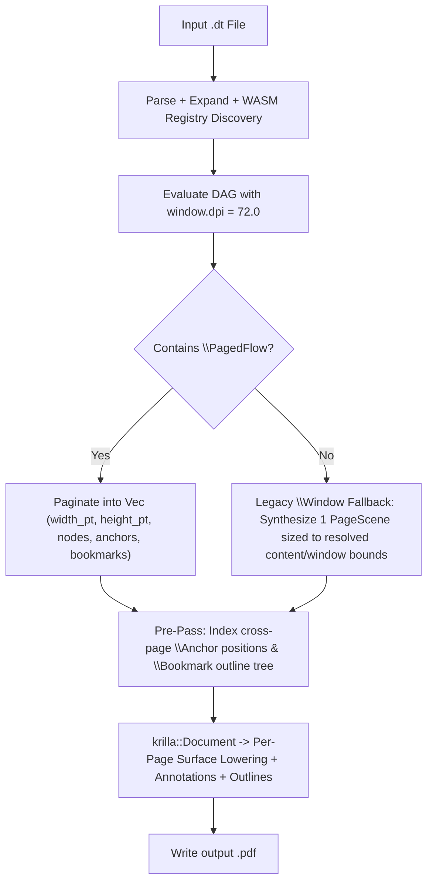

# DirectedType Design Document: Vector PDF Backend (`krilla`) & `dt2pdf` CLI

- **Status:** Proposed Architecture
- **Date:** November 2026
- **Target Area:** [`Cargo.toml`](file:///Users/hoefel/dev/directedtype/Cargo.toml), [`src/render/color.rs`](file:///Users/hoefel/dev/directedtype/src/render/color.rs), [`src/compiler/graph.rs`](file:///Users/hoefel/dev/directedtype/src/compiler/graph.rs), [`src/compiler/layout.rs`](file:///Users/hoefel/dev/directedtype/src/compiler/layout.rs), [`src/compiler/text.rs`](file:///Users/hoefel/dev/directedtype/src/compiler/text.rs), [`src/render/scene.rs`](file:///Users/hoefel/dev/directedtype/src/render/scene.rs), and new modules `src/pdf/` (`src/render/pdf.rs`) + `src/bin/dt2pdf.rs`
- **Related Specifications:** [`text_engine_and_knuth_plass.md`](file:///Users/hoefel/dev/directedtype/docs/designs/pages/text_engine_and_knuth_plass.md), [`hypertext_links.md`](file:///Users/hoefel/dev/directedtype/docs/designs/hypertext_links.md), [`anchors_and_internal_navigation.md`](file:///Users/hoefel/dev/directedtype/docs/designs/anchors_and_internal_navigation.md)

---

## Executive Summary & Locked Architectural Contracts

DirectedType compiles declarative algebraic layouts into resolved paint primitives (`\Rect`, `\Line`, `\Text`, `\Clip`, `\Link`, `\Anchor`) via a single-pass topological DAG. While [`src/render/scene.rs`](file:///Users/hoefel/dev/directedtype/src/render/scene.rs) and [`src/render/headless.rs`](file:///Users/hoefel/dev/directedtype/src/render/headless.rs) lower layouts into a GPU-rasterized `vello::Scene`, print and multi-page document export require a **pure-vector PDF backend** with searchable Unicode text, font subsetting, clickable cross-page hyperlinks, and zero GPU runtime requirement.

This document specifies the V1 PDF backend built around four locked architectural contracts:

1. **Core PDF Crate (`krilla`):** Use **`krilla`** (built atop `pdf-writer` and `skrifa`) for vector PDF generation, completely decoupled from `vello` GPU rasterization while sharing Parley/`skrifa` font binaries and handles.
2. **Standalone CLI Binary (`dt2pdf`) & Interactive Viewer Non-Goal:** Deliver PDF export through a dedicated CLI binary at `src/bin/dt2pdf.rs` supporting both paginated `\PagedFlow` documents (`Vec<PageScene>`) and a 1-page fallback mode for legacy `\Window`-based `.dt` files. The interactive [`src/bin/viewer.rs`](file:///Users/hoefel/dev/directedtype/src/bin/viewer.rs) application is explicitly **not** modified to display paginated documents.
3. **Single-Engine Typographic Parity:** Text shaping and line breaking happen during Phase 2 DAG evaluation (via Parley today, or `ShapedParagraph` IR per [`text_engine_and_knuth_plass.md`](file:///Users/hoefel/dev/directedtype/docs/designs/pages/text_engine_and_knuth_plass.md)), never re-laid-out differently at PDF export time. `1pt` maps `1:1` to PDF points when `window.dpi = 72.0`.
4. **Transparency (`opacity: 0.0`) vs. Omission:** In V1, node `opacity: 0.0` (and `#00000000` color on `\Text`) still emits transparent PDF operators via `krilla` graphics states rather than omitting the element, preserving intentionally authored invisible searchable text (e.g., OCR overlays or accessibility probes). Structural omission of fully transparent nodes is deferred to a post-V1 optimization pass.

---

## 1. Crate Selection & Dependency Analysis

### 1.1 PDF Library Evaluation (`krilla` vs. `printpdf`, `lopdf`, `pdf`)

| Evaluation Criterion | **`krilla` (+ `pdf-writer` + `skrifa`)** | `printpdf` | `lopdf` | `pdf` |
| :--- | :--- | :--- | :--- | :--- |
| **Abstraction Layer** | High-level 2D vector `Surface`, `PathBuilder`, graphics state stack, annotations, outlines, built atop `pdf-writer` | Mid-level document/layer API built atop `lopdf` | Low-level raw PDF object/dictionary/stream tree | Low-level PDF parser & object serializer |
| **`/ToUnicode` CMap Correctness** | Automatic CIDFont Type 0/2 + `/ToUnicode` CMap generation from `KrillaGlyph::text_range` clusters; handles ligatures, combining marks, and multi-byte UTF-8 cleanly | Exposes manual `cmap` serialization; historically brittle for shaped complex scripts and multi-glyph ligatures | None (caller must hand-author `/ToUnicode` CMap streams and `/W` width arrays) | None |
| **OpenType / CFF Subsetting** | Built-in TrueType (`glyf`) and OpenType CFF/CFF2 subsetting via `skrifa` + `subsetter`, matching [`Cargo.toml`](file:///Users/hoefel/dev/directedtype/Cargo.toml#L29) (`skrifa = "0.44.0"`) | Auto-subsetting added in recent versions, coupled to `lopdf` font dicts | None | None |
| **Graphics States & `/SMask`** | Symmetric `push_clip_path`, `push_opacity`, `push_mask` (`MaskType::Alpha` / `Luminosity`), automatic `/ExtGState` deduplication | Limited soft-mask ergonomics; manual `ExtGState` wiring for complex masks | Manual content-stream opcodes (`q`/`Q`/`gs`/`W`/`n`) | Manual raw stream construction |
| **Annotations & Outlines** | First-class `LinkAnnotation` (`Quadrilateral` / `Rect`), `Action::Link(LinkAction)` (URI), `XyzDestination`, and `Outline` / `OutlineNode` | Basic link annotations; sparse outline/quad-point ergonomics | Manual `/Annots` and `/Outlines` dictionary graphs | Raw dictionary construction |
| **PDF/A & PDF/UA Readiness** | Native `krilla::tagging` (`TagTree`, `StructParent`) and `Validator` / `Configuration` profiles (PDF 1.7, PDF 2.0, PDF/UA-1, PDF/A) | No built-in PDF/UA structure tree validator | Manual `/StructTreeRoot` construction | None |

**Decision:** Select **`krilla`** (with `pdf-writer` and `skrifa` already aligned with our typography stack). Its top-down `Surface` API, cluster-indexed `KrillaGlyph` pipeline, `Mask` `/SMask` support, `LinkAnnotation` / `XyzDestination` / `Outline` primitives, and `krilla::tagging` foundation eliminate every low-level PDF failure mode while keeping our renderer concise.

### 1.2 Decoupling `vello` from the PDF Pipeline

Inspecting [`Cargo.toml`](file:///Users/hoefel/dev/directedtype/Cargo.toml#L20-L33) and [`src/render/color.rs`](file:///Users/hoefel/dev/directedtype/src/render/color.rs#L1) shows two existing couplings to `vello`:

1. [`Cargo.toml`](file:///Users/hoefel/dev/directedtype/Cargo.toml#L23-L33) declares `vello = "0.10.0"`, `winit = "0.30.13"`, `objc2 = "0.5.2"`, `raw-window-handle = "0.6.2"`, and `pollster = "1.0.1"` as unconditional dependencies.
2. [`src/render/color.rs`](file:///Users/hoefel/dev/directedtype/src/render/color.rs#L1-L71) imports `vello::peniko::Color` directly in `parse_color` and `color_to_rgba8`.

To ensure `dt2pdf` builds and runs on headless CI runners and servers without GPU drivers, WGPU, or windowing libraries:

- **Feature-Gate Renderers in `Cargo.toml`:**

```toml
[features]
default = ["vello-renderer", "pdf"]
vello-renderer = [
    "dep:vello",
    "dep:winit",
    "dep:objc2",
    "dep:raw-window-handle",
    "dep:pollster",
]
pdf = ["dep:krilla"]

[dependencies]
# Core compiler & text shaping (always enabled)
parley = "0.11.1"
skrifa = "0.44.0"
serde = { version = "1.0.229", features = ["derive"] }
serde_json = "1.0.154"
thiserror = "2.0"
wasmi = "2.0.0"
logos = "0.14"

# Optional PDF backend
krilla = { version = "0.8", optional = true }

# Optional Vello GPU / interactive window stack
vello = { version = "0.10.0", optional = true }
winit = { version = "0.30.13", optional = true }
objc2 = { version = "0.5.2", optional = true }
raw-window-handle = { version = "0.6.2", optional = true }
pollster = { version = "1.0.1", optional = true }
```

- **Renderer-Neutral Color Parsing:** Refactor `parse_color` in [`src/render/color.rs`](file:///Users/hoefel/dev/directedtype/src/render/color.rs#L4-L71) to return a lightweight `Rgba8 { pub r: u8, pub g: u8, pub b: u8, pub a: u8 }` struct (or `[u8; 4]` with a `parse_color_rgba8` core), with `#[cfg(feature = "vello-renderer")]` conversion to `vello::peniko::Color` and `#[cfg(feature = "pdf")]` conversion to `(krilla::color::rgb::Color, krilla::num::NormalizedF32)`.
- **Gate Vello-Only Binaries & Modules:** Add `required-features = ["vello-renderer"]` to `viewer`, `docgen`, and `vello_testbed` (or keep `default` enabling both), while `dt2pdf` sets `required-features = ["pdf"]`. A minimal build `cargo build --no-default-features --features pdf --bin dt2pdf` links zero GPU crates while sharing the exact same `parley`, `skrifa`, and `fontique` font collection.

---

## 2. CLI Binary & Module Architecture

### 2.1 Crate Module Structure

```text
src/
├── bin/
│   ├── docgen.rs          # Existing Markdown/PNG compiler (unchanged)
│   ├── viewer.rs          # Existing Vello interactive viewer (explicitly untouched)
│   └── dt2pdf.rs          # NEW: Standalone CLI compiler (.dt -> .pdf)
├── pdf/                   # NEW (behind #[cfg(feature = "pdf")], re-exported at src/render/pdf.rs)
│   ├── mod.rs             # PdfOptions, PdfExportError, compile_and_render_pdf, render_pages_to_pdf
│   ├── lower.rs           # PageScene / ResolvedLayout painter's-order traversal, Rect, Line, Clip, opacity
│   ├── text.rs            # Font cache, Parley/ShapedParagraph -> KrillaGlyph runs, span bg, underlines
│   ├── shadow.rs          # Analytical 1D separable Gaussian erf soft-mask (/SMask) generator
│   ├── links.rs           # Disjoint fragment LinkAnnotation emission + cross-page Anchor resolution
│   └── outline.rs         # Document outline (bookmarks) builder
└── render/
    ├── mod.rs             # Conditionally exposes vello submodules + `#[cfg(feature = "pdf")] pub use crate::pdf;`
    ├── color.rs           # Renderer-neutral Rgba8 color parser
    └── scene.rs           # Vello GPU scene builder (#[cfg(feature = "vello-renderer")])
```

Placing the implementation under `src/pdf/` (and re-exporting it as `directedtype::render::pdf` when `feature = "pdf"` is active, matching the path referenced in [`text_engine_and_knuth_plass.md`](file:///Users/hoefel/dev/directedtype/docs/designs/pages/text_engine_and_knuth_plass.md#L5)) keeps [`src/render/mod.rs`](file:///Users/hoefel/dev/directedtype/src/render/mod.rs) cleanly modularized so `dt2pdf` never drags in [`src/render/headless.rs`](file:///Users/hoefel/dev/directedtype/src/render/headless.rs) or [`src/render/viewer.rs`](file:///Users/hoefel/dev/directedtype/src/render/viewer.rs).

### 2.2 `dt2pdf` CLI Interface

```text
dt2pdf <input.dt> [-o <output.pdf>] [--pdf-version 1.7|2.0] [--compressed]
```

| Flag / Argument | Default | Behavior |
| :--- | :--- | :--- |
| `<input.dt>` | Required | Input DirectedType source file. Missing file or syntax/DAG error prints diagnostic and exits with code `1`. |
| `-o, --output <PATH>` | `<input_stem>.pdf` | Destination PDF path (defaults to `input.with_extension("pdf")`). |
| `--pdf-version <1.7\|2.0>` | `1.7` | Maps to `krilla::configure::PdfVersion::Pdf17` or `PdfVersion::Pdf20` in `SerializeSettings::configuration`. |
| `--compressed` | `true` (opt-in flag accepted cleanly; `--uncompressed` / debug builds may disable) | Enables FlateDecode stream & object-stream compression for compact output. Explicitly setting `--compressed` guarantees compressed streams even when `CARGO_PROFILE` or test defaults vary. |
| `--width <PT>`, `--height <PT>` | Auto / `800 x 600` | Optional fallback viewport bounds when compiling a legacy non-paginated `\Window` `.dt` file. |
| `--deterministic` | `false` | Pins metadata timestamps and reproducible font-subsetting settings for golden tests (Section 6). |
| `-h, --help` | — | Prints CLI usage and exits `0`. |

An alias `dt2pdf = "run --bin dt2pdf --"` should be added alongside `viewer` and `docgen` in [`.cargo/config.toml`](file:///Users/hoefel/dev/directedtype/.cargo/config.toml#L4-L5).

### 2.3 Compilation Pipeline: Paginated `\PagedFlow` vs. Single-Page `\Window` Fallback

Mirroring the discovery and compilation flow in [`src/bin/viewer.rs`](file:///Users/hoefel/dev/directedtype/src/bin/viewer.rs#L78-L108):

1. Call `directedtype::compiler::text::prewarm_font_context()` ([`src/compiler/text.rs`](file:///Users/hoefel/dev/directedtype/src/compiler/text.rs#L12)) while parsing the `.dt` file with `parse_document_with_file`.
2. Initialize `FsResolver` and `ComponentRegistry::standard()`, running `auto_discover_wasm` and `auto_discover_wasm_for_document`.
3. Compile the DAG with **`window.dpi = 72.0`** (unless explicitly overridden by `\Window(dpi: ...)` in source; see Section 3.1). Currently [`build_variable_graph_with_window`](file:///Users/hoefel/dev/directedtype/src/compiler/graph.rs#L290-L293) hardcodes `window.dpi = 96.0`; we add `build_variable_graph_with_window_and_dpi` / `CompiledDocument::compile_with_options(..., WindowOptions { width, height, dpi: 72.0 })` so `dt2pdf` evaluates `pt` units natively at 72 DPI without changing `viewer`'s 96 DPI screen default.
4. Dispatch into one of two output pipelines:



- **Mode A — Paginated Documents (`\PagedFlow`):** Consumes `pages: Vec<PageScene>` produced by the pagination pass. Each `PageScene` owns its page dimensions `(width, height)` in points, the ordered slice of primitives belonging to that page, page-relative coordinates, and any `\Text` line slices (`start_line..end_line`) split across page breaks.
- **Mode B — Single-Page `\Window` Fallback (Legacy `.dt` Files):** For existing `.dt` documents (such as [`examples/link_demo.dt`](file:///Users/hoefel/dev/directedtype/examples/link_demo.dt) or [`examples/text_flow_demo.dt`](file:///Users/hoefel/dev/directedtype/examples/text_flow_demo.dt)) that do not instantiate `\PagedFlow`:
  - Evaluate the document with initial viewport `(width, height)` from CLI flags or default `800pt × 600pt`.
  - Compute the 1-page MediaBox size from the maximum visual extents across `layout.nodes` (mirroring the extent scan in [`src/render/scene.rs`](file:///Users/hoefel/dev/directedtype/src/render/scene.rs#L323-L334)):
    - `page_w = cli_width.unwrap_or_else(|| content_max_x.max(window_width))`
    - `page_h = cli_height.unwrap_or_else(|| content_max_y.max(window_height))`
  - Wrap the entire `ResolvedLayout` into a single `PageScene { page_index: 0, width: page_w, height: page_h, ... }` and render a 1-page PDF. This ensures tall single-scroll demos export completely onto one canvas without arbitrary clipping at `600pt`.

### 2.4 Explicit Non-Goal: `viewer` Isolation

[`src/bin/viewer.rs`](file:///Users/hoefel/dev/directedtype/src/bin/viewer.rs) and [`src/render/viewer.rs`](file:///Users/hoefel/dev/directedtype/src/render/viewer.rs) remain strictly dedicated to interactive single-viewport GPU rendering with `vello` and `winit`. Neither `viewer` nor `docgen` (`src/bin/docgen.rs`) gains page-turning UI, print preview chrome, or PDF export flags in V1.

---

## 3. Coordinate Systems, MediaBox & Transforms

### 3.1 Units & `window.dpi = 72.0`

In [`src/compiler/eval.rs`](file:///Users/hoefel/dev/directedtype/src/compiler/eval.rs#L344-L357):
- `DistanceUnit::Px` evaluates directly to `Value::Distance(d)` (`1px -> 1.0`).
- `DistanceUnit::Pt` evaluates to `Value::Distance(d * (dpi / 72.0))`, reading `VarId::new(NodeId::WINDOW, Symbol::DPI)`.

When `dt2pdf` seeds `window.dpi = 72.0`:
- `1pt == 1.0` in `ResolvedNode.rect` and `ResolvedLayout` values, matching ISO 32000-1 PDF user space directly (`1 user unit = 1/72 inch`).
- Unqualified numeric distances and `px` values map `1:1` to PDF points (`1.0`).
- **Explicit `\Window(dpi: ...)` Override:** Because `\Window` allows `dpi` in [`ALLOWED_WINDOW_PORTS`](file:///Users/hoefel/dev/directedtype/src/compiler/expand/builtins/window.rs#L9), if a legacy `.dt` file explicitly sets `\Window(dpi: D)` (for example `dpi: 96.0`), `dt2pdf` applies a uniform root surface transform `Transform::from_scale(72.0 / D, 72.0 / D)` and scales `PageSettings` and annotation coordinates by `72.0 / D`. That guarantees physical dimensions (`12pt`, `612pt`) always remain true to physical inches in the output PDF.

### 3.2 MediaBox vs. `krilla::page::Page` Top-Down Coordinates

Raw PDF `/MediaBox [0 0 W H]` defines a bottom-up Cartesian space with `(0, 0)` at the **bottom-left** corner and $+y$ pointing upward, whereas DirectedType (`ResolvedNode.rect` in [`src/compiler/layout.rs`](file:///Users/hoefel/dev/directedtype/src/compiler/layout.rs#L15-L20)) uses a **top-down** `(0, 0)` origin at top-left with $+y$ pointing downward.

`krilla::page::Page` (started via `document.start_page_with(PageSettings::from_wh(w, h))`) **natively adopts a top-down `(0, 0)` coordinate space**:
- Internally, `krilla` configures the PDF `/MediaBox [0 0 w h]` and emits the page-level Y-inversion CTM (`1 0 0 -1 0 h cm`) onto the PDF content stream.
- All `krilla::surface::Surface` drawing APIs (`PathBuilder`, `draw_glyphs`, `draw_image`, `push_clip_path`, `push_mask`), as well as `LinkAnnotation` bounds (`Rect` / `Quadrilateral`) and `XyzDestination` points, accept **top-down `(x, y)` coordinates** directly in `[0..w, 0..h]`.

**Critical Invariant:** Do **not** apply a second `page_height - y` flip in DirectedType's lowering code. Passing `ResolvedNode.rect` / `PageScene` coordinates directly into `krilla` avoids double-inversion bugs while keeping coordinate math identical between `scene.rs` and `pdf/lower.rs`.

### 3.3 Per-Page Dimensions & Paper Background

- Every `PageScene` calls `document.start_page_with(PageSettings::from_wh(page.width as f32, page.height as f32))`. Mixed page geometries (e.g., US Letter `612pt × 792pt` portrait followed by `792pt × 612pt` landscape diagrams) are natively supported in a single PDF.
- **No Implicit Backdrop Fill:** Unlike [`src/bin/viewer.rs`](file:///Users/hoefel/dev/directedtype/src/bin/viewer.rs#L121-L124) (which fills `#f8fafc` via `SceneOptions::background`), PDF pages emit **no background fill rectangle** unless explicitly authored via a page-level background color or root `\Rect`. Paper-white remains transparent for clean printing and composition.

---

## 4. Scene-to-PDF Lowering Table & Primitive Specifications

Primitives are traversed in **Painter's Algorithm order** (`layout.render_order()` in [`src/compiler/layout.rs`](file:///Users/hoefel/dev/directedtype/src/compiler/layout.rs#L405-L415): ascending `z`, tie-broken by AST declaration index), mirroring [`src/render/scene.rs`](file:///Users/hoefel/dev/directedtype/src/render/scene.rs#L347).

| DirectedType Primitive / Property | Resolved Data Source | `krilla` PDF Target | Fidelity & Edge-Case Rules |
| :--- | :--- | :--- | :--- |
| **`\Text` & `\Span`** | `node.text_content` / `properties["text"]`, `node.text_spans`, `node.inline_boxes`, Parley / `ShapedParagraph` | `surface.draw_glyphs(origin, &krilla_glyphs, font, text, size, false)` | Never outlines glyphs; emits `/ToUnicode` CMap via `KrillaGlyph::text_range`. Respects `TextStart` `y_offset` and per-span `baseline_shift`. |
| **`\Span` `bg` highlight** | `current_bg` -> `bg` -> `span.style.bg_color`, `child_node.fragments` | Filled rounded `Path` (`radius: 4.0`, horizontal pad `±2.0`) | Painted *before* glyphs, matching [`scene.rs`](file:///Users/hoefel/dev/directedtype/src/render/scene.rs#L970-L1004). |
| **`\Span` `underline`** | `glyph_run.style().underline` / `current_underline` | Filled `Rect` path `[min_gx, gy + 2.0, max_gx, gy + 3.2]` | Painted *after* glyphs in active run color, matching [`scene.rs`](file:///Users/hoefel/dev/directedtype/src/render/scene.rs#L1035-L1065). |
| **`\Rect` fill** | `node.rect`, `properties["color"]`, `extract_corner_radii` | `PathBuilder` rect or cubic-Bézier rounded rect + `surface.set_fill(...)` | Skipped when `color.a == 0` (e.g. `#00000000`) unless node `opacity` forces transparent emission. |
| **`\Rect` border** | `border_width > 0.0`, `border_color`, `extract_corner_radii` | `surface.set_stroke(Some(Stroke { width, .. }))` on same `(x0, y0, x1, y1)` path | **Center-aligned** stroke painted after fill, matching [`scene.rs`](file:///Users/hoefel/dev/directedtype/src/render/scene.rs#L630-L637). |
| **`\Rect` + `\Shadow`** | `shadow_color`, `shadow_offset_x/y`, `shadow_blur`, `shadow_spread` | Hard vector `RoundedRect` if `blur == 0`; else analytical `erf` `/SMask` (`MaskType::Luminosity`) + solid fill rect | Painted *before* `\Rect` fill; avoids high-DPI full-card rasterization. |
| **`\Line`** | `x1, y1, x2, y2`, `thickness`, `color`, `cap` (`LineCap`) | `PathBuilder::move_to`/`line_to` + `Stroke { line_cap, width }` | Matches `Butt`, `Round`, `Square` caps from [`line.rs`](file:///Users/hoefel/dev/directedtype/src/compiler/expand/builtins/line.rs#L50-L58). |
| **`\Clip`** | `get_clip_chain(node.clip)`, `box` bounds + radii, `scroll_x/y` | `surface.push_clip_path(&path, FillRule::NonZero)` (+ optional `push_transform`) ... `surface.pop()` | Stack-diffed by `common_len` exactly like [`scene.rs`](file:///Users/hoefel/dev/directedtype/src/render/scene.rs#L374-L390). |
| **`opacity` port** | `node.properties.get("opacity")` (`0.0..=1.0`) | `surface.push_opacity(NormalizedF32)` ... `surface.pop()` | **`opacity: 0.0` still emits content transparently in V1** (no node omission). |
| **`\Link` / `\Anchor`** | `node.fragments`, `properties["url"]`, `ScopeTree` | `page.add_annotation(LinkAnnotation::...)` + `XyzDestination` | Emits disjoint clickable fragments; inline descendants skipped for painting remain visited for annotations. |

---

### 4.1 `\Text`, Inline `\Span`s, & `/ToUnicode` Glyph Emission

#### A. Node Selection & `y_offset` Alignment
Following [`src/render/scene.rs`](file:///Users/hoefel/dev/directedtype/src/render/scene.rs#L354-L372) and [`src/render/scene.rs`](file:///Users/hoefel/dev/directedtype/src/render/scene.rs#L707-L730):
- Skip paint emission for inline descendants nested inside a `\Text` node (unless separated by an `\InlineBox` boundary). Note that inline `\Link` and `\Anchor` descendants are still processed in the annotation/destination pass (Section 5).
- Resolve `active_text` from dynamic `properties["text"]` or static `node.text_content`.
- Compute `y_offset` from `TextBounds.start_at` (`Capital`, `Ascender`, `EmTop`, or `LineHeight`) identically to [`text_y_offset`](file:///Users/hoefel/dev/directedtype/src/compiler/text.rs#L64-L87) and [`scene.rs`](file:///Users/hoefel/dev/directedtype/src/render/scene.rs#L961-L967), translating the text layout origin to `(node.rect.x, node.rect.y + y_offset)`.

#### B. Span Background Highlights (`bg` / `current_bg`)
Painted **before** any glyph runs, matching [`src/render/scene.rs`](file:///Users/hoefel/dev/directedtype/src/render/scene.rs#L970-L1004):
- For each `TextSpan` carrying a `child_id`, resolve `current_bg` -> `bg` -> `span.style.bg_color`.
- If `bg_color.a > 0`, iterate `frag in &child_node.fragments` (note that `frag.x` and `frag.y` from [`project_inline_fragments`](file:///Users/hoefel/dev/directedtype/src/compiler/layout.rs#L1244-L1245) are already in absolute page coordinates including `y_offset`), construct a rounded rectangle `(frag.x - 2.0, frag.y, frag.width + 4.0, frag.height)` with uniform corner radius `4.0`, and fill via `surface.draw_path(...)`.

#### C. Direct Glyph Runs (`PositionedLayoutItem::GlyphRun` -> `KrillaGlyph`)
To preserve vector sharpness, font subsetting, and exact copy-paste Unicode semantics, **`\Text` never converts glyphs to path outlines** (`outlined = false` in `surface.draw_glyphs`).

1. **Shared Font Caching:** Parley's `run.font()` returns a `FontData` handle (`data: Blob<u8>`, `index: u32`) backed by the exact same font bytes that `skrifa::FontRef::from_index` already inspects in [`measure_font_metrics`](file:///Users/hoefel/dev/directedtype/src/compiler/text.rs#L443). Maintain a per-document `FontCache: HashMap<(*const u8, u32), krilla::text::Font>` (keyed by font data pointer/Arc identity + collection index) wrapping `krilla::text::Font::new(Data::from(font.data.clone()), font.index)`.
2. **Extracting Cluster & Glyph Offsets:**
   - Iterate `run.visual_clusters()` (from `parley::layout::Run`) rather than flattening straight to `positioned_glyphs()` alone:
     - Each `cluster` yields `cluster.text_range(): Range<usize>` (exact UTF-8 byte range in `active_text`) and `cluster.glyphs()`.
     - This preserves exact `N`-to-`M` cluster mappings (e.g., `f` + `i` -> single `fi` ligature with `text_range = i..i+2`, or decomposed diacritics `e` + `\u{0301}` -> 2 glyphs sharing `text_range`), guaranteeing accurate `/ToUnicode` CMaps and text selection highlights.
   - **Coordinate & Normalization Mapping (`Parley` -> `KrillaGlyph`):**
     - Parley's positioned glyphs provide scaled coordinates `(g.x, g.y, g.advance)` in points relative to the paragraph's `(0, 0)` origin (where `g.y` includes the line baseline and `g.x` accumulates prior glyph advances).
     - `KrillaGlyph` stores `font_size`-normalized advances and offsets (`advance / font_size`, `offset / font_size`), and `surface.draw_glyphs(run_origin, &glyphs, font, active_text, font_size, false)` scales them by `font_size` while tracking the PDF text matrix from `run_origin`:
       - Set `run_origin = Point::from_xy(node.rect.x as f32 + first_glyph_x, (node.rect.y + y_offset) as f32 + line_baseline + y_shift)`.
       - For each glyph in the run, compute delta relative to the expected cursor `(cursor_x, line_baseline + y_shift)`:
         - `x_offset = (g.x - cursor_x) / font_size`
         - `y_offset = -(g.y - (line_baseline + y_shift)) / font_size` *(negated if `KrillaGlyph::y_offset` is Y-up in font em space; verified via the golden diacritic/superscript test in Section 6)*
         - `x_advance = g.advance / font_size`
         - `cursor_x += g.advance`
         - `text_range = cluster.text_range()`
     - If `ShapedParagraph` IR ([`text_engine_and_knuth_plass.md`](file:///Users/hoefel/dev/directedtype/docs/designs/pages/text_engine_and_knuth_plass.md#L98-L126)) is adopted, `ShapedGlyphRun` replaces the Parley call directly and additionally exposes `PositionedGlyph::is_inserted_hyphen` so automatic hyphenation glyphs map cleanly in copy-paste reconstruction.
3. **Variable Fonts:** If `run.normalized_coords()` is non-empty, pass the normalized `skrifa::instance::NormalizedCoord` location to `KrillaGlyph::location` (or `Font::new_variable` / static instance) so variable weights (`weight: 600` on variable system fonts like SF Pro or Inter) render with matching stroke thickness rather than falling back to the default Regular axis.

#### D. Underlines
Matching [`src/render/scene.rs`](file:///Users/hoefel/dev/directedtype/src/render/scene.rs#L1035-L1065):
- When `glyph_run.style().underline.is_some()`, track `[min_gx, max_gx]` across the run's glyphs and `gy = g.y + y_shift`.
- Emit a filled rectangle `[origin_x + min_gx, origin_y + gy + 2.0, origin_x + max_gx, origin_y + gy + 3.2]` using the run's solid fill color and opacity. *(Post-V1 refinement: optionally read `underline_metrics` from `skrifa::FontRef::metrics` in tandem with `scene.rs` so Vello and PDF always stay aligned.)*

#### E. Node `opacity: 0.0` vs. Color Alpha (`#00000000`) on `\Text`
In DirectedType, `opacity` (`StaticType::Float`) is an accepted built-in port on `\Text`, `\Rect`, and `\Line` ([`src/compiler/expand/builtins/mod.rs`](file:///Users/hoefel/dev/directedtype/src/compiler/expand/builtins/mod.rs#L231)), distinct from color alpha (`color: #00000000`):

- **Transparent Text Color (`color: #00000000` / `transparent`):** Notice [`src/render/scene.rs`](file:///Users/hoefel/dev/directedtype/src/render/scene.rs#L1019-L1032) does **not** skip drawing `\Text` when `run_color` has alpha `0`. In PDF, `pdf/text.rs` sets `Fill { paint, opacity: NormalizedF32::ZERO, rule: FillRule::NonZero }` on the `Surface`, emitting a real `BT ... Tj ET` text object with `/ExtGState` (`ca = 0.0`) and full `/ToUnicode` mapping. The text is visually invisible yet 100% searchable and copy-pasteable (supporting invisible OCR layers over raster/diagram content).
- **Node `opacity` Port (`opacity: 0.0` on `\Text`, `\Rect`, `\Line`):** When `node.properties.get("opacity")` is present (`alpha = val.clamp(0.0, 1.0)`), V1 wraps the node's entire emission in `surface.push_opacity(NormalizedF32::new_clamped(alpha as f32))` ... `surface.pop()`, **without omitting the node** even when `alpha == 0.0`. Thus `\Text(opacity: 0.0) { "hidden index" }` remains searchable in V1; true structural omission of `opacity: 0.0` primitives (e.g., via an explicit `visible: false` or optimization flag) is left as a post-V1 roadmap item.

---

### 4.2 `\Rect`, Rounded Corners, Borders, & Transparent Fill

1. **Per-Corner Radii & Path Construction:**
   - Extract `(tl, tr, br, bl) = extract_corner_radii(&node.properties)` ([`src/compiler/layout.rs`](file:///Users/hoefel/dev/directedtype/src/compiler/layout.rs#L91-L130)).
   - Clamp radii to match `vello::kurbo::RoundedRect`: if any adjacent pair sums above the edge length (`tl + tr > width`, `tr + br > height`, `br + bl > width`, `bl + tl > height`), scale all four radii uniformly by `min(1.0, width / (tl + tr), width / (bl + br), height / (tl + bl), height / (tr + br))`.
   - When all radii are `0.0`, call `PathBuilder::push_rect(Rect::from_xywh(x, y, w, h))`.
   - When any radius `> 0.0`, build a closed `Path` with exact quarter-circle cubic Bézier segments using $\kappa = \frac{4(\sqrt{2}-1)}{3} \approx 0.55228475$ so rounded corners match `kurbo::RoundedRect` to sub-micron precision.
2. **Fill & `#00000000` Handling:**
   - Matching [`src/render/scene.rs`](file:///Users/hoefel/dev/directedtype/src/render/scene.rs#L603-L611): if `color` has alpha `> 0` (`color.a > 0`), emit `surface.set_fill(...)` + `surface.draw_path(&rect_path)`. When `color` is `#00000000` (`transparent`), **skip the fill** (`set_fill(None)`) unless an explicit node `opacity` wrapper requires emitting an isolated group—avoiding spurious invisible filled polygons behind stroked borders.
3. **Border / Stroke Alignment:**
   - In [`src/render/scene.rs`](file:///Users/hoefel/dev/directedtype/src/render/scene.rs#L630-L637), Vello strokes the exact `Rect`/`RoundedRect` `(x0, y0, x1, y1)` using `Stroke::new(stroke_width)` after drawing the fill. That is a **center-aligned** stroke straddling `± border_width / 2` around `(x0, y0, x1, y1)`.
   - PDF strokes (`krilla::paint::Stroke`) are also natively **center-aligned**. Setting `surface.set_fill(None)` and `surface.set_stroke(Some(Stroke { width: border_width as f32, paint, opacity, .. }))` on the **exact same `rect_path`** after the fill matches Vello rendering 1:1.

---

### 4.3 `\Line`

Verified against [`src/render/scene.rs`](file:///Users/hoefel/dev/directedtype/src/render/scene.rs#L642-L704) and [`src/compiler/expand/builtins/line.rs`](file:///Users/hoefel/dev/directedtype/src/compiler/expand/builtins/line.rs#L50-L97):
- Read `(x1, y1, x2, y2)` (falling back to `node.rect`), `thickness` (default `1.0`), `color` (default `#000000`), and `cap` (`LineCap::Butt | Round | Square`).
- Skip if `thickness <= 0.0` or (`color.a == 0` and no explicit node `opacity` wrapper).
- Construct `PathBuilder` (`move_to(x1, y1); line_to(x2, y2);`), set `Fill = None` and `Stroke { width: thickness as f32, line_cap, paint, opacity, .. }`, and call `surface.draw_path(&path)`.

---

### 4.4 `\Clip` Stack & Scrolled Containers

Verified against [`src/render/scene.rs`](file:///Users/hoefel/dev/directedtype/src/render/scene.rs#L282-L303) and [`src/render/scene.rs`](file:///Users/hoefel/dev/directedtype/src/render/scene.rs#L374-L497):
- Resolve `target_chain = get_clip_chain(node.clip, layout)` (root-to-leaf `Vec<NodeId>` walking `up` edges).
- Maintain an active `Vec<PdfClipEntry>` stack alongside painter's-order iteration. At each primitive:
  1. Compute `common_len` matching the longest shared prefix between active `clip_stack` and `target_chain`.
  2. For each popped `PdfClipEntry` above `common_len`, emit `surface.pop()` (popping transform first if scrolled, then `push_clip_path`).
  3. For each new `clip_id` in `target_chain[common_len..]`:
     - Look up `box_node_id = layout.get_value(clip_id, "box")?.as_node()?`, reading `(x, y, width, height)` and full per-corner `(tl, tr, br, bl) = extract_corner_radii(&box_node.properties)` (aligning with [`clip_chain_contains`](file:///Users/hoefel/dev/directedtype/src/compiler/layout.rs#L544-L547)).
     - Build `clip_path` (rect or rounded rect) and call `surface.push_clip_path(&clip_path, FillRule::NonZero)`.
     - Read `(scroll_x, scroll_y)` from `clip_id`; if non-zero (e.g., a legacy `\ScrollView` in `\Window` fallback mode), also push `surface.push_transform(&Transform::from_translate(-scroll_x as f32, -scroll_y as f32))` and mark `has_scroll_transform = true` so `pop()` balances cleanly.
- Drain all remaining `clip_stack` entries at the end of the page before `surface.finish()`.

---

### 4.5 `\Shadow` on `\Rect` via Analytical Gaussian `/SMask`

In [`src/render/scene.rs`](file:///Users/hoefel/dev/directedtype/src/render/scene.rs#L538-L601), a `\Rect` with `shadow: \Shadow(offset_x, offset_y, blur, spread, color)` computes:
- Shadow bounds: `sx0 = x0 + dx - spread`, `sy0 = y0 + dy - spread`, `sx1 = x1 + dx + spread`, `sy1 = y1 + dy + spread`
- Corner radius: `shadow_radii = (tl + spread, tr + spread, br + spread, bl + spread)` clamped to `[0, min(sw, sh) / 2]` *(extending `scene.rs:568-569` uniformly to per-corner radii)*
- Standard deviation: $\sigma = \max(\text{blur} \times 0.5, 0.0)$

Because PDF 1.7/2.0 provides no native Gaussian blur operator, lowering `\Shadow` splits cleanly into two cases:

1. **Zero-Blur Drop Shadow (`std_dev == 0.0`):** Emit a pure vector `Rect` / `RoundedRect` filled with `shadow_color` directly behind the `\Rect` fill. Zero rasterization.
2. **Blurred Drop Shadow (`std_dev > 0.0`) — Analytical Separable `erf` Soft-Mask (`/SMask`):**
   - **Why not high-DPI rasterization?** Rasterizing a full blurred card or page region at 300–600 DPI produces multi-megabyte bitmap bloat and blurs vector text or borders if merged. Conversely, a 2D Gaussian blur is infinitely smooth ($C^\infty$) and band-limited by $\sigma$.
   - **Analytical Mask Domain:** Pad the shadow bounds by $P = 3\sigma$ (where $\operatorname{erfc}(3/\sqrt{2}) / 2 \approx 0.0013 < 1/255$, i.e. zero visible truncation):
     $$\Omega = [sx_0 - P,\; sx_1 + P] \times [sy_0 - P,\; sy_1 + P]$$
   - **Compact Grid Resolution:** Sample on an analytical grid of step $h = \max(0.5,\; \min(2.0,\; \sigma / 3.0))$ points (capped at e.g. `256 × 256` pixels max). A typical `12pt` blur (`σ = 6pt`) needs only `step = 2.0pt`, meaning a `400pt × 200pt` card shadow mask is just `~218 × 118` grayscale bytes (~2–4 KB Flate-compressed)!
   - **Analytical Evaluation:**
     - When `shadow_radii` are all `0.0`, the 2D Gaussian convolution of a box is **exact in closed form** as a separable 1D product:
       $$A(x, y) = \frac{1}{4}\left[\operatorname{erf}\!\left(\frac{x - sx_0}{\sqrt{2}\sigma}\right) - \operatorname{erf}\!\left(\frac{x - sx_1}{\sqrt{2}\sigma}\right)\right] \cdot \left[\operatorname{erf}\!\left(\frac{y - sy_0}{\sqrt{2}\sigma}\right) - \operatorname{erf}\!\left(\frac{y - sy_1}{\sqrt{2}\sigma}\right)\right]$$
       requiring only `W + H` evaluations of `erf` (Abramowitz & Stegun 7.1.26, max error $< 1.5 \times 10^{-7}$), computed in microseconds.
     - When `shadow_radii > 0.0`, compute the analytical 1D horizontal `erf` integral on each scanline slice `y` across its rounded horizontal span $[x_L(y), x_R(y)]$ (using 1D Gauss-Hermite / midpoint quadrature over `y' ∈ [y - 3σ, y + 3σ]` at the coarse grid resolution, or analytical rounded-box SDF approximation matching Vello's `draw_blurred_rounded_rect`).
   - **PDF `/SMask` Emission via `krilla`:**
     1. Wrap the `u8` grayscale buffer (`round(A(x, y) * 255)`) into an interpolated `krilla::image::Image` (`interpolate = true` -> PDF `/Interpolate true`, using a 1-channel `DeviceGray` `CustomImage` implementation or `Image::from_png` fallback). Because `/Interpolate true` enables smooth hardware/viewer bilinear/bicubic upsampling, the shadow halo stays razor-smooth at 100% through 6400% zoom in macOS Preview, Adobe Acrobat, and Chrome PDFium.
     2. Build a `krilla::mask::Mask`:
        ```rust
        let mut sb = surface.stream_builder();
        let mut mask_surface = sb.surface();
        mask_surface.push_transform(&Transform::from_translate(ox, oy));
        mask_surface.draw_image(gray_mask_image, Size::from_wh(mask_w, mask_h).unwrap());
        mask_surface.pop();
        mask_surface.finish();
        let mask = Mask::new(sb.finish(), MaskType::Luminosity);
        ```
     3. Apply the mask on the page surface and paint a solid vector fill rectangle across $\Omega$ with `shadow_color`:
        ```rust
        surface.push_mask(mask);
        surface.set_fill(Some(Fill {
            paint: shadow_rgb.into(),
            opacity: shadow_alpha,
            rule: FillRule::NonZero,
        }));
        surface.set_stroke(None);
        surface.draw_path(&mask_bounds_rect_path);
        surface.pop();
        ```
   - **Cross-Viewer Consistency Note:** Using `MaskType::Luminosity` with a `DeviceGray` (`/ColorSpace /DeviceGray`) XObject image (`0 = transparent`, `255 = opaque`) + solid vector fill guarantees identical premultiplication and sRGB blending behavior across macOS Preview (Quartz), Adobe Acrobat, and Chrome PDFium—avoiding alpha-double-premultiplication quirks seen in some viewers with RGB PNG soft-masks.

---

### 4.6 Future Extension Hook: SVG & Vector Embedding (`krilla-svg`)

Because `krilla` shares its crate ecosystem with `krilla-svg`, adding an `\Svg(src: ...)` primitive or OpenType `SVG` color emoji/icon glyph support later requires no backend refactor:
- An embedded SVG tree (`usvg::Tree`) lowers directly onto the active `krilla::surface::Surface` at `(node.rect.x, node.rect.y)` inside the active `\Clip` stack.
- OpenType `SVG` tables inside fonts hook into `SerializeSettings::render_svg_glyph_fn` cleanly without changing the `\Text` glyph run loop.

---

## 5. Hyperlinks (`\Link`), Internal Destinations (`\Anchor`), & PDF Outlines

### 5.1 Two-Pass Cross-Page Anchor Indexing

Because a Table of Contents on Page 1 frequently links forward to an `\Anchor` on Page 15—while `krilla::Document::start_page_with` opens and finishes pages sequentially—PDF generation executes a fast **Pre-Pass** over `pages: &[PageScene]` before starting Page 0:

1. Walk every `page` (`page_idx = 0..pages.len()`) and record every node with `node.anchor_name.is_some()` (or `node.name == "Anchor"`) into:
   ```rust
   pub struct AnchorTarget {
       pub page_index: usize,
       pub x: f32,
       pub y: f32,
   }
   ```
   - For block-wrapping anchors (`\Anchor("intro") { \H1 { ... } }`), target `(node.rect.x, node.rect.y)`.
   - For empty inline bookmark anchors (`\Anchor("footnote-1")` inside `\Text`), target `(node.fragments[0].x, node.fragments[0].y)` if fragments are present (matching [`scroll_container_to_node`](file:///Users/hoefel/dev/directedtype/src/compiler/compiled.rs#L818-L822)), otherwise `(node.rect.x, node.rect.y)`.
   - Notice: unlike interactive scrolling, PDF `/XYZ` destinations jump cleanly even for clipped or non-scrolled pages, and coordinates are already page-local in `PageScene`.

### 5.2 External URI Links (`\Link(url: "https://...")`)

In [`src/compiler/layout.rs`](file:///Users/hoefel/dev/directedtype/src/compiler/layout.rs#L1402-L1451), `project_inline_fragments` already computes `node.fragments: Vec<Rect>` (one disjoint rectangle per wrapped line) and stores `properties["url"]` on `\Link` nodes (and standalone `\Link` primitives outside `\Text` carry `node.rect`).

For every node on `page` with a resolved `url` property not starting with `'#'`:
1. Collect candidate hitboxes: `&node.fragments` if non-empty, else `&[node.rect]`.
2. Intersect each hitbox `Rect` against the active `\Clip` bounding box (`clip_chain_rect`, shifted by `-scroll_x, -scroll_y` if applicable) and discard zero-area rectangles.
3. Convert each surviving fragment `Rect` into a `krilla::geom::Quadrilateral` (top-left, top-right, bottom-right, bottom-left in `krilla` top-down coordinates).
4. Emit `LinkAnnotation` on the current `Page` via `page.add_annotation(...)`:
   - **Recommended multi-fragment rule:** Emit `LinkAnnotation::new_with_quad_points(quads, Target::Action(Action::Link(LinkAction::new(uri))))` when targeting modern PDF 1.7/2.0 viewers (Acrobat, Chrome PDFium, macOS Preview), **or** emit one `LinkAnnotation` per fragment rect sharing the `LinkAction` if `--compat-fragment-links` / strict viewer compatibility requires avoiding union-`/Rect` overlap in naive PDF readers. In both cases, wrapped links across line breaks never create a false clickable box over unlinked middle lines.

### 5.3 Internal Cross-Page Links (`\Link(url: "#...")` -> `\Anchor`)

When `url` starts with `'#'` (e.g. `#inline-links`, `#sub/step1`, or `#/doc-left/intro`):
1. Resolve `(target_node_id, _scope_id)` via `layout.resolve_anchor(link_node.id, url)` ([`src/compiler/layout.rs`](file:///Users/hoefel/dev/directedtype/src/compiler/layout.rs#L391-L400) -> [`ScopeTree::resolve_anchor`](file:///Users/hoefel/dev/directedtype/src/compiler/scope.rs#L143-L167)).
2. Look up `target_node_id` in the Pre-Pass `AnchorTarget` map to retrieve `(target_page_index, target_x, target_y)`.
3. Attach `LinkAnnotation` using `Target::Destination(Destination::Xyz(XyzDestination::new(target_page_index, Point::from_xy(target_x, target_y))))` across the link's disjoint fragment rects.
4. **Dangling Anchor Handling:** If `resolve_anchor` returns `None` or the target node is not mapped to any rendered page, emit a diagnostic warning to `stderr` (or fail if `--strict-links` is passed) and skip emitting a broken annotation.

**Strict DirectedType Authoring Example (`.dt`):**

```dt
\use "components/VStackStretch.dt"
\use "components/Link.dt"

\env font = \Font(family: "Georgia", size: 11pt, line_height: 16pt);

\VStackStretch(width: 468pt, gap: 14pt) {
    \Text(font: \Font(size: 18pt, weight: 700), color: #0f172a) {
        Table of Contents
    }

    \Text {
        1. \Link(url: "#methods"){Experimental Methods}
    }

    \Text {
        For repository details see \Link(url: "https://directedtype.org"){directedtype.org}.
    }

    \Anchor("methods") {
        \Text(font: \Font(size: 15pt, weight: 700), color: #0f172a) {
            1. Experimental Methods
        }
    }
}
```

### 5.4 Document Outline / Sidebar Bookmarks

To populate the PDF viewer bookmark sidebar (`krilla::outline::Outline`):
- **Metadata Source:** Collect outline entries in document/page order from either:
  1. Dedicated `\Bookmark(title: String, level: Integer, target: ...)` nodes (or optional `outline_title` / `outline_level` properties on `\Anchor` / heading components in the pagination DOM), or
  2. Document-level metadata conventions resolved during the Pre-Pass: `(level: u32, title: String, page_index: usize, x: f32, y: f32)`.
- **Tree Construction:** Maintain a small level stack (`Vec<(u32, OutlineNode)>`) converting a flat heading stream into nested `OutlineNode::new(title, Destination::Xyz(XyzDestination::new(page_idx, Point::from_xy(x, y))))` trees. Skipped levels (e.g. `level 1` -> `level 3`) attach directly to the nearest open ancestor on the stack without panicking.
- Commit to the PDF via `document.set_outline(outline)` before `document.finish()`.

### 5.5 Future Tagged PDF (`PDF/UA`) Readiness via `krilla::tagging`

`krilla::tagging` allows a clean staged path to PDF/UA-1 accessibility without altering `dt2pdf`'s geometry lowering:
1. Map `\Text` / `\H1`..`\H6` / `\List` / `\Link` DOM semantics to `TagTree` nodes (`TagKind::P`, `TagKind::H1`..`H6`, `TagKind::L`/`LI`, `TagKind::Link`).
2. Group multi-fragment `LinkAnnotation`s under a single `TagKind::Link` structure element using `Identifier` (`/StructParent` & `/ParentTree`), so screen readers announce a wrapped multi-line link once.
3. Mark background `\Rect`s, `\Shadow` soft-masks, running headers/footers, and `\HDivider` rules as `ArtifactType::Pagination` or `ArtifactType::Layout` so assistive tools skip decorative shapes.

---

## 6. Determinism, Font Loading, & Regression Testing Strategy

### 6.1 Byte-Reproducible PDF Output

PDF files routinely embed wall-clock creation timestamps and random document IDs, making naïve binary comparisons fail. To guarantee byte-identical output for regression testing and reproducible builds:
- **`Metadata` Control:**
  - Read `SOURCE_DATE_EPOCH` if set, or use explicit `--deterministic` mode in tests.
  - When deterministic mode is active: pin `Metadata` fields (`creator: Some("DirectedType dt2pdf".into())`, `creation_date: None`, `title` from `\Window(title: ...)`), ensuring `krilla` emits deterministic object numbering, cross-reference streams, and subset font tags.
- **Deterministic Iteration:** All `HashMap`-backed property lookups that emit PDF state or font tables (`FontCache`, `AnchorTarget` indexing, `Span` ordering) must iterate in stable `NodeId` / `render_order()` sequence rather than arbitrary `HashMap` bucket order.

### 6.2 Hermetic Font Loading Across macOS & Linux CI

[`create_font_context`](file:///Users/hoefel/dev/directedtype/src/compiler/text.rs#L22-L28) currently initializes `parley::FontContext::new()`, scanning host OS font directories (producing different fallback fonts between macOS `Arial` / `Helvetica` and Linux `DejaVu Sans`).
- Add an optional font-directory override (`--font-dir <DIR>` + `--no-system-fonts` on `dt2pdf`, wired to `FontContext::from_source` / `collection.register_fonts`) and commit compact open-licensed test fonts (e.g., Inter / Noto Sans / JetBrains Mono subset under `tests/fixtures/fonts/`) for CI golden tests.
- Keep system font scanning as the default when running interactively via `dt2pdf input.dt`.

### 6.3 Three-Tier Regression Test Suite

| Test Tier | Tooling (`dev-dependencies` / CI) | Exact Assertions |
| :--- | :--- | :--- |
| **1. Structural PDF & Determinism Tests** | `hayro-syntax` or `lopdf` (`[dev-dependencies]` only; never shipped in `dt2pdf`) | - `pdf_bytes_run1 == pdf_bytes_run2` under `--deterministic`.<br>- Page count equals `pages.len()` (or `1` for `\Window` fallback).<br>- Exact `/MediaBox` `[0 0 W H]` per page.<br>- Presence of `/ToUnicode` CMap & font subsets (proves text is **not** outlined).<br>- Presence of `/SMask` luminosity soft-mask XObjects on `\Shadow` fixtures.<br>- Exact `/Link` annotation `/Rect` / `/QuadPoints`, `/URI` strings, internal `/XYZ` page + `(x, y)` coordinates, and `/Outlines` bookmark hierarchy. |
| **2. Text Extraction & Searchability Parity** | `pdftotext` (Poppler) or `hayro` text extractor | - Extracted Unicode matches authored source strings verbatim (including ligatures `fi`/`ffi`, em-dashes, accents, RTL runs).<br>- Both `\Text(color: #00000000)` and `\Text(opacity: 0.0)` extract full searchable text.<br>- Multi-line wrapped paragraphs and `\Span` boundaries preserve spaces and avoid spurious word joins. |
| **3. Visual Pixel Parity vs. Vello** | Pure-Rust `hayro` rasterizer (72/144 DPI) vs. [`HeadlessRenderer`](file:///Users/hoefel/dev/directedtype/src/render/headless.rs#L15) | - Render minimal canonical `.dt` scenes (`\Rect` radii + center-aligned borders, `\Line` caps, nested `\Clip`, `\Shadow` soft-mask falloff, `\Text` spans + `bg` + underlines) through both `dt2pdf` -> `hayro` and `HeadlessRenderer` at `72.0` DPI.<br>- Assert perceptual / RMSE pixel-diff within anti-aliasing tolerance, verifying `y_offset`, `KrillaGlyph` offset signs, corner radii, and shadow falloff match screen rendering. |

---

## 7. Phased Implementation Plan

| Phase | Deliverables | Key Files |
| :--- | :--- | :--- |
| **Phase 1: Decoupling & Scaffolding** | Refactor [`src/render/color.rs`](file:///Users/hoefel/dev/directedtype/src/render/color.rs) to `Rgba8`; add `vello-renderer` / `pdf` features in [`Cargo.toml`](file:///Users/hoefel/dev/directedtype/Cargo.toml); add `dpi` parameter to [`build_variable_graph_with_window`](file:///Users/hoefel/dev/directedtype/src/compiler/graph.rs#L254); create `src/pdf/mod.rs` and `src/bin/dt2pdf.rs`. | `Cargo.toml`, `src/render/color.rs`, `src/compiler/graph.rs`, `src/compiler/compiled.rs`, `src/pdf/`, `src/bin/dt2pdf.rs` |
| **Phase 2: Vector Primitives & Text** | Lower `\Rect` (per-corner radii, `#00000000` fill skip, center-aligned border), `\Line` (`LineCap`), `\Clip` stack, `opacity` group stack, and `\Text` (`KrillaGlyph` + `FontCache` + `bg` highlights + underlines). | `src/pdf/lower.rs`, `src/pdf/text.rs` |
| **Phase 3: Analytical `\Shadow` `/SMask`** | Implement separable 1D `erf` box/rounded-rect grayscale soft-mask generator with `/Interpolate true` (`MaskType::Luminosity`). | `src/pdf/shadow.rs` |
| **Phase 4: Links, Anchors, & Outlines** | Pre-pass `AnchorTarget` table, disjoint fragment `LinkAnnotation`s (URI + `XyzDestination`), and `Outline` tree builder; wire `\PagedFlow` `Vec<PageScene>` integration. | `src/pdf/links.rs`, `src/pdf/outline.rs` |
| **Phase 5: Determinism & CI Verification** | Wire `--deterministic`, `--font-dir` / `--no-system-fonts`, structural `hayro-syntax`/`lopdf` tests, `pdftotext` checks, and Vello vs. PDF parity tests. | `tests/pdf_*.rs`, `tests/fixtures/` |
