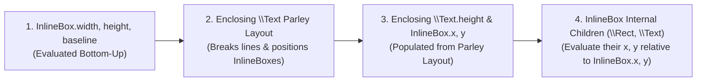

# DirectedType Design Document: Plain Text Contexts, Paragraph Flow, and Inline Components (`\Span` & `\InlineBox`)

- **Status:** Proposed
- **Date:** October 2026
- **Target Area:** Lexer & Parser (`src/token.rs`, `src/ast.rs`, `src/parser/`), Compiler & DAG Expander (`src/compiler/expand.rs`, `src/compiler/text.rs`, `src/compiler/eval.rs`), Scene Renderer (`src/render/scene.rs`)

---

## 1. Executive Summary & Motivation

DirectedType (`.dt`) models layout as a Directed Acyclic Graph (DAG) of port equations solved in a single topological pass. While this provides mathematical determinism for 2D spatial layout (`\VStack`, `\HStack`, `\Card`, `\Rect`), authoring multi-paragraph documents with rich inline typography currently requires excessive boilerplate and suffers from several parser/expander flaws:

1. **No Paragraph Coalescing in Containers**: In [`src/compiler/expand.rs`](file:///Users/hoefel/dev/directedtype/src/compiler/expand.rs), every `ContentItem::Text` chunk inside a container (such as `\VStack` or `\Card`) is wrapped into its own isolated `\Text` block. Placing an inline element like `\Link` in a sentence splits the sentence into three vertically stacked blocks unless the author manually wraps every paragraph in `\Text { ... }`.
2. **Loss of Paragraph Breaks (`\n\n`)**: In [`src/parser/cursor.rs`](file:///Users/hoefel/dev/directedtype/src/parser/cursor.rs), `normalize_whitespace` collapses all whitespace—including blank lines (`\n\n`)—into a single space `' '`.
3. **Inter-Tag Newline Whitespace Annihilation**: When two inline elements are separated by a newline and indentation (`\Link{First}\n    \Link{Second}`), `flush_text` discards the whitespace completely instead of treating a single newline as a space.
4. **Directive Interference with Boundary Trimming**: Placing `\let`, `\env`, or comments at the start of a `{ ... }` content slot prevents leading whitespace trimming on the following text.
5. **No Formal Distinction Between Block Components, Inline Boxes, and Wrappable Spans**: The compiler lacks a clear contract distinguishing components that break paragraphs (`\Component`), atomic inline boxes that sit on a text line (`\InlineBox`), and wrappable styled text ranges (`\Span`).

This document specifies a TeX-inspired text and inline flow architecture for DirectedType that allows authors to type natural multi-paragraph prose and inline markup directly inside containers while preserving DirectedType's strict single-pass DAG evaluation model.

---

## 2. Plain Text Parsing & Whitespace Rules

### 2.1 Contexts Supporting Plain Text

At the syntax level, blocks enclosed in `{ ... }` fall into two lexical modes:

| Context | Examples | Plain Text Allowed? |
| :--- | :--- | :---: |
| **Top-Level Document** | Root of a `.dt` file | **No** (declarations & root `\Elem`s only) |
| **Declaration Body (`SlotMode::ComponentDef`)** | `\Component Name(...) { ... }`<br>`\InlineBox Name(...) { ... }`<br>`\Span Name(...) { ... }`<br>`\Enum Name { ... }` | **No** (directives & element/children nodes only) |
| **Element Content Slot (`SlotMode::ContentSlot`)** | `\VStack { ... }`, `\Card { ... }`, `\Text { ... }`, `\Bold { ... }`, `\Kbd { ... }` | **Yes** |

### 2.2 Whitespace, Newlines, and Spacing Around Tags

Within an element content slot (`{ ... }`), plain text and whitespace follow five deterministic rules inspired by TeX:

1. **Block Boundary Trimming (Inside `{` and `}`)**:
   - Leading whitespace immediately following the opening `{` and trailing whitespace immediately preceding the closing `}` are treated as **structural formatting whitespace** and stripped.
   - Consequently, single-line and multi-line formatting produce identical text without introducing accidental leading or trailing spaces inside underlined or highlighted spans:
     ```dt
     \Link(url: "https://example.com"){Example}
     // is identical to:
     \Link(url: "https://example.com") {
         Example
     }
     ```
   - **Directive & Comment Transparency**: Non-visual directives (`\let`, `\alias`, `\env`, `\assert`) and comments (`// ...`, `/* ... */`) at the beginning or end of a `{ ... }` slot do **not** count as text items for boundary trimming. Any formatting whitespace between a leading directive/comment and the first character of text is trimmed.

2. **Explicit Spacing Outside Tags**:
   - Whitespace outside component tags is preserved as word spacing, while flush adjacency produces no space:
     - `Visit \Link(url: "a"){Google} today!` $\rightarrow$ `"Visit Google today!"`
     - `Visit \Link(url: "a"){Google}!` $\rightarrow$ `"Visit Google!"` (punctuation flush against tag)
     - `(\Link(url: "a"){Google})` $\rightarrow$ `"(Google)"`

3. **Single Newline (`\n`) = Single Space (`' '`)**:
   - Within a paragraph, any sequence of horizontal whitespace and at most **one** newline (`\n` or `\r\n`, plus following indentation) collapses to a single ASCII space `' '`.
   - This applies equally between two adjacent inline tags on consecutive lines:
     ```dt
     \Bold { First }
     \Italic { Second }
     ```
     produces `"First Second"`.
   - **Suppressing Space Across Lines with `//`**: Just as `%` at the end of a line in TeX joins lines without a space, ending a line with a `//` comment consumes the newline and following indentation without emitting a space:
     ```dt
     \Bold { Red }//
     \Italic { Blue }
     ```
     produces `"RedBlue"`.

4. **Double Newline / Blank Line (`\n\s*\n`) = Paragraph Break**:
   - Any whitespace sequence containing **two or more newlines** (one or more blank lines, with optional spaces/tabs on the blank line) emits an explicit `ContentItem::ParagraphBreak` in the AST.
   - Any trailing space before the paragraph break and leading space after the paragraph break are stripped.

5. **Escape Sequences in Content Text**:
   - `\\` $\rightarrow$ Literal backslash `\`
   - `\{` $\rightarrow$ Literal opening brace `{`
   - `\}` $\rightarrow$ Literal closing brace `}`
   - `\ ` (backslash followed by space) $\rightarrow$ Explicit space `' '` that is immune to `{ ... }` boundary trimming
   - `~` $\rightarrow$ Non-breaking space (`U+00A0`)

---

## 3. The Three Component Definition Types (`\Component`, `\InlineBox`, `\Span`)

To make paragraph breaking and inline layout unambiguous without fragile heuristics, DirectedType provides three distinct component declaration keywords. Each defines both the component's **outer role** when placed in a text flow and its **spatial contract** in the DAG:

| Declaration Keyword | Outer Role in Flow Container | Line-Breaking Behavior | Allowed Body Items | Spatial Contract in the DAG |
| :--- | :--- | :--- | :--- | :--- |
| **`\Component`** | **Block**: Closes any open paragraph; becomes a direct child of the container. | Occupies its own block in container layout. | Directives, `\Children`, any spatial/block primitives & components. | Standard 2D box (`x`, `y`, `width`, `height`, `left`, `top`, `right`, `bottom`). |
| **`\InlineBox`** | **Inline**: Stays inside the current paragraph. | **Atomic (unbreakable)**: Flows on a line like a single glyph; wraps to the next line as a whole unit. | Directives, `\Children`, any spatial/block primitives & components. | **2-way contract**: Exports intrinsic `width`, `height` (and optional `baseline`) *before* paragraph shaping; receives `x`, `y` from Parley *after* shaping. |
| **`\Span`** | **Inline**: Stays inside the current paragraph. | **Wrappable**: Text breaks across multiple lines into 1 or more line fragments. | **Directives & `\Children` only** (no components or primitives). | **No input `x`/`y`/`width`/`height`**: Supplies font/style/handlers to Parley; exposes read-only post-shaping `x`, `y`, `width`, `height`, `baseline`. |

> [!IMPORTANT]
> **Why `\Component` and `\InlineBox` Must Be Distinct**:
> Many block components—such as `\H1 { Chapter 1 }`, `\Button { Save }`, or `\Divider`—have intrinsic `width` and `height`. If the compiler inferred inline behavior merely from having intrinsic dimensions, a heading or button would be pulled inline into the following paragraph whenever the author omitted a blank line. Making `\InlineBox` explicit guarantees that `\Component` always acts as a block and `\InlineBox` always acts as an inline atom.

---

### 3.1 `\Span`: Wrappable Inline Text Ranges

`\Span` is strictly a **declaration keyword** (`\Span Name(...) { ... }`), never a primitive literal.

#### Syntax & Restrictions
- A `\Span` body may only contain port/environment/state directives (`\let`, `\alias`, `\state`, `\env`, `\assert`) and `\Children`.
- Placing any primitive (`\Rect`, `\Text`, `\Clip`) or component (`\Component`, `\InlineBox`, or another `\Span`) inside a `\Span` definition body is a compile-time error. Because Parley must be able to break a span's text across arbitrary line boundaries, a `\Span` cannot establish a local 2D coordinate system for child boxes.

#### The `\Span` Contract with the Text Engine
When a `\Span` instance appears inside a `\Text` paragraph (or nested inside another `\Span`), the text engine reads the following properties from the expanded `\Span` node:

| Property / Binding | Source on `\Span` | Type | Default (if omitted) | Description |
| :--- | :--- | :--- | :--- | :--- |
| **`font`** | Active `\env font` (or `font` port/alias) | `Font` | Inherited from enclosing `\Text` or `\Span` | Determines `family`, `size`, `weight`, `line_height`, and `italic` for the span's glyph range. |
| **`color`** | Optional port or `\alias color` | `Color` | Inherited from enclosing `\Text` or `\Span` | Foreground glyph brush color. |
| **`bg`** | Optional port or `\alias bg` | `Color` | `#00000000` (transparent) | Highlight background painted behind each line fragment of the span. |
| **`underline`** | Optional port or `\alias underline` | `Boolean` | Inherited (`false`) | Draws an underline across the span's glyph runs. |
| **`baseline_shift`** | Optional port or `\alias baseline_shift` | `Distance` | `0` | Vertical offset from the line's baseline (positive = upward/superscript, negative = downward/subscript). |
| **`cursor`** | Optional port or `\alias cursor` | `String` | Inherited (`"Default"`) | Mouse cursor icon when hovering over any of the span's line fragments (e.g. `"Pointer"`). |
| **`on_*`** | Optional event handler ports | `Handler` | `unset` | Interactive callbacks (`on_click`, `on_pointer_enter`, `on_pointer_leave`, `on_focus`, `on_blur`) hit-tested against the span's disjoint line fragments. |

#### Post-Shaping Output Ports on `\Span`
After Parley breaks the enclosing paragraph into lines, the layout engine computes the span's line fragments (`Vec<Rect>`) and populates read-only spatial output ports on the `\Span` node in the DAG:
- `x`, `y`, `width`, `height` (and `left`, `top`, `right`, `bottom`): Bounding box union of the span's line fragments (or zero-width caret position if empty).
- `baseline`: The Y-coordinate of the typographic baseline of the **first line** on which the span appears.

#### Manual `env font` Forwarding & the Derived `\Font` Overload
Custom spans that modify typography accept `env font: Font` and explicitly rebind `\env font` for their `\Children`. To make deriving a modified font concise without repeating `family`, `size`, `weight`, and `line_height`, `\Font` provides a constructor overload that accepts `env font: Font` as its base:

```dt
// Overload 1: Base Font constructor (requires `size`)
\Font(
    size: Distance,
    family: String = "",
    weight: Integer = 400,
    line_height: Distance = font_line_height(size, weight, family)
)

// Overload 2: Derived Font constructor (inherits from `env font` or explicit `font: self.font`)
\Font(
    env font: Font,
    family: String = font.family,
    size: Distance = font.size,
    weight: Integer = font.weight,
    line_height: Distance = font.line_height
)
```

Examples of standard `\Span` definitions:

```dt
// Bold.dt
\Span Bold(env font: Font) {
    \env font = \Font(font: self.font, weight: 700);
    \Children
}

// Code.dt
\Span Code(env font: Font) {
    \env font = \Font(font: self.font, family: "Courier New", size: 0.9em);
    \alias color = #be185d;
    \alias bg = #fdf2f8;
    \Children
}

// Sup.dt
\Span Sup(env font: Font) {
    \env font = \Font(font: self.font, size: 0.75em);
    \alias baseline_shift = self.font.size * 0.35;
    \Children
}

// Link.dt
\Span Link(
    url: String,
    env link_style: LinkStyle,
    env font: Font,
    view: ViewPort = window,
    cursor: String = "Pointer",
    on_click: Handler = self.click,
    on_focus: Handler = self.focus,
    on_blur: Handler = self.blur,
    on_pointer_enter: Handler = self.pointer_enter,
    on_pointer_leave: Handler = self.pointer_leave
) {
    \state focused: Boolean = false;
    \state hovered: Boolean = false;

    \alias color = focused ? link_style.focused_color : (hovered ? link_style.hover_color : link_style.color);
    \alias underline = focused ? link_style.focused_underline : (hovered ? link_style.hover_underline : link_style.underline);
    \alias bg = focused ? link_style.focused_bg : (hovered ? link_style.hover_bg : link_style.bg);

    \Children
}
```

---

### 3.2 `\InlineBox`: Atomic Inline 2D Components

An `\InlineBox` (such as a keyboard badge `\Kbd`, an inline `\Icon`, a status `\Pill`, or an inline equation box) is a full 2D spatial component that flows inline within a paragraph as an unbreakable unit.

#### Two-Way DAG Contract with Parley (`parley::InlineBox`)
Because DirectedType's dependency graph tracks individual ports (`VarId(NodeId, "port")`) rather than whole nodes, an `\InlineBox` participates in a cycle-free two-phase dataflow within the single topological pass:



1. **Bottom-Up Inputs to `\Text` (Evaluated *Before* Paragraph Shaping)**:
   - **`width: Distance`** *(Required port or `\alias`)*: Intrinsic width of the box. Must **not** depend on `x`, `y`, or `parent.width`.
   - **`height: Distance`** *(Required port or `\alias`)*: Intrinsic height of the box. Must **not** depend on `x`, `y`, or `parent.height`.
   - **`baseline: Distance`** *(Optional `\alias`, defaults to `y + height`)*: The Y-coordinate of the box's internal typographic baseline.
     - Note: To compute the baseline offset (`baseline - y`) *before* `y` is known, the compiler either extracts the offset from `baseline` (by evaluating `baseline` at `y = 0` or exposing `baseline_offset = baseline - y`) so Parley knows both the box's ascent above the baseline (`baseline - y`) and descent below the baseline (`height - (baseline - y)`).
2. **Top-Down Outputs from `\Text` (Populated *After* Paragraph Shaping)**:
   - **`x: Distance`** *(Implicit input port, default `parent.left` outside `\Text`)*: The resolved X-coordinate of the inline box on its shaped line.
   - **`y: Distance`** *(Implicit input port, default `parent.top` outside `\Text`)*: The resolved Y-coordinate of the inline box on its shaped line, positioned so that its `baseline` aligns with the text line's typographic baseline.

#### Example `\InlineBox` Definition
```dt
\InlineBox Kbd(
    env font: Font,
    x: Distance = parent.left,
    y: Distance = parent.top,
    pad_x: Distance = 6px,
    pad_y: Distance = 2px
) {
    \let kbd_font = \Font(font: self.font, family: "Courier New", size: 0.85em, weight: 600);
    \let label = \Text(x: x + pad_x, y: y + pad_y, font: kbd_font, color: #1e293b) {
        \Children
    };

    \alias width = label.width + 2 * pad_x;
    \alias height = label.height + 2 * pad_y;
    \alias baseline = label.baseline;

    \Rect(
        x: x,
        y: y,
        width: width,
        height: height,
        color: #f1f5f9,
        border_color: #cbd5e1,
        border_width: 1px,
        radius: 4px
    )
}
```
> [!TIP]
> **Using `\InlineBox` Outside of Text**: Because `x` and `y` on `\Kbd` default to `parent.left` and `parent.top`, `\Kbd` can also be placed directly inside a block container like `\HStack(gap: 8px) { \Kbd{Cmd} \Kbd{K} }` when not adjacent to text!

---

## 4. Inner Contexts & Automatic Paragraph Coalescing

How a component treats the content inside its `{ ... }` slot is determined completely by **where `\Children` is placed inside that component's definition**:

### 4.1 Single-Text Context (`\Text { \Children }`)
When a component places `\Children` inside a `\Text` primitive (or inside another component whose `\Children` is inside `\Text`), such as `\H1` or `\Button`:

```dt
\Component H1(env font: Font, x: Distance = parent.left, y: Distance = parent.top) {
    \let t = \Text(x: x, y: y, font: \Font(size: 32px, weight: 700)) { \Children };
    \alias width = t.width;
    \alias height = t.height;
}
```
- The `{ ... }` slot of `\H1` is a **Single-Text Inline Context**.
- Plain text, `\Span`s, and `\InlineBox`es inside `\H1 { ... }` flow directly into `t` (`\Text`).
- Placing a block `\Component` (e.g., `\H1 { \Card }`) or a blank-line paragraph break (`\H1 { First \n\n Second }`) inside `{ ... }` is a **compile-time error**.

### 4.2 Block Container Context (Bare `\Children(...)`)
When a component places `\Children(...)` directly in its structural body (outside of `\Text`), such as `\VStack`, `\HStack`, `\Card`, or `\ScrollView`:

```dt
\Component VStack(width: Distance, gap: Distance = 0, x: Distance = parent.left, y: Distance = parent.top) {
    \Children(x: left, y: prev ? prev.bottom + gap : top, width: width)
    \alias height = sum(children.height) + max(0, children.len - 1) * gap;
}
```
The `{ ... }` slot of `\VStack` is a **Block Container Context**, governed by three rules:

1. **Block `\Component`s Are Never Wrapped in Paragraphs**:
   - Any `\Component` instance (`\A`, `\B`, `\H1`, `\Card`, `\Divider`) is already a block node and is passed **directly** into `\Children` untouched.
   - Therefore, `\MyComponent { \A \B }` (where `\A` and `\B` are `\Component`s) always yields `[ \A, \B ]` as direct children of `\MyComponent`, with zero synthetic `\Text` nodes.
2. **Contiguous Inline Runs Coalesce into Synthetic `\Text` Paragraphs**:
   - Whenever plain text, a `\Span`, or an `\InlineBox` appears directly inside a Block Container Context, the expander opens a synthetic `\Text` paragraph node and accumulates all contiguous inline items (`ContentItem::Text`, `\Span`, `\InlineBox`, and inline `\let` bindings) into that single `\Text` node.
   - Special case for standalone `\InlineBox`es: If a content slot in a block container (like `\HStack { \Kbd{Cmd} \Kbd{K} }`) contains `\InlineBox` nodes with **no** surrounding plain text and **no** `\Span`s, are they treated as direct children of `\HStack` or coalesced into a `\Text` paragraph?
     - **Rule**: A synthetic `\Text` paragraph is opened whenever a run contains **plain text** or a **`\Span`**. If an `\InlineBox` is part of a run that contains plain text or a `\Span` (e.g., `Press \Kbd{Cmd} now` or `\Kbd{Cmd} opens the menu`), it joins that synthetic `\Text` paragraph. If `\InlineBox`es appear with no plain text or `\Span` in the run (e.g., `\HStack { \Kbd{Cmd} \Kbd{K} }`), they act directly as block children of `\HStack`!
3. **Paragraph Breaks (`\n\n`) and Block `\Component`s Close the Current Paragraph**:
   - Encountering `ContentItem::ParagraphBreak` (`\n\n`) or a block `\Component` flushes and closes any open synthetic `\Text` paragraph.
   - Subsequent inline items after the break or block `\Component` start a new synthetic `\Text` paragraph node.

### 4.3 Summary Matrix of Block Expansion

| Author Writes at Call Site | When `MyComp` Has Bare `\Children(...)` (`\VStack`, `\Card`) | When `MyComp` Has `\Text { \Children }` (`\H1`, `\Button`) |
| :--- | :--- | :--- |
| `\MyComp { \A \B }`<br>*(where `\A`, `\B` are `\Component`s)* | Direct children: **`[ \A, \B ]`**<br>*(No `\Text` synthesized)* | **Compile Error**: Block `\Component` cannot be placed inside `\Text`. |
| `\MyComp { \Kbd{Cmd} \Kbd{K} }`<br>*(only `\InlineBox`es, no text/spans)* | Direct children: **`[ \Kbd{Cmd}, \Kbd{K} ]`**<br>*(Works directly in `\HStack`!)* | Single `\Text` containing two inline boxes: **`\Text { \Kbd{Cmd} " " \Kbd{K} }`**. |
| `\MyComp { Hello \Bold{world}! }` | Direct child: **`[ \Text { Hello \Bold{world}! } ]`**<br>*(1 synthesized paragraph)* | Direct inline content of `MyComp`'s inner `\Text`. |
| `\MyComp { Para 1 \n\n Para 2 }` | Direct children: **`[ \Text { Para 1 }, \Text { Para 2 } ]`**<br>*(2 synthesized paragraphs)* | **Compile Error**: Multiple paragraphs (`\n\n`) not allowed inside single `\Text`. |
| `\MyComp { \H1{Title} \n Para 1 \n\n Para 2 \n \Card{...} }` | Direct children:<br>**`[ \H1{Title}, \Text{Para 1}, \Text{Para 2}, \Card{...} ]`** | **Compile Error**: Block `\Component`s not allowed inside `\Text`. |

---

## 5. DOM Representation, Scoping, & Cross-Component References

Consider a document container with a heading, two paragraphs, inline components, and an external margin note:

```dt
\VStack(x: 40px, y: 40px, width: 500px, gap: 16px) {
    \H1 { DirectedType Flow }

    Paragraph one has \Bold { bold text } and a \let n1 = \Sup { [1] }
    reference marker.

    Paragraph two presses \Kbd { Cmd+K } inline.
}

\Text(x: 560px, baseline: n1.baseline, width: 180px) {
    [1] Baseline-aligned margin note!
}
```

This expands to the following DOM hierarchy:

```text
window
 ├── \VStack (Component)
 │    ├── \H1 (Component)
 │    │    └── \Text { "DirectedType Flow" }
 │    ├── \Text (Synthesized Paragraph 1)
 │    │    ├── "Paragraph one has "
 │    │    ├── \Bold (Span) -> "bold text"
 │    │    ├── " and a "
 │    │    ├── \Sup (Span, bound to `n1`) -> "[1]"
 │    │    └── " reference marker."
 │    └── \Text (Synthesized Paragraph 2)
 │         ├── "Paragraph two presses "
 │         ├── \Kbd (InlineBox)
 │         └── " inline."
 └── \Text (Margin Note, `baseline: n1.baseline`)
```

### 5.1 Container $\rightarrow$ Paragraphs (`\Children` and `children.<port>`)
- `\VStack`'s `\Children` configures its 3 direct block children (`\H1`, Paragraph 1, Paragraph 2).
- `\VStack` does not need visibility into `\Bold`, `\Sup`, or `\Kbd`: Parley shapes each paragraph using the styles and inline box dimensions of its inline descendants, folding their metrics into Paragraph 1's and Paragraph 2's `width` and `height`.

### 5.2 Paragraph / Outer `\Span` $\rightarrow$ Inner `\Span` / `\InlineBox` (`\env` and `parent`)
- **`\Text(font: ...)` Environment Forwarding**: When a `\Text` primitive is given an explicit `font` port (e.g., `\Text(font: my_font) { ... }`), `\Text` binds `\env font = my_font` for its `{ ... }` content scope so all child `\Span`s and `\InlineBox`es inside that paragraph receive `my_font` via `env font`.
- **`\env` Propagation Across Synthesized Paragraphs**: Any environmental variable bound on or above a container (`\env font`, `\env link_style`, etc.) propagates transparently through synthesized `\Text` paragraphs to all nested `\Span`s and `\InlineBox`es.
- **`parent` Inside `\Span` and `\InlineBox`**: Inside a `\Span` or `\InlineBox`, `parent` resolves to the immediately enclosing `\Text` or `\Span` node, which exposes typographic ports (`size`, `weight`, `family`, `color`, `cap_height`, `x_height`, `ascent`, `descent`).

### 5.3 Inline `\Span` / `\InlineBox` $\rightarrow$ External Observers (`\let`)
- A `\Span` or `\InlineBox` inside a paragraph can be bound with `\let name = \MySpan { ... }`.
- Because every expanded `\Span` and `\InlineBox` node in the DOM exposes post-shaping output ports (`x`, `y`, `width`, `height`, `left`, `top`, `right`, `bottom`, `baseline`), external nodes (such as `\Arrow` diagrams, tooltips, or a `\MarginColumn` of sidenotes) can reference `name.baseline`, `name.left`, or `name.bottom` directly in their port equations.

---

## 6. Staged Implementation Plan

To deliver this cleanly and incrementally with full test coverage at every step, implementation is divided into five stages:

### Stage 1: Lexer & Content-Slot Whitespace / Paragraph Parser Overhaul
- **Files**: [`src/ast.rs`](file:///Users/hoefel/dev/directedtype/src/ast.rs), [`src/parser/cursor.rs`](file:///Users/hoefel/dev/directedtype/src/parser/cursor.rs), [`src/parser/node.rs`](file:///Users/hoefel/dev/directedtype/src/parser/node.rs), [`tests/parser_tests.rs`](file:///Users/hoefel/dev/directedtype/tests/parser_tests.rs)
- **Changes**:
  1. Add `ContentItem::ParagraphBreak(Span)` to `crate::ast::ContentItem`.
  2. Rewrite `flush_text` and whitespace scanning in `ParserCursor::parse_content_slot_mode`:
     - Detect blank lines (`\n` followed by optional horizontal whitespace and another `\n`) and emit `ContentItem::ParagraphBreak` between trimmed text chunks.
     - Collapse single newlines (plus indentation) to a single `' '`, including between two adjacent inline `\Elem` tags.
     - Track whether any *visual* item (`Text` or `Node`) has been emitted in the slot so leading directives (`\let`, `\env`, `\assert`) and comments (`//`, `/* */`) do not prevent leading whitespace trimming on the first text chunk.
     - Support `//` line-ending comment continuation without injecting a space.
     - Add `\ ` (escaped space) and `~` (non-breaking space `\u{00A0}`) alongside `\\`, `\{`, `\}`.
- **Verification**: Unit tests in `tests/parser_tests.rs` covering boundary trimming, single vs. double newlines, inter-tag newlines, `//` line joins, directive transparency, and escapes.

### Stage 2: Derived `\Font(env font: Font, ...)` Overload & `\Text` Font Forwarding
- **Files**: [`src/compiler/expand.rs`](file:///Users/hoefel/dev/directedtype/src/compiler/expand.rs), [`tests/compiler_tests.rs`](file:///Users/hoefel/dev/directedtype/tests/compiler_tests.rs)
- **Changes**:
  1. Support the derived `\Font` overload (`\Font(env font: Font, family: ..., size: ..., weight: ..., line_height: ...)`) so `\Font(weight: 700)` or `\Font(font: self.font, weight: 700)` inherits unspecified properties from the base `Font` node.
  2. When expanding a `\Text` primitive with an explicit `font` port, bind `font` into the `env_scope` passed to `\Text`'s content slot so child elements receive it via `env font`.
- **Verification**: Compiler tests verifying `\Font(weight: 700)` with ambient `\env font`, `\Font(font: self.font, weight: 700)` inside shadowed scopes, and `\Text(font: custom_font)` forwarding `custom_font` to child `env font` parameters.

### Stage 3: `\Span` Declarations, Nested Span Flattening, & Post-Shaping Ports
- **Files**: [`src/token.rs`](file:///Users/hoefel/dev/directedtype/src/token.rs), [`src/ast.rs`](file:///Users/hoefel/dev/directedtype/src/ast.rs), [`src/parser/component.rs`](file:///Users/hoefel/dev/directedtype/src/parser/component.rs), [`src/compiler/expand.rs`](file:///Users/hoefel/dev/directedtype/src/compiler/expand.rs), [`src/compiler/text.rs`](file:///Users/hoefel/dev/directedtype/src/compiler/text.rs), [`src/compiler/eval.rs`](file:///Users/hoefel/dev/directedtype/src/compiler/eval.rs), [`src/render/scene.rs`](file:///Users/hoefel/dev/directedtype/src/render/scene.rs), [`components/Link.dt`](file:///Users/hoefel/dev/directedtype/components/Link.dt)
- **Changes**:
  1. Add `\Span` declaration syntax (`ComponentKind::Span` in AST) and validate that `\Span` bodies contain only directives (`\let`, `\alias`, `\state`, `\env`, `\assert`) and `\Children`.
  2. Generalize `\Text` span flattening in `expand.rs` to recursively expand arbitrary nested `\Span` instances, evaluating their active `\env font` and span ports/aliases (`color`, `bg`, `underline`, `baseline_shift`, `cursor`, `url`, `on_*`) in the DAG rather than hardcoding literal port inspection on `\Link`.
  3. Update `measure_text_bounds`, `compute_span_fragments`, and `scene.rs` to apply per-span `font_family`, `font_size`, `font_weight`, `color`, `bg` highlight rects, `underline`, and `baseline_shift` in Parley's `ranged_builder`.
  4. Wire post-shaping output ports (`x`, `y`, `width`, `height`, `left`, `top`, `right`, `bottom`, `baseline`) on `\Span` nodes so `\let s = \Bold { ... }` can be referenced by external nodes in the DAG.
  5. Migrate `components/Link.dt` to `\Span Link` and add standard library spans (`Bold.dt`, `Italic.dt`, `Code.dt`, `Sup.dt`).
- **Verification**: Tests for custom `\Span` definitions, nested spans (`\Bold { \Italic { ... } }`), reactive hover/focus state on `\Span Link`, and `\let` references reading `span.baseline` and `span.x`.

### Stage 4: Automatic Paragraph Coalescing in Block Containers
- **Files**: [`src/compiler/expand.rs`](file:///Users/hoefel/dev/directedtype/src/compiler/expand.rs), [`tests/compiler_tests.rs`](file:///Users/hoefel/dev/directedtype/tests/compiler_tests.rs)
- **Changes**:
  1. Distinguish Single-Text Context (`\Text { \Children }`) from Block Container Context (bare `\Children(...)`) during component expansion.
  2. In Block Container Context:
     - Pass block `\Component` children (`\MyComp { \A \B }`) directly through without wrapping.
     - Coalesce contiguous runs containing plain text or `\Span`s (and any adjacent `\InlineBox`es) into synthetic `\Text` paragraph nodes.
     - Split synthetic `\Text` paragraphs on `ContentItem::ParagraphBreak` (`\n\n`) or intervening block `\Component`s.
  3. In Single-Text Context (`\Text { ... }` or `\H1 { ... }`), emit clear compile errors if a block `\Component` or `ContentItem::ParagraphBreak` (`\n\n`) is encountered.
- **Verification**: Tests confirming `\VStack { \A \B }` produces 2 direct children, `\VStack { Para 1 \n\n Para 2 }` produces 2 `\Text` children, mixed headings/paragraphs/cards expand into the expected flat child sequence, and invalid block-in-text produces a compile diagnostic.

### Stage 5: `\InlineBox` Declarations & Parley `InlineBox` Layout Integration
- **Files**: [`src/token.rs`](file:///Users/hoefel/dev/directedtype/src/token.rs), [`src/ast.rs`](file:///Users/hoefel/dev/directedtype/src/ast.rs), [`src/parser/component.rs`](file:///Users/hoefel/dev/directedtype/src/parser/component.rs), [`src/compiler/expand.rs`](file:///Users/hoefel/dev/directedtype/src/compiler/expand.rs), [`src/compiler/text.rs`](file:///Users/hoefel/dev/directedtype/src/compiler/text.rs), [`src/compiler/eval.rs`](file:///Users/hoefel/dev/directedtype/src/compiler/eval.rs), [`src/render/scene.rs`](file:///Users/hoefel/dev/directedtype/src/render/scene.rs)
- **Changes**:
  1. Add `\InlineBox` declaration syntax (`ComponentKind::InlineBox` in AST) and validate that `\InlineBox` definitions export `width` and `height` (plus optional `baseline`).
  2. Wire the 2-way DAG dependencies for `\InlineBox` inside `\Text`:
     - Enclosing `\Text.width` / `\Text.height` depend on each child `\InlineBox.width`, `\InlineBox.height`, and `\InlineBox.baseline_offset`.
     - Pass `parley::InlineBox { id, index, width, height }` into Parley's layout builder during text shaping and align each box's baseline with the line's baseline.
     - Populate each `\InlineBox`'s `x` and `y` ports from the positioned `parley::PositionedLayoutItem::InlineBox` coordinates so the `\InlineBox`'s internal children evaluate their positions in the same topological pass.
  3. Add standard `\InlineBox` examples (e.g. `components/Kbd.dt`, `components/Badge.dt`).
- **Verification**: End-to-end layout and golden render tests with `\Kbd` and `\Badge` flowing inline inside wrapped multi-line paragraphs and standalone inside `\HStack`.

