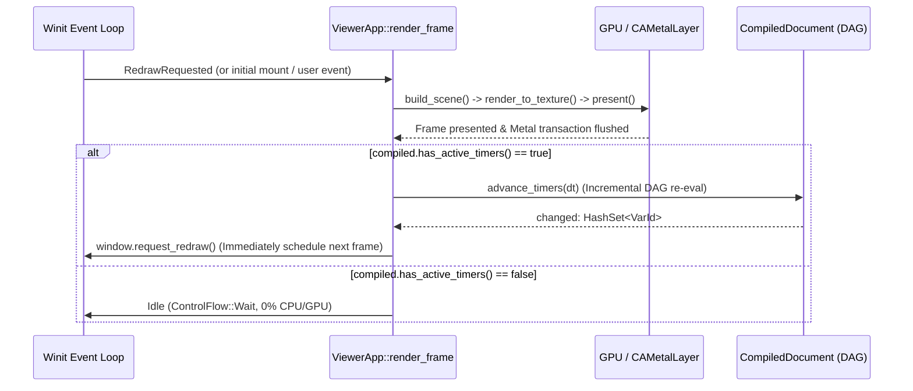

# DirectedType (DTML) Specification: Declarative Timers & Animations (`\Timer`)

- **Status:** Proposed
- **Topic:** Declarative Time Sources (`\Timer`, `\IndefiniteTimer`), `Duration` Units (`s`, `ms`), Lifecycle & Auto-Unset Semantics, and DAG Animation Pipeline
- **Target Area:** Lexer/Parser (`token`, `ast`), Type System (`typecheck`), DAG Evaluator (`eval`, `compiled`), Companion SDK (`component`, `directedtype-guest`), Interactive Viewer (`render::viewer`)

---

## 1. Executive Summary & Architectural Philosophy

DirectedType models user interfaces as a **Directed Acyclic Graph (DAG)** of algebraic equations evaluated in a single topological pass under the **One-Way Information Pipeline**:

$$\text{Application Logic (State)} \longrightarrow \text{Topological Layout Evaluation (DAG)} \longrightarrow \text{GPU Composition (Vello)}$$

Traditional UI frameworks implement animations either by mutating imperative style properties on every frame from JavaScript/application code, or by bolting on an external CSS transition engine that operates outside the layout solver. Both approaches violate DirectedType's core guarantees: imperative per-frame logic forces application code to manage frame loops and interpolation math, while an external transition engine cannot drive arbitrary algebraic layout relationships (such as intrinsic container bounds, sibling positions, or color math).

### The Core Idea: Time as a Reactive DAG Input

In DirectedType, **an animation is simply a layout formula parameterized by time**.

We introduce the `\Timer` component, which provides a time-varying member `t.time` (and `t.elapsed` on fixed-length timers). Because `t.time` and `t.elapsed` are nodes in the layout DAG, they can be wired as inputs to *any* algebraic calculation—positions, dimensions, colors, opacities, or typography:

```dtml
\let t = \Timer(duration: 5s);
\let d = t ? t.elapsed * 5em : 0;
```

### Key Architectural Principles

1. **Starts on Creation:** A timer begins counting (`t.time = 0s`) the moment it is created—either when a component mounts (for `\let t = \Timer(...)` or initialized `\state`) or when application logic assigns a new timer to a `\state` variable (`ctx.set_state("t", Timer::from_secs(5.0))`).
2. **Nullable / `unset` Lifecycle:** Timer-valued variables can be `unset`. When a fixed-length timer reaches its `duration`, it **automatically unsets itself**.
3. **Ternary Existence Guard (`t ? ... : ...`):** Evaluating a timer variable `t` in a conditional expression tests whether the timer is currently active. When `t` is `unset` (before being started, or after expiring), the ternary short-circuits to the `: else` branch.
4. **Compile-Time Type Safety (`Timer` vs. `IndefiniteTimer`):** Fixed-length timers (`\Timer(duration: 5s)`) have static type `Timer` and expose both `t.time: Duration` and `t.elapsed: Float` (`0.0..=1.0`). Indefinite timers (`\Timer()` or `\IndefiniteTimer()`) have static type `IndefiniteTimer` and expose only `t.time: Duration`. Accessing `t.elapsed` on an indefinite timer is rejected at compile time.
5. **Static DAG Topology & Zero Idle Overhead:** Starting, ticking, or auto-unsetting a timer never alters the DAG structure or triggers a topological re-sort. It simply updates the timer's cell in the `VariableGraph` and incrementally re-evaluates downstream dependents. When no timers are active, the viewer does not schedule animation frames and consumes zero CPU/GPU while idle.

---

## 2. The `Duration` Type & Time Units (`s`, `ms`)

To prevent unit confusion and preserve dimensional safety alongside `Distance` (`px`, `pt`, `em`), DirectedType introduces a first-class **`Duration`** type.

### 2.1 Time Unit Literals & Internal Microsecond (`i64`) Representation

The lexer and parser recognize two time suffixes on numeric literals, stored internally as an exact signed 64-bit integer (`i64`) count of **microseconds** (`1s = 1_000_000`, `1ms = 1_000`). Using an integer microsecond representation preserves base-10 decimal values (such as `0.1s` or `0.001ms`) exactly without IEEE-754 binary floating-point rounding drift.

Base-10 decimal literals are supported up to the microsecond accuracy limit for each unit; specifying more decimal places than 1 microsecond produces a compile-time parse error:

| Unit Suffix | Name | Internal Microseconds | Max Decimal Places | Valid Examples | Rejected (Compile Error) |
| :--- | :--- | :--- | :--- | :--- | :--- |
| `s` | Seconds | $1\text{s} = 1{,}000{,}000\,\mu\text{s}$ | **6** (`0.000001s`) | `5s`, `0.25s`, `0.000001s` | `0.0000001s` (> 6 decimals) |
| `ms` | Milliseconds | $1\text{ms} = 1{,}000\,\mu\text{s}$ | **3** (`0.001ms`) | `150ms`, `16.67ms`, `0.001ms` | `0.0001ms` (> 3 decimals) |

Zero-polymorphism applies to `Duration` just as it does to `Distance`: the integer literal `0` coerces to `0s` when expected by a `Duration` port or binary operation.

### 2.2 Dimensional Arithmetic & Conversions

`Duration` participates in dimensional algebra:

| Operation | Operand Types | Result Type | Semantics / Example |
| :--- | :--- | :--- | :--- |
| Addition / Subtraction | `Duration ± Duration` | `Duration` | `5s - t.time`, `100ms + 250ms` |
| Scalar Multiplication | `Duration * Float/Int`<br>`Float/Int * Duration` | `Duration` | `2 * 500ms -> 1s` |
| Scalar Division | `Duration / Float/Int` | `Duration` | `1s / 4 -> 250ms` |
| **Ratio Division** | **`Duration / Duration`** | **`Float`** | **`t.time / 5s -> Float` (dimensionless)** |
| Comparison | `Duration < Duration` (etc.) | `Boolean` | `t.time < 2s`, `t.time >= 500ms` |

### 2.3 Built-in Conversion Methods

For explicit conversion between `Duration` and `Float`, `Duration` provides two built-in methods:

- **`d.to_seconds() -> Float`**: Returns the duration in seconds as a dimensionless `Float` (equivalent to `d / 1s`).
- **`d.to_ms() -> Float`**: Returns the duration in milliseconds as a dimensionless `Float` (equivalent to `d / 1ms`).

Because `t.time.to_seconds()` and `t.time.to_ms()` return a `Float`, they can be multiplied by any `Distance` unit (`1px`, `1em`, `100px`) to convert time into spatial distance:

```dtml
\let d = t ? t.time.to_seconds() * 1px : 0;
```

---

## 3. `\Timer` Signatures, Overloads, & Static Types

Following DirectedType's [Component Constructor Overloading](file:///Users/hoefel/dev/directedtype/docs/designs/overloading.md) model, `\Timer` provides two distinct constructor signatures based on whether `duration` is supplied, corresponding to two distinct static types: **`Timer`** (fixed-length) and **`IndefiniteTimer`** (unbounded).

### 3.1 Overload 1: Fixed-Length Timer (`Timer`)

```dtml
// Constructor signature:
\Timer(duration: Duration)
```

- **Static Type:** `Timer`
- **Public Properties (Read-Only):**
  - `t.time: Duration` — Elapsed time since the timer started (`0s <= t.time < t.duration`).
  - `t.duration: Duration` — The configured total duration of the timer.
  - `t.elapsed: Float` — Normalized progress ratio `t.time / t.duration` in `[0.0, 1.0)`.
  - `t.dt: Duration` — Duration of the most recent frame tick ($\Delta t$ since the previous render; `0s` on the initial mount frame).
  - `t.frames: Integer` — Number of frames rendered since this timer started (`0` on the initial mount frame, incrementing by `1` each frame).
- **Auto-Unset Behavior:** When elapsed time reaches or exceeds `duration` (`t.time >= t.duration`), the timer automatically unsets itself (`t` becomes `unset`).

Because `t.elapsed` is a dimensionless `Float` in `[0.0, 1.0)`, multiplying it against any `Distance` (`px`, `pt`, `em`) naturally produces a `Distance`:

```dtml
\let t = \Timer(duration: 5s);
\let d = t ? t.elapsed * 5em : 0;
```

### 3.2 Overload 2: Indefinite Timer (`IndefiniteTimer`)

```dtml
// Constructor signature (also aliased as \IndefiniteTimer()):
\Timer()
\IndefiniteTimer()
```

- **Static Type:** `IndefiniteTimer`
- **Public Properties (Read-Only):**
  - `t.time: Duration` — Elapsed time since the timer started (`t.time >= 0s`).
  - `t.dt: Duration` — Duration of the most recent frame tick ($\Delta t$ since the previous render; `0s` on the initial mount frame).
  - `t.frames: Integer` — Number of frames rendered since this timer started (`0` on the initial mount frame, incrementing by `1` each frame).
- **Compile-Time Property Restriction:** `IndefiniteTimer` does **not** define `elapsed` or `duration`. Attempting to access `t.elapsed` or `t.duration` on an `IndefiniteTimer` produces a compile-time error:
  ```text
  CompileError: Node 'IndefiniteTimer' has no public property 'elapsed'
  ```
- **Lifecycle:** Counts upward indefinitely from `0s` until unset or replaced by application logic.

### 3.3 Why `t.dt` and `t.frames` Live on the Timer (Solving Stateful Metrics in a Stateless DAG)

Because DirectedType's layout graph is a pure, stateless **Directed Acyclic Graph (DAG)**, an expression cannot reference its own value from the previous frame ($v_{k-1}$) without introducing a cycle. This raises a natural question: *how can a document compute frame-to-frame rate metrics like framerate (FPS) if DAG formulas cannot store the previous timer value?*

The answer is that **the timer itself is the time-state root of the DAG**. Because the runtime already measures the frame delta $\Delta t$ to advance each active timer between frames, storing `dt: Duration` (the latest frame delta) and `frames: Integer` (cumulative frame count) directly on the timer value allows downstream DAG formulas to compute both instantaneous and average FPS purely declaratively—with zero feedback loops or mutable state:

```dtml
\let clock = \Timer();

// Instantaneous FPS from the latest frame delta (1.0 / dt):
\let inst_fps = clock ? (clock.dt > 0s ? 1.0 / clock.dt.to_seconds() : 0.0) : 0.0;

// Average FPS since timer creation (frames / total seconds):
\let avg_fps = clock ? (clock.time > 0s ? clock.frames / clock.time.to_seconds() : 0.0) : 0.0;
```

### 3.4 Why Separate Static Types (`Timer` vs. `IndefiniteTimer`) Matter

When a timer is declared inline via `\let t = \Timer(duration: 5s);` vs. `\let t = \Timer();`, the compiler knows the overload at the binding site. However, when a component declares a reactive state variable initialized to `unset`:

```dtml
\state transition: Timer = unset;
\state stopwatch: IndefiniteTimer = unset;
```

Having distinct type names `Timer` and `IndefiniteTimer` allows the typechecker to statically verify `transition.elapsed` (valid on `Timer`) and reject `stopwatch.elapsed` (invalid on `IndefiniteTimer`) even when the default expression is `unset`.

---

## 4. Lifecycle Semantics: Creation, Existence Checks, & Auto-Unset

### 4.1 Creation Starts the Clock

A timer has no `start()`, `pause()`, or `reset()` imperative methods in DTML. **Creation is activation:**

1. **Mount-Time Creation (`\let` or initialized `\state`):**
   ```dtml
   \let intro_timer = \Timer(duration: 800ms);
   \state pulse_timer: Timer = \Timer(duration: 2s);
   ```
   Both timers start at `0s` when the enclosing component (or document) mounts.

2. **Event-Driven Creation (Application Logic sets `\state`):**
   ```dtml
   \state anim: Timer = unset;
   ```
   Initially `anim` is `unset`. When an event handler in Rust/WASM executes:
   ```rust
   ctx.set_state("anim", Timer::new(Duration::from_millis(200)));
   ```
   the runtime creates a fresh timer anchored at the current timestamp (`time = 0s`). If `anim` was already running, setting a new `Timer` replaces it and restarts the clock from `0s`. Setting `ctx.set_state("anim", Value::Unset)` cancels the timer immediately.

### 4.2 Existence Checking with the Ternary Operator (`? :`)

Timer variables can be evaluated directly as the condition of a ternary expression (`t ? then_expr : else_expr`) or boolean negation (`!t`):

- **When `t` is active (`Value::Timer` / `Value::IndefiniteTimer`):** `t.is_truthy()` is **`true`**. The ternary evaluates `then_expr`, where `t.time` and `t.elapsed` are guaranteed to be valid.
- **When `t` is `unset` (`Value::Unset`):** `t.is_truthy()` is **`false`**. The ternary short-circuits and evaluates `else_expr` without evaluating `t.time` or `t.elapsed`.

```dtml
\let t = \Timer(duration: 5s);

// Uses t.time.to_seconds() * 1px while t is running; falls back to 0 (0px) when unset:
\let d1 = t ? t.time.to_seconds() * 1px : 0;

// Uses normalized [0, 1) elapsed progress multiplied against 5em:
\let d2 = t ? t.elapsed * 5em : 0;
```

### 4.3 Unguarded Member Access Safety

To encourage safe handling of expiring timers:
- Accessing `t.time` or `t.elapsed` when `t` is `unset` is prevented by guarding with `t ? ... : ...` because `Expr::Ternary` only evaluates the taken branch at runtime.
- If an author writes an unguarded access (`\let x = t.elapsed * 100px;`) and `t` becomes `unset` at runtime, `eval_expr` returns a descriptive runtime evaluation error (`Cannot access '.elapsed' on an unset Timer; guard with 't ? ... : ...'`), or the compiler can emit a static diagnostic when `t` is a fixed-length or nullable timer accessed outside a guarding condition `t`.

### 4.4 Auto-Unset When a Fixed-Length Timer Runs Out

On each animation tick by delta $\Delta t$:
1. The runtime advances `t.time` by $\Delta t$, sets `t.dt = dt`, and increments `t.frames` by `1`.
2. For a fixed-length `Timer(duration)`:
   - While `t.time < t.duration`, the timer remains active with `t.elapsed = t.time / t.duration` in `[0.0, 1.0)`.
   - As soon as `t.time >= t.duration`, **the timer unsets itself** (`Value::Unset`).
3. Because `t` is now `unset`, any expression `t ? active_expr : resting_expr` automatically transitions to `resting_expr`.

#### Why Auto-Unset Makes State Transitions Seamless

Consider a Material `\Switch` toggling `is_checked` between `false` (`thumb_unchecked_x`) and `true` (`thumb_checked_x`):

```dtml
\state is_checked: Boolean = checked;
\state anim: Timer = unset;

// Eased progress (e.g. smoothstep or cubic ease-out) while `anim` is active:
\let p = anim ? (1.0 - (1.0 - anim.elapsed) * (1.0 - anim.elapsed)) : 1.0;

// When `is_checked` is true, animate from unchecked_x -> checked_x;
// When `anim` finishes and unsets itself, `p` is 1.0 (or ternary falls back to target_x):
\let thumb_x: Distance = x + (is_checked
    ? (anim ? thumb_unchecked_x + p * (thumb_checked_x - thumb_unchecked_x) : thumb_checked_x)
    : (anim ? thumb_checked_x + p * (thumb_unchecked_x - thumb_checked_x) : thumb_unchecked_x));
```

1. When the user clicks the switch, `Switch::click` flips `is_checked = !is_checked` and sets `anim = Timer::from_millis(150)`.
2. Over the next `150ms`, `anim` is truthy and `anim.elapsed` sweeps from `0.0` to `1.0`, smoothly moving the thumb from the old side to the new side.
3. At `150ms`, `anim` expires and unsets itself. The ternary `anim ? ... : thumb_checked_x` settles cleanly on the exact resting coordinate `thumb_checked_x`, and the animation loop stops.

---

## 5. Companion API (Rust & WebAssembly)

Both the native component API (`src/component.rs`) and the WASM guest SDK (`directedtype-guest`) expose ergonomic types for setting and clearing timers on `\state` variables.

### 5.1 Rust Types

```rust
/// A fixed-length timer value with a required duration.
#[derive(Debug, Clone, Copy, PartialEq)]
pub struct Timer {
    /// Elapsed time in seconds (starts at 0.0 when created by application logic).
    pub time: f64,
    /// Total duration in seconds (> 0.0).
    pub duration: f64,
    /// Duration of the most recent frame delta in seconds (0.0 on initial frame).
    pub dt: f64,
    /// Number of frames ticked since creation (0 on initial frame).
    pub frames: i64,
}

impl Timer {
    /// Creates a new fixed-length timer starting at `time = 0s` with the given duration.
    pub fn new(duration: std::time::Duration) -> Self {
        Self {
            time: 0.0,
            duration: duration.as_secs_f64(),
            dt: 0.0,
            frames: 0,
        }
    }

    pub fn from_secs(secs: f64) -> Self {
        Self {
            time: 0.0,
            duration: secs.max(0.0),
            dt: 0.0,
            frames: 0,
        }
    }

    pub fn from_millis(ms: u64) -> Self {
        Self {
            time: 0.0,
            duration: (ms as f64) / 1000.0,
            dt: 0.0,
            frames: 0,
        }
    }

    pub fn elapsed(&self) -> f64 {
        if self.duration > 0.0 {
            (self.time / self.duration).clamp(0.0, 1.0)
        } else {
            1.0
        }
    }
}

/// An indefinite timer value that counts upward from 0s until unset.
#[derive(Debug, Clone, Copy, PartialEq, Default)]
pub struct IndefiniteTimer {
    /// Elapsed time in seconds (starts at 0.0 when created).
    pub time: f64,
    /// Duration of the most recent frame delta in seconds (0.0 on initial frame).
    pub dt: f64,
    /// Number of frames ticked since creation (0 on initial frame).
    pub frames: i64,
}

impl IndefiniteTimer {
    pub fn new() -> Self {
        Self {
            time: 0.0,
            dt: 0.0,
            frames: 0,
        }
    }
}
```

### 5.2 Setting and Unsetting Timers via `Context`

Because `From<Timer>`, `From<IndefiniteTimer>`, and `From<Option<Timer>>` are implemented for `Value`:

```rust
// Start a 150ms fixed-length timer on `\state anim: Timer = unset;`:
ctx.set_state("anim", Timer::from_millis(150));

// Or using Option<Timer>:
ctx.set_state("anim", Some(Timer::from_millis(150)));

// Explicitly unset / cancel a timer:
ctx.set_state("anim", None::<Timer>); // or Value::Unset

// Start an indefinite timer on `\state stopwatch: IndefiniteTimer = unset;`:
ctx.set_state("stopwatch", IndefiniteTimer::new());
```

---

## 6. Compiler, DAG, & Runtime Implementation Architecture

### 6.1 Runtime `Value` Representation (`src/compiler/value.rs`)

We extend `Value` with `Duration`, `Timer`, `IndefiniteTimer`, and `Unset`:

```rust
pub enum Value {
    Integer(i64),
    Float(f64),
    Distance(f64),
    Area(f64),
    Duration(i64), // Stored in microseconds (1s = 1_000_000, 1ms = 1_000)
    String(String),
    Bool(bool),
    Color(String),
    Node(NodeId),
    Enum {
        enum_name: String,
        variant: String,
    },
    Timer {
        time: i64,     // Microseconds elapsed
        duration: i64, // Total duration in microseconds
        dt: i64,       // Latest frame delta in microseconds
        frames: i64,   // Frames ticked since timer creation
    },
    IndefiniteTimer {
        time: f64,     // Seconds elapsed
        dt: f64,       // Latest frame delta in seconds
        frames: i64,   // Frames ticked since timer creation
    },
    Unset,
}
```

- **`Value::is_truthy(&self)`:**
  - `Value::Unset` $\rightarrow$ `false`
  - `Value::Timer { .. }` | `Value::IndefiniteTimer { .. }` $\rightarrow$ `true`
- **Member Access in `eval_expr` (`src/compiler/eval.rs`):**
  When evaluating `Expr::MemberAccess(m)` where `eval_expr(&m.target, env)` produces:
  - `Value::Timer { time, duration, dt, frames }`:
    - `"time"` $\rightarrow$ `Ok(Value::Duration(time))`
    - `"duration"` $\rightarrow$ `Ok(Value::Duration(duration))`
    - `"elapsed"` $\rightarrow$ `Ok(Value::Float(if duration > 0.0 { (time / duration).clamp(0.0, 1.0) } else { 1.0 }))`
    - `"dt"` $\rightarrow$ `Ok(Value::Duration(dt))`
    - `"frames"` $\rightarrow$ `Ok(Value::Integer(frames))`
  - `Value::IndefiniteTimer { time, dt, frames }`:
    - `"time"` $\rightarrow$ `Ok(Value::Duration(time))`
    - `"dt"` $\rightarrow$ `Ok(Value::Duration(dt))`
    - `"frames"` $\rightarrow$ `Ok(Value::Integer(frames))`

### 6.2 Unified DAG Representation for `\let` and `\state` Timers

How should `\let t = \Timer(duration: 5s)` and `\state t: Timer = ...` be represented in `ExpandedDocument` and `VariableGraph` so both work identically with `t ? t.elapsed * 5em : 0`?

If a timer is stored as a **`Value::Timer` / `Value::IndefiniteTimer` inside a `VarId` cell** in the `VariableGraph`:

1. **For `\state t: Timer = unset` (or `\state t: Timer = \Timer(duration: 5s)`):**
   - Already creates a component variable cell `VarId(comp_node_id, "t")` in `VariableGraph`!
   - References to `t` rewrite to `__node_X.t`.
   - References to `t.time` rewrite to `(__node_X.t).time`.
   - `extract_var_dependencies` in `graph.rs` walks `(__node_X.t).time`, recurses into `__node_X.t`, and records `VarId(comp_node_id, "t")` as the upstream dependency!
2. **For `\let t = \Timer(duration: 5s)` (or `\let t = \Timer()`):**
   - Expands to a non-spatial `Timer` node `timer_node_id` (or a synthetic state/value port `VarId(timer_node_id, "value")`) whose equation initializes to `Value::Timer { time: 0.0, duration: 5.0, dt: 0.0, frames: 0 }`.
   - In lexical scope, `t` binds to `Expr::MemberAccess { target: __node_timer, member: "value" }`.
   - Consequently, `t ? t.elapsed * 5em : 0` rewrites to:
     ```text
     __node_timer.value ? (__node_timer.value).elapsed * 5em : 0px
     ```
   - `extract_var_dependencies` automatically registers `VarId(timer_node_id, "value")` as the upstream dependency for both the condition `t` and the member accesses `t.time` / `t.elapsed`!

Look at what this unified representation achieves:
- **Both `\let` timers and `\state` timers use the exact same mechanism in `VariableGraph`, `eval_expr`, and `CompiledDocument`!**
- A single `VarId` cell holds the timer's current `Value::Timer { time, duration, dt, frames }`, `Value::IndefiniteTimer { time, dt, frames }`, or `Value::Unset`.
- When the timer ticks or auto-unsets, mutating that single `VarId` in `state_overrides` and calling `invalidate_and_reevaluate` updates every dependent expression (`t`, `t.time`, `t.elapsed`, `t.dt`, `t.frames`) in one topological pass!

### 6.3 Active Timer Tracking & Tick Advancement (`CompiledDocument`)

`CompiledDocument` tracks active timer cells in a lightweight table:

```rust
#[derive(Debug, Clone, Copy, PartialEq)]
pub enum ActiveTimerKind {
    Fixed { duration: f64 },
    Indefinite,
}

#[derive(Debug, Clone, Copy, PartialEq)]
pub struct ActiveTimerState {
    pub kind: ActiveTimerKind,
    pub elapsed_secs: f64,
    pub dt_secs: f64,
    pub frames: i64,
}
```

- **At Compilation / Mount (`CompiledDocument::compile_with_resolver`):**
  - Any `VarId` whose initial evaluated value is `Value::Timer { time, duration, dt, frames }` or `Value::IndefiniteTimer { time, dt, frames }` is registered in `active_timers: HashMap<VarId, ActiveTimerState>`.
- **On `CompiledDocument::set_state(node_id, state_name, value)`:**
  - If `value` is `Value::Timer { time, duration, dt, frames }`, inserts/resets `active_timers.insert(var_id, ActiveTimerState { kind: ActiveTimerKind::Fixed { duration }, elapsed_secs: time, dt_secs: dt, frames })` (or unsets immediately if `duration <= 0.0`).
  - If `value` is `Value::IndefiniteTimer { time, dt, frames }`, inserts/resets `active_timers.insert(var_id, ActiveTimerState { kind: ActiveTimerKind::Indefinite, elapsed_secs: time, dt_secs: dt, frames })`.
  - If `value` is `Value::Unset`, removes `var_id` from `active_timers`.
- **Advancing Time (`CompiledDocument::advance_timers(&mut self, dt_secs: f64) -> Result<HashSet<VarId>, CompileError>`):**
  1. If `self.active_timers.is_empty()` or `dt_secs <= 0.0`, return `Ok(HashSet::new())`.
  2. For each `(var_id, timer_state)` in `self.active_timers`:
     - `timer_state.elapsed_secs += dt_secs;`
     - `timer_state.dt_secs = dt_secs;`
     - `timer_state.frames += 1;`
     - Match `timer_state.kind`:
       - `ActiveTimerKind::Fixed { duration }`:
         - If `timer_state.elapsed_secs >= duration`:
           - Remove `var_id` from `active_timers`.
           - Set `self.state_overrides.insert(var_id, Value::Unset)`.
         - Else:
           - Set `self.state_overrides.insert(var_id, Value::Timer { time: timer_state.elapsed_secs, duration, dt: dt_secs, frames: timer_state.frames })`.
       - `ActiveTimerKind::Indefinite`:
         - Set `self.state_overrides.insert(var_id, Value::IndefiniteTimer { time: timer_state.elapsed_secs, dt: dt_secs, frames: timer_state.frames })`.
     - Push `var_id` to `dirty_roots`.
  3. Call `invalidate_and_reevaluate(&self.graph, &self.schedule, &mut self.layout.values, &dirty_roots, &self.state_overrides)`.
  4. Call `update_resolved_layout(&mut self.layout, &self.expanded, &changed)` and return `Ok(changed)`.

---

## 7. Frame Loop, Incremental DAG Evaluation, & Visual Update Architecture

### 7.1 Render-Completion Frame Loop (`render_frame` $\rightarrow$ Update Timer $\rightarrow$ Immediate Next Render)

In [`ViewerApp::render_frame`](file:///Users/hoefel/dev/directedtype/src/render/viewer.rs#L2119-L2477), the frame lifecycle is driven directly by render completion:



1. **Frame $0$ ($t = 0\text{s}$):** When a page loads with a `\let` timer (or when an event handler sets a `\state` variable to a `Timer`), `render_frame()` renders the page with `t.time = 0s` (`t.elapsed = 0.0`, `t.dt = 0s`, `t.frames = 0`) and presents the frame to the screen (`surface_texture.present()` + `flush_metal_transaction()`).
2. **Immediate Timer Advancement on Render Completion:** Right after presenting the frame at the end of `render_frame()`, if `compiled.has_active_timers()` is `true`:
   - `ViewerApp` records `now = Instant::now()` and computes the elapsed wall-clock time `dt` since the previous frame finished (or since the timer started on Frame $0$).
   - It immediately calls `compiled.advance_timers(dt)` to update the active timer inputs and incrementally recompute their downstream DAG dependents for the upcoming frame.
   - It calls `window.request_redraw()` so `winit` immediately begins rendering the next frame with the updated timer values.
3. **Final Resting Frame & Zero-Overhead Idle:** When a fixed-length timer reaches `t.time >= t.duration` during `advance_timers(dt)`, it unsets itself (`Value::Unset`) and is removed from `active_timers`. `window.request_redraw()` is called one final time to render the settled resting state (`t == unset`). When that frame finishes, `compiled.has_active_timers()` is `false`, so no further redraw is requested and the viewer goes completely idle.

### 7.2 How the Visual Update Works Today vs. Incremental Rendering

When a timer ticks, we are only changing a single input (`VarId`) in the DAG. Does that mean the whole page is recomputed and rerendered from scratch?

Here is a stage-by-stage breakdown of what is **already incremental today** in DirectedType versus what still touches the full page:

| Pipeline Stage | Current Implementation | Incremental Status |
| :--- | :--- | :--- |
| **1. DAG Formula Evaluation**<br>([`invalidate_and_reevaluate`](file:///Users/hoefel/dev/directedtype/src/compiler/eval.rs#L93-L136)) | Computes the forward transitive closure [`find_downstream_dependents(graph, dirty_roots)`](file:///Users/hoefel/dev/directedtype/src/compiler/eval.rs#L139-L163) and re-evaluates **only** the `VarId`s in that dirty cone in topological order. Also prunes branches whose value did not actually change (`old_val == new_val`). | **Already 100% Incremental.** Only formulas downstream of the timer are evaluated; unrelated components on the page are untouched. |
| **2. Layout Node Update**<br>([`update_resolved_layout`](file:///Users/hoefel/dev/directedtype/src/compiler/layout.rs#L867-L977)) | Filters by `affected_node_ids` (`changed_vars.iter().map(\|v\| v.node)`) to update `rect`, `z`, `properties`, `clip`, and `event_handlers` only on changed nodes. *(Note: [`project_inline_fragments`](file:///Users/hoefel/dev/directedtype/src/compiler/layout.rs#L976) currently re-projects all rich-text roots and should be filtered by `affected_node_ids`.)* | **Incremental for node rects/ports**; filtering `project_inline_fragments` by `affected_node_ids` avoids re-shaping unaffected rich-text paragraphs during animations. |
| **3. Vello Scene Construction**<br>([`build_scene`](file:///Users/hoefel/dev/directedtype/src/render/scene.rs#L306-L520)) | Walks `layout.render_order()` to assemble a `vello::Scene`, **backed by two caches**:<br>• [`TextSceneCache`](file:///Users/hoefel/dev/directedtype/src/render/scene.rs#L59-L94): Caches shaped glyph `vello::Scene`s per `NodeId` (keyed by [`TextRenderKey`](file:///Users/hoefel/dev/directedtype/src/render/scene.rs#L37-L56), which excludes `x`/`y`). Static or translating text never re-runs Parley shaping.<br>• [`ClipSceneCache`](file:///Users/hoefel/dev/directedtype/src/render/scene.rs#L108-L143): Caches entire `vello::Scene` subtrees for `clip` containers keyed by content hash. | **Partially Incremental.** Expensive text shaping and unchanged clip subtrees are cached, while lightweight vector commands (`\Rect` fills/strokes/shadows) and scene assembly run per frame. |
| **4. GPU Rasterization**<br>([`Renderer::render_to_texture`](file:///Users/hoefel/dev/directedtype/src/render/viewer.rs#L2438-L2450)) | Vello's GPU compute pipeline rasterizes the encoded `vello::Scene` command buffer to the swapchain texture on the GPU. | **Full-Viewport GPU Pass** (fast on Metal/Vulkan because it runs in GPU compute shaders). |

### 7.3 Roadmap to Fine-Grained Incremental Scene Updates

Because Stage 1 ([`invalidate_and_reevaluate`](file:///Users/hoefel/dev/directedtype/src/compiler/eval.rs#L93-L136)) already returns the exact `changed: HashSet<VarId>`—from which we immediately know the exact set of dirty nodes (`affected_node_ids: HashSet<NodeId>`)—DirectedType's DAG architecture is uniquely positioned for fine-grained incremental rendering:

1. **Skip Unaffected Rich-Text Projection (Immediate Optimization):**
   In [`update_resolved_layout`](file:///Users/hoefel/dev/directedtype/src/compiler/layout.rs#L976), only run [`project_inline_fragments`](file:///Users/hoefel/dev/directedtype/src/compiler/layout.rs#L980) on rich-text roots whose `text_id`, `font` node, or inline span/box descendants intersect `affected_node_ids`.
2. **Per-Node Retained `vello::Scene` Fragments:**
   Cache a `vello::Scene` fragment per `NodeId` (drawn in local node coordinates `(0, 0, width, height)`), and only rebuild a node's fragment when `affected_node_ids.contains(&node.id)` (and when *only* `x` or `y` changed, keep the cached fragment and simply update its `Affine::translate((node.rect.x, node.rect.y))` when appending to the parent scene, just as [`TextSceneCache`](file:///Users/hoefel/dev/directedtype/src/render/scene.rs#L59-L94) already does for text!).
3. **Dirty-Driven `ClipSceneCache` Invalidation:**
   Instead of hashing every descendant inside [`compute_clip_content_hash`](file:///Users/hoefel/dev/directedtype/src/render/scene.rs#L170-L246) on each frame, a clip subtree only needs to be invalidated if `affected_node_ids` intersects the clip node or any node clipped by it.

---

## 8. End-to-End Examples

### Example 1: Declarative Entrance Animation (`\let t = \Timer(duration: 5s)`)

```dtml
\env font = \Font(size: 16px);

\let t = \Timer(duration: 5s);
\let d1 = t ? to_seconds(t.time) * 1px : 0;
\let d2 = t ? t.elapsed * 5em : 0;

\Rect(
    x: 20px + d2,
    y: 40px + d1,
    width: 100px,
    height: 40px,
    color: #1976d2
)
```

### Example 2: Live Framerate (FPS) Monitor (`t.dt` and `t.frames`)

Because `\Timer` exposes `t.dt: Duration` (frame delta $\Delta t$) and `t.frames: Integer` (cumulative frame count), an application can display both instantaneous and average FPS alongside a continuous animation in pure DTML:

```dtml
\env font = \Font(size: 16px);

\let clock = \Timer();

// Instantaneous FPS (1 / frame delta in seconds) and Average FPS (total frames / elapsed seconds):
\let inst_fps = clock ? (clock.dt > 0s ? round(1.0 / to_seconds(clock.dt)) : 0) : 0;
\let avg_fps  = clock ? (clock.time > 0s ? round(clock.frames / to_seconds(clock.time)) : 0) : 0;
\let frame_ms = clock ? round(to_ms(clock.dt)) : 0;

\Column(x: 24px, y: 24px, spacing: 12px) {
    \Text() { "FPS: \{inst_fps} (avg: \{avg_fps} FPS, frame time: \{frame_ms} ms)" }
    \Text() { "Frames rendered: \{clock ? clock.frames : 0}" }

    // Animated indicator sweeping back and forth:
    \let phase = clock ? sin(to_seconds(clock.time) * 3.14159) : 0.0;
    \Rect(
        x: 150px + phase * 120px,
        width: 24px,
        height: 24px,
        radius: 12px,
        color: #2e7d32
    )
}
```

### Example 3: Interactive Component State Transition (`Switch`)

```dtml
// Inside Switch.dt:
\state is_checked: Boolean = checked;
\state anim: Timer = unset;

\let progress = anim ? anim.elapsed : 1.0;
\let start_x = is_checked ? thumb_unchecked_x : thumb_checked_x;
\let end_x = is_checked ? thumb_checked_x : thumb_unchecked_x;
\let thumb_x: Distance = x + start_x + progress * (end_x - start_x);
```

```rust
// Inside Switch.rs:
pub fn click(&mut self, ctx: &mut Context<'_>) -> Result<(), DispatchError> {
    if self.is_disabled(ctx) {
        return Ok(());
    }
    let current = ctx.get_port_bool("is_checked").unwrap_or(self.checked);
    let next = !current;
    self.checked = next;

    if !ctx.get_port_bool("controlled").unwrap_or(self.controlled) {
        ctx.set_state("is_checked", next);
        ctx.set_state("anim", Timer::from_millis(150));
    }
    self.on_change.emit(ctx, next);
    Ok(())
}
```


